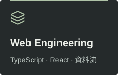

<p align="center">
  
</p>

# MR Blog｜工程實作與技術判斷

我是 MingRay，一位 Full-Stack Engineer。這裡記錄我正在理解的工程問題、技術選擇的理由，以及遇到相似問題時值得回看的筆記。

<p>
  <a href="https://ntustray.github.io/mr-blog/"> 閱讀部落格</a>　
  <a href="https://ntustray.github.io/mr-blog/archive/"> 文章索引</a>　
  <a href="https://ntustray.github.io/mr-blog/search/"> 搜尋筆記</a>
</p>

##  技術探索地圖

<p align="center">
  
  
  
</p>

關注 Agent 如何接進既有產品、Web 應用如何組織資料與狀態，以及效能改善是否真的解決問題。題目隨實際需求延伸，寫作保留假設、限制與取捨。

##  這個部落格，也是一份工程實作

以 Astro、TypeScript 與 Markdown 建置，部署到 GitHub Pages。採用 Static-first 架構，閱讀與內容檢索是主要用途。

-  **內容與設定**：用 [Content Collection schema](src/content.config.ts) 驗證文章 metadata；站名、作者與主題集中在 [site.ts](src/config/site.ts)。
-  **全文搜尋**：Build 時產生 Pagefind 索引，[搜尋頁](src/pages/search/index.astro)提供標題與內文檢索。
-  **品質檢查**：Build 包含[內部連結檢查](scripts/check-links.mjs)，[Quality workflow](.github/workflows/quality.yml) 執行 Build 與 Lighthouse CI。
-  **文章留言**：[giscus 留言元件](src/components/ArticleComments.astro)在接近可視範圍或手動開啟時載入；收到有留言的 metadata 後自動展開。

##  從這三篇開始讀

###  Agent 的能力，如何受到 Harness 影響？

[**[Insight] Coding Agent 需要多少 Harness？176 組實驗的條件與取捨**](https://ntustray.github.io/mr-blog/posts/coding-agent-harness-176-configurations/)

解讀研究中的 Planning、Tools 與 Context 設定，釐清結果成立的條件，再整理可用於自身工作流的驗證方式。

###  UI 與 Agent，如何共用操作契約？

[**[News] Agent-Native 的共享 Action：聊天與 UI 怎麼操作同一份資料？**](https://ntustray.github.io/mr-blog/posts/agent-native-shared-actions-ui-state/)

依官方文件與原始碼，從共享 Action、物件 ID 到版本衝突，思考聊天入口如何接進既有應用。

###  工具省下的時間，應該怎麼算？

[**[Insight] Bun + Biome：讓 Agent 每次重跑都快一點**](https://ntustray.github.io/mr-blog/posts/bun-biome-agent-iteration-compound-time/)

以示意試算把環境準備與每輪檢查分開，討論工具省下的時間，如何轉成更有用的回饋。

[瀏覽全部文章 →](https://ntustray.github.io/mr-blog/archive/)

##  延伸作品

| 專案 | 用途與工程重點 |
| --- | --- |
|  [**React DateTime Range Picker**](https://github.com/ntustRay/react-datetime-range-picker) | 給分析、圖表與 Logs 使用的 React 範圍元件。Timestamp-first API、IANA 顯示時區、Draft／Commit 分離。[查看 Demo ↗](https://ntustray.github.io/react-datetime-range-picker/) |
|  [**Agent Workspace Template**](https://github.com/ntustRay/agent-workspace-template) | 給 Coding Agent 清楚的專案入口：精簡的 AGENTS.md、架構文件，以及按任務使用的 Skills。 |

##  本機開發

需要 Node.js **22.12.0 以上**，CI 使用 Node.js 24。

```bash
npm ci
npm run dev
```

```bash
npm run build        # 產生靜態網站、Pagefind 索引，檢查內部連結
npm run preview      # 預覽 Build 產物
npm run lighthouse   # 執行 Lighthouse CI
```

<details>
<summary>撰文、部署與服務設定</summary>

- **新增文章**：複製 [templates/article.md](templates/article.md) 到 `src/content/blog/`，以檔名作為 slug；草稿保留 `draft: true`。文章準則見 [AGENTS.md](AGENTS.md)。
- **文章圖片**：Raster images 使用 WebP；Icon 等向量資產使用 SVG。
- **站點設定**：修改 [src/config/site.ts](src/config/site.ts)，避免跨頁重複設定作者與站點資料。
- **部署**：推送到 `main` 觸發 [GitHub Pages workflow](.github/workflows/deploy.yml)；Pages Source 設為 GitHub Actions。
- **第三方服務**：留言、PV 計數、選用 AdSense 的行為與設定整理在[維護指南](docs/maintenance.md)。

</details>

<sub>README 圖示採用 <a href="https://lucide.dev/">Lucide</a>，授權見 <a href="docs/readme/LICENSE-lucide.txt">LICENSE-lucide.txt</a>。品牌圖形沿用本站資產。</sub>
