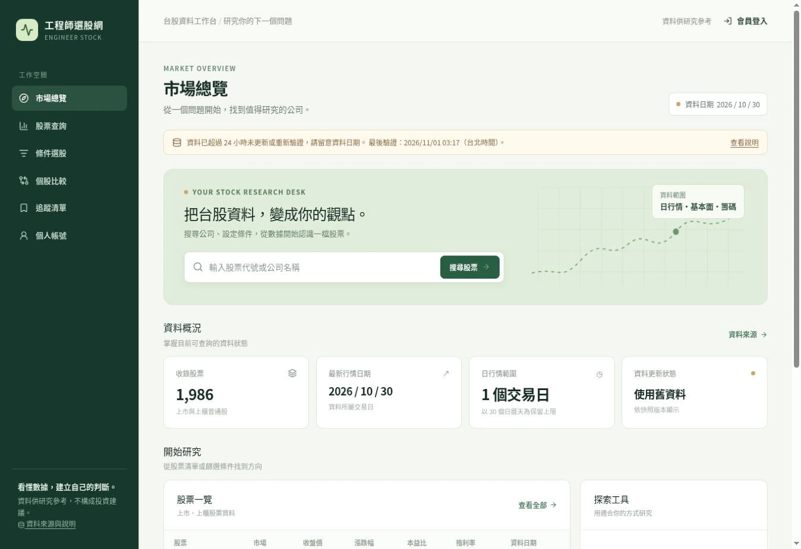
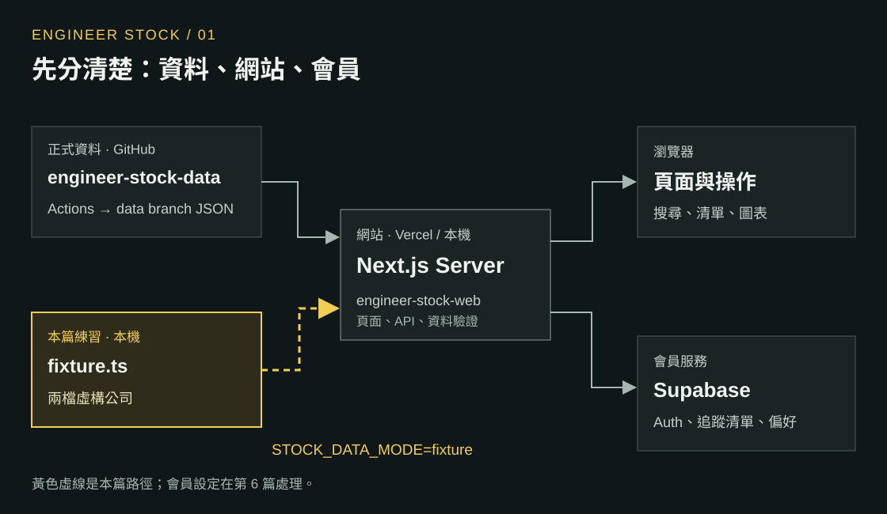
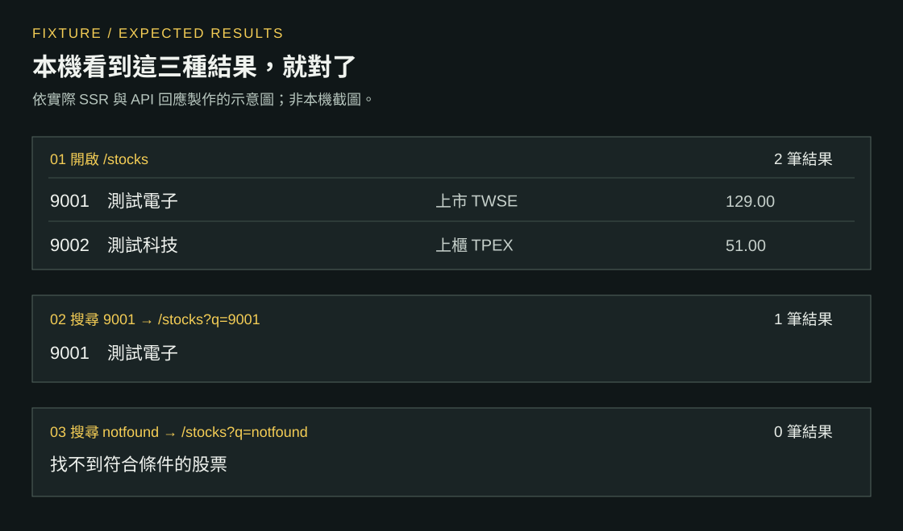
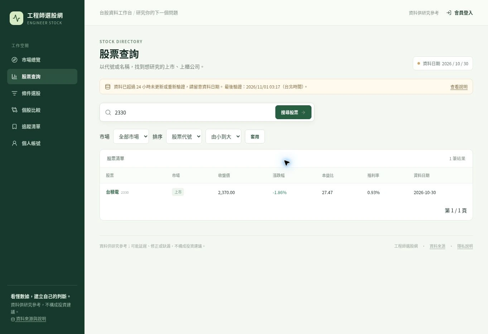

系列：[1 本機啟動](./engineer-stock-01-local.md) · [2 股票 JSON](./engineer-stock-02-json.md) · [3 Actions](./engineer-stock-03-actions.md) · [4 Next.js 資料流](./engineer-stock-04-nextjs-data.md) · [5 篩選與圖表](./engineer-stock-05-screener-charts.md) · [6 註冊登入](./engineer-stock-06-auth.md) · [7 追蹤與 RLS](./engineer-stock-07-rls.md) · [8 Vercel 部署](./engineer-stock-08-vercel.md) · [9 核心架構與選型](./engineer-stock-09-architecture.md)

完成這篇：本機顯示兩檔測試公司、搜尋只剩一檔，能找到資料與畫面的檔案。

正式站參考畫面。下方練習使用固定的虛構公司。

<figure>
  <a href="../images/01-production-home.webp"></a>
  <figcaption>正式網站實拍：市場總覽，資料日期顯示為 2026-10-30。</figcaption>
</figure>

## 1. 先分清楚資料放在哪裡

<figure>
  <a href="../images/02-data-flow.svg"></a>
  <figcaption>資料流圖：GitHub 股票快照與本機 fixture 交給 Next.js；網站顯示在瀏覽器，會員資料存 Supabase。</figcaption>
</figure>

| 位置 | 責任 |
| --- | --- |
| `engineer-stock-data` | 抓官方資料、驗證 JSON、由 Actions 發布到 `data` branch |
| `engineer-stock-web` | Next.js 頁面、API、搜尋與圖表；正式站部署在 Vercel |
| Supabase | Auth、會員資料、追蹤清單與個人設定 |

這篇先走圖中的 fixture 路徑；會員設定留到第 6 篇。

## 2. 下載網站專案、安裝套件

準備 Node.js 24、Git，以及網站 private Repo 的讀取權限。以下指令在 macOS 或 WSL 終端機執行。

```sh
node --version
git clone https://github.com/ntustRay/engineer-stock-web.git
cd engineer-stock-web
npm ci
cp .env.example .env.local
```

`node --version` 應顯示 `v24.x.x`；[`npm ci`](https://docs.npmjs.com/cli/v11/commands/npm-ci/) 依現有 lockfile 安裝。

## 3. 啟用測試資料

開啟專案根目錄的 `.env.local`，設定這兩個值。同名欄位直接改值；測試模式那行移除開頭的 `#`。

```dotenv title=".env.local"
STOCK_DATA_MODE=fixture
NEXT_PUBLIC_SITE_URL=http://localhost:3000
```

其餘欄位保留空白。[Next.js 會從專案根目錄載入 `.env.local`](https://nextjs.org/docs/app/guides/environment-variables)。

```sh
npm run dev
```

出現 `Ready` 後，開啟終端機顯示的 Local 網址，預設為 `http://localhost:3000`。若顯示其他 port，網址與 `NEXT_PUBLIC_SITE_URL` 一起改成該 port，再重啟。

## 4. 用搜尋結果驗證啟動成功

首頁應出現「本機測試模式」提示。點「股票查詢」，依序輸入 `9001`、`notfound`，每次按「搜尋股票」。

<figure>
  <a href="../images/03-fixture-results.svg"></a>
  <figcaption>本機預期結果示意：首頁兩檔；搜尋 9001 只剩測試電子；搜尋 notfound 得到空結果。這張是依實際回應製作的示意圖，不是本機截圖。</figcaption>
</figure>

正式站使用相同的搜尋操作，實拍範例是 `2330`。本機測試模式請使用 `9001`。

<figure>
  <a href="../images/04-production-search.webp"></a>
  <figcaption>正式網站搜尋 2330 的實拍：網址包含 q=2330，表格顯示一筆結果。</figcaption>
</figure>

## 5. 從畫面追到資料

依序開啟這四個檔案，搜尋右欄的名稱。

| 檔案 | 找什麼 |
| --- | --- |
| `src/lib/stock-data/fixture.ts` | `fixtureRows`：兩檔測試公司的資料 |
| `src/lib/stock-data/client.ts` | `loadSnapshot`：讀取 `STOCK_DATA_MODE`；`getSnapshot`：提供快照 |
| `src/app/page.tsx` | `getSnapshot`、`getRows`：首頁在 Server 取得資料 |
| `src/components/ui.tsx` | `StockTable`：把資料畫成表格 |

首頁直接呼叫資料函式；這條路徑沒有先請求自己的 `/api/v1/stocks`。

## 6. 自己改一次

在 `src/app/page.tsx` 找到 `PageHead` 的這行：

```tsx
title="市場總覽"
```

改成：

```tsx
title="我的選股練習"
```

回首頁確認標題改變，股票仍是兩檔；再將標題改回原值。

能完成後，應該能回答：**要改畫面標題開哪個檔案？要改測試公司的名稱開哪個檔案？**

答案：`src/app/page.tsx`、`src/lib/stock-data/fixture.ts`。


