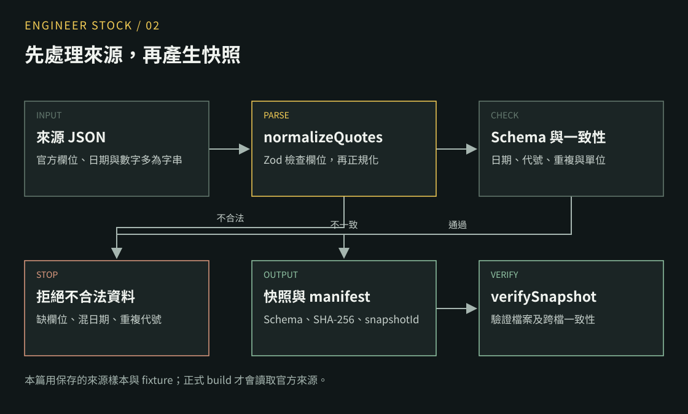
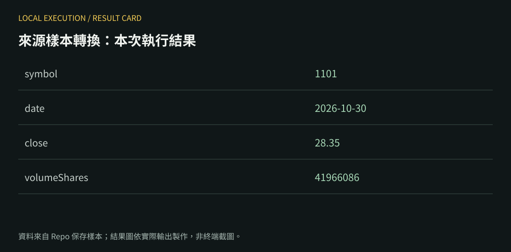

系列：[1 本機啟動](./engineer-stock-01-local.md) · [2 股票 JSON](./engineer-stock-02-json.md) · [3 Actions](./engineer-stock-03-actions.md) · [4 Next.js 資料流](./engineer-stock-04-nextjs-data.md) · [5 篩選與圖表](./engineer-stock-05-screener-charts.md) · [6 註冊登入](./engineer-stock-06-auth.md) · [7 追蹤與 RLS](./engineer-stock-07-rls.md) · [8 Vercel 部署](./engineer-stock-08-vercel.md) · [9 核心架構與選型](./engineer-stock-09-architecture.md) · [10 Workflow 與 API 來源](./engineer-stock-10-workflow-api-sources.md)

完成這篇：把一筆來源回應轉成有型別的資料，再產生可驗證的 JSON 快照。先用 Repo 內保存的樣本，讓結果可重現。

<figure>
  <a href="../images/02-normalize-flow.svg"></a>
  <figcaption>處理流程示意：先驗證來源欄位，再轉換日期與數字；不合法的資料停止處理。</figcaption>
</figure>

## 1. 下載資料專案

準備 Bun 1.4.4。另開終端機，和網站 Repo 放在同一層。

```sh
git clone https://github.com/ntustRay/engineer-stock-data.git
cd engineer-stock-data
bun --version
bun install --frozen-lockfile
```

網站用 npm、資料 Pipeline 用 Bun，是兩個 Repo 目前各自的設定。

## 2. 找到原始資料

開啟 `tests/fixtures/official/twse-quotes.json`。第一筆樣本是 `1101`：

```json
{
  "Date": "1151030",
  "Code": "1101",
  "ClosingPrice": "28.35",
  "TradeVolume": "41966086"
}
```

這是欄位節錄，完整資料還有開高低價等欄位。來源網址登記在 `config/sources.yml`；上市行情為 [TWSE STOCK_DAY_ALL](https://openapi.twse.com.tw/v1/exchangeReport/STOCK_DAY_ALL)。API 回傳整批行情，這一步先處理保存的樣本。

## 3. 跑一次轉換

在資料專案根目錄新增 `lesson-normalize.ts`：

```ts title="lesson-normalize.ts"
import { readFileSync } from 'node:fs';
import { normalizeQuotes } from './src/providers/quotes.ts';

const raw: unknown = JSON.parse(
  readFileSync('tests/fixtures/official/twse-quotes.json', 'utf8'),
);
const quote = normalizeQuotes('TWSE', raw).quotes[0];
if (!quote) throw new Error('No quote');
console.log(JSON.stringify({
  symbol: quote.symbol,
  date: quote.daily.date,
  close: quote.daily.close,
  volumeShares: quote.daily.volumeShares,
}, null, 2));
```

```sh
bun lesson-normalize.ts
```

本次執行結果（保存樣本的數值）：

<figure>
  <a href="../images/02-normalize-result.svg"></a>
  <figcaption>本機轉換結果對照圖，依實際 JSON 輸出製作；非終端截圖。</figcaption>
</figure>

## 4. 對照三個轉換規則

| 輸入 | 輸出 | 程式位置 |
| --- | --- | --- |
| `1151030` | `2026-10-30` | `src/normalize.ts` → `parseDate` |
| `"28.35"` | `28.35` | `parseNumber` |
| `"--"` | `null` | `parseNumber` |

`null` 表示缺值；用 `0` 代替，後面的估值與篩選會得到不同結果。`normalizeQuotes` 先用 Zod 驗證來源結構，並拒絕重複代號、混合日期。

## 5. 產生完整測試快照

```sh
bun run fixture
bun run verify
```

開啟 `staging/snapshot/`，對照：

| 檔案 | 用途 |
| --- | --- |
| `manifest.json` | 版本、日期、資料筆數與檔案 SHA-256 |
| `index/screener.json` | 搜尋、篩選用的資料列 |
| `stocks/TWSE/9001.json` | 一檔公司的詳細資料 |

本次 fixture 產生 18 個檔案，verify 回應 `status: valid`。這組快照使用虛構的 `9001／9002`，與步驟 3 的官方保存樣本是兩組測試資料；**fixture 不可發布成正式行情**。

## 6. 自己驗證錯誤處理

把練習程式的 `raw` 暫時改成空陣列，再執行。應看到 Zod 驗證錯誤，修復後再跑：

```sh
bun test tests/providers.test.ts tests/normalize.test.ts
```

實際抓官方資料的指令是 `bun run build`；它會讀來源、交易日曆與前版資料，完成後寫入 staging。只有 `publish` 會更新遠端 `data` branch；下一篇追這條路徑。


