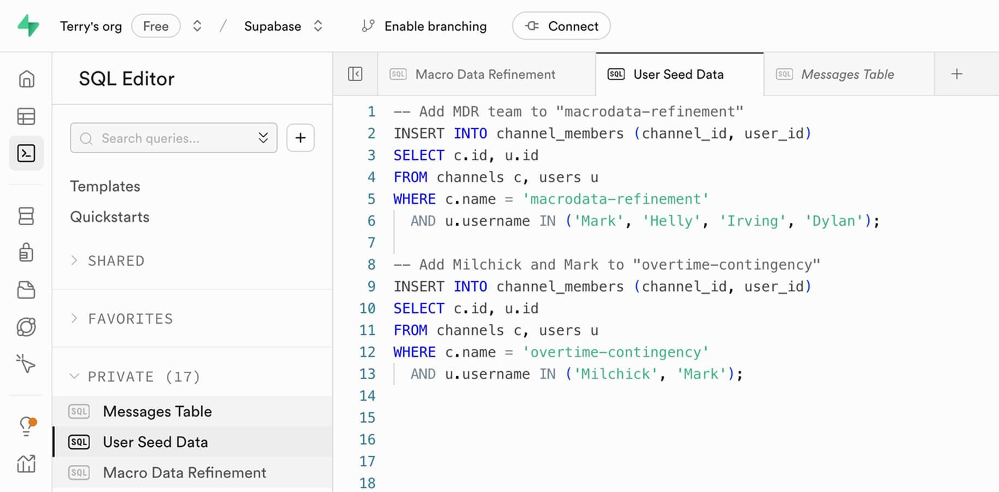

# [Guide] 工程師選股網 07：在 Supabase 建立個人追蹤清單，實作三條 RLS policy

[查看線上最新版](https://ntustray.github.io/mr-blog/posts/engineer-stock-07-rls/) · [離線目錄](../README.md)

先完成[上一課的 Email 登入](./engineer-stock-06-auth.md)，並在自己的 Supabase **測試專案**建立兩個能登入的測試帳號。這一課會新增一張教學表和一個頁面。做完後，A、B 可以各自追蹤 9001；A 登出之後，B 只能移除自己的那筆。

## 1. 建一張帶有擁有者的表

開啟 Supabase Dashboard 的 **SQL Editor → New query**。在測試專案只執行一次以下 SQL。若提示同名表已存在，先從 Table Editor 核對之前的練習，再決定是否沿用。



```sql
create table public.lesson_watchlist (
  user_id uuid not null default auth.uid() references auth.users(id) on delete cascade,
  symbol text not null check (symbol in ('9001','9002','9003')),
  primary key (user_id, symbol)
);
alter table public.lesson_watchlist enable row level security;
revoke all on public.lesson_watchlist from anon, authenticated;
grant select, insert, delete on public.lesson_watchlist to authenticated;

create policy own_read on public.lesson_watchlist for select to authenticated
  using (user_id = (select auth.uid()));
create policy own_add on public.lesson_watchlist for insert to authenticated
  with check (user_id = (select auth.uid()));
create policy own_remove on public.lesson_watchlist for delete to authenticated
  using (user_id = (select auth.uid()));
```

在 Table Editor 確認兩個欄位。`user_id` 預設來自當前登入者，`symbol` 是文字，兩個欄位合起來是主鍵。確認專案啟用了 **Data API** 且 API 開放 `public` schema，讓 SDK 可經由這個介面存取資料。前台沿用上一課的 publishable key 和登入者的 Cookie。

## 2. 讓登入者加入和移除 9001

在練習專案新增以下頁面。寫入只交 `symbol`，Postgres 用登入者身分補上 `user_id`；資料庫的主鍵會阻止同一人重複追蹤。移除時程式只篩代號，哪一列可以刪由 DELETE policy 決定。

```tsx title="src/app/watch-lab/page.tsx"
import { revalidatePath } from "next/cache";
import { redirect } from "next/navigation";
import { serverClient } from "@/lib/supabase/server";

async function change(form: FormData) {
  "use server";
  const db = await serverClient();
  const { data: { user } } = await db.auth.getUser();
  if (!user) redirect("/email-lab");
  const action = form.get("action");
  if (action !== "add" && action !== "remove") throw new Error("未知操作");
  const table = db.from("lesson_watchlist");
  const result = action === "add"
    ? await table.insert({ symbol: "9001" })
    : await table.delete().eq("symbol", "9001");
  if (result.error) throw new Error("追蹤清單寫入失敗");
  revalidatePath("/watch-lab");
}

export default async function WatchLab() {
  const db = await serverClient();
  const { data: { user } } = await db.auth.getUser();
  if (!user) redirect("/email-lab");
  const { data, error } = await db.from("lesson_watchlist").select("symbol");
  if (error) throw new Error("無法查詢教學表");
  const saved = data.some(row => row.symbol === "9001");
  return <main>
    <h1>我的追蹤清單</h1><p>{user.email}</p>
    <p>9001：{saved ? "已追蹤" : "未追蹤"}</p>
    <form action={change}>
      <button name="action" value={saved ? "remove" : "add"}>
        {saved ? "移除 9001" : "加入 9001"}
      </button>
    </form>
  </main>;
}
```

在 `src/proxy.ts` 的 `matcher` 陣列再加上 `"/watch-lab/:path*"`，保留上一課的路徑，重新執行 `npm run dev`。從 `/email-lab` 登入後，手動開 `http://localhost:3000/watch-lab`。

## 3. 用兩個帳號驗證同一檔股票

| 在哪裡做 | 操作 | 應看到 |
| --- | --- | --- |
| 一般視窗 A | 加入 9001，重整 | A 仍顯示「已追蹤」 |
| 無痕視窗 B | 以另一帳號登入，打開相同頁面 | B 初始是「未追蹤」 |
| B | 先加入、再移除 9001 | B 回到「未追蹤」 |
| A | 重整 | A 仍是「已追蹤」 |
| 另一個未登入視窗 | 直接開 `/watch-lab` | 導回 `/email-lab` |

若 B 剛登入就顯示「已追蹤」，核對兩個畫面顯示不同 Email，再到 Table Editor 的 **RLS policies** 找 `own_read`。若 B 移除後 A 的項目也消失，檢查 `own_remove` 的 `using`。不要用 Dashboard 的 SQL Editor 身分代替兩個帳號測試，管理者有較高的權限。[Supabase RLS 的角色與政策說明](https://supabase.com/docs/guides/database/postgres/row-level-security)。

## 參考資料

- [公開的 Next.js 選股練習與測試資料](../stock-fixture-lab.zip)
- [Supabase Row Level Security](https://supabase.com/docs/guides/database/postgres/row-level-security)

[回離線目錄](../README.md) · [上一章](./engineer-stock-06-auth.md) · [下一章](./engineer-stock-08-vercel.md)
