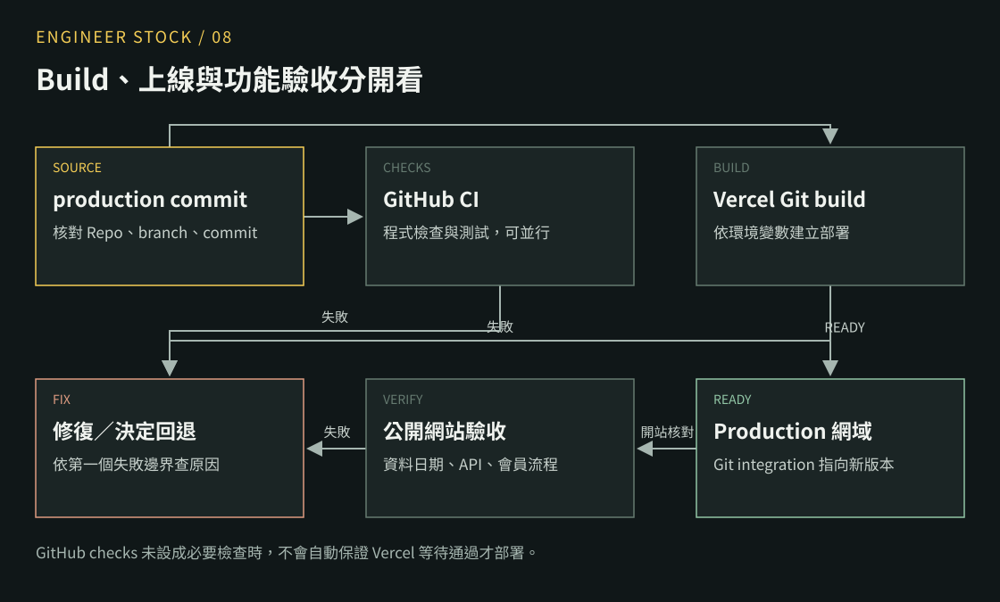
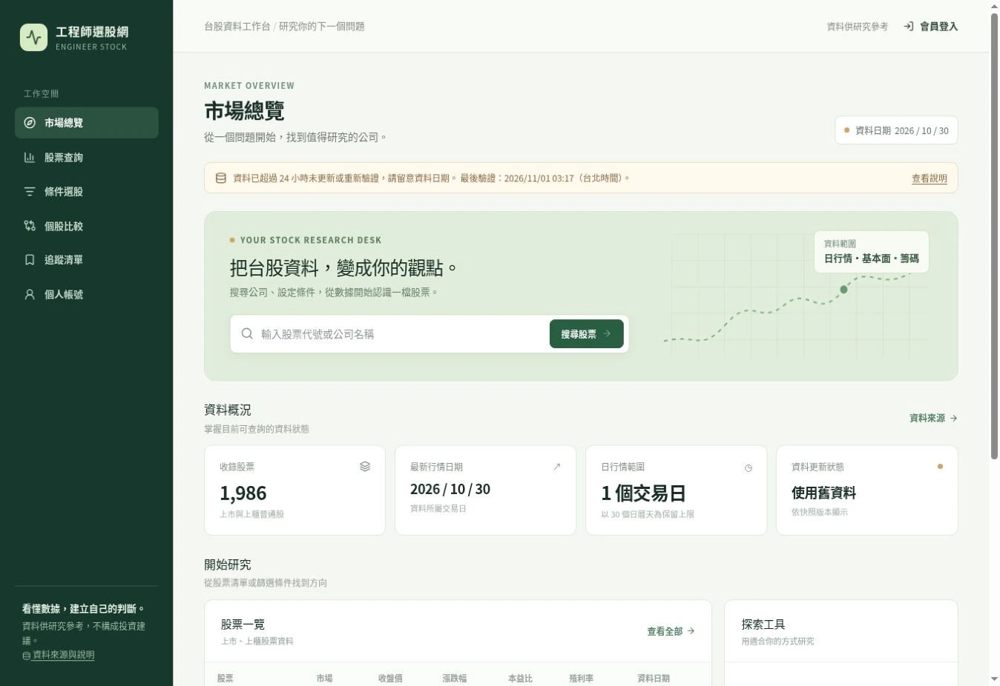

系列：[1 本機啟動](./engineer-stock-01-local.md) · [2 股票 JSON](./engineer-stock-02-json.md) · [3 Actions](./engineer-stock-03-actions.md) · [4 Next.js 資料流](./engineer-stock-04-nextjs-data.md) · [5 篩選與圖表](./engineer-stock-05-screener-charts.md) · [6 註冊登入](./engineer-stock-06-auth.md) · [7 追蹤與 RLS](./engineer-stock-07-rls.md) · [8 Vercel 部署](./engineer-stock-08-vercel.md) · [9 核心架構與選型](./engineer-stock-09-architecture.md)

完成這篇：找到目前部署、核對版本與環境，並能分開判斷 Build、資料與登入錯誤。

<figure>
  <a href="../images/08-deploy-flow.svg"></a>
  <figcaption>部署流程示意：GitHub CI 與 Vercel Git builds 可並行；Vercel Production READY 後仍需驗收資料與登入。</figcaption>
</figure>

## 1. 打開既有專案

在 Vercel 選 `engineer-stock-web`。到 Settings 確認連接的 GitHub Repo、production branch 與 Node.js 版本。此專案以 Next.js 部署，Node.js 設定為 24.x。

進 Deployments，選 Production 那筆，核對 Source 的 branch、commit 與狀態。本文核對到的最新 Production 狀態是 `READY`；Build logs 未取得，所以不提供虛構的 Build log 截圖。

## 2. 核對 Production 環境變數

使用第 6 篇的 Vercel Environment Variables 設定方式，股票與會員分別核對：

| 名稱 | 正式設定 |
| --- | --- |
| `STOCK_DATA_OWNER` | `ntustRay` |
| `STOCK_DATA_REPO` | `engineer-stock-data` |
| `STOCK_DATA_BRANCH` | `data` |
| `STOCK_DATA_REF_TTL_SECONDS` | `900` |
| `NEXT_PUBLIC_SITE_URL` | `https://engineer-stock-web.vercel.app` |
| `NEXT_PUBLIC_SUPABASE_URL` | 正式會員專案的 URL |
| `NEXT_PUBLIC_SUPABASE_PUBLISHABLE_KEY` | 同專案的 publishable key |

`STOCK_DATA_MODE` 留空；production 程式也會拒絕 fixture 模式。Preview 若要測會員，使用獨立測試專案，不複製正式會員環境。

修改環境變數後，需要[重新部署](https://vercel.com/docs/environment-variables)才會套用到新的部署。可選的 HMAC cache 通知未設定時，網站使用目前的 TTL 重新解析來源。

## 3. 本機先跑檢查

在網站 Repo：

```sh
npm run check
npm run typecheck
npm test
npm run test:rls
npm run build
```

本系列已實際執行 Web 的 21 個 unit tests 與隔離 RLS 測試；發布驗證記錄附在下載檔。沒有新增 E2E，也未把 Build 通過當作登入通過。

## 4. 追一次自己的程式部署

用分支與 PR 提交需要的程式修改，檢查 Preview。合併至 production branch 後，到 Deployments 看這個 commit 的 Production build。

若只是要套用新的環境變數，可在該 Production deployment 的選單執行 Redeploy，完成後重新核對環境與公開網域。這裡操作的是網站程式部署；資料 Repo 更新 `data` branch 通常不需要重新部署網站。

目前 GitHub CI 與 Vercel Git integration 各自啟動；是否阻擋發布，取決於是否配置必要檢查與 Deployment Checks。不要只因 GitHub 有 workflow，就假設 Vercel 一定等它通過。

## 5. 用三個入口驗收

| 入口 | 確認內容 |
| --- | --- |
| 首頁 | 有資料、來源日期與狀態提示 |
| `/api/v1/stocks?q=2330` | 回應結構、meta.source、實際筆數 |
| 未登入開 `/api/v1/watchlist` | 401，會員資料不進共享快取 |

再依第 6 篇完成收信、登入、重整與登出驗收。這段仍需真實帳號與 SMTP 配置。

<figure>
  <a href="../images/01-production-home.webp"></a>
  <figcaption>正式站實拍：網頁可用，同時顯示舊資料提示；這兩件事可以同時成立。</figcaption>
</figure>

## 6. 從第一個壞掉的邊界往下查

| 現象 | 下一個檢查 |
| --- | --- |
| Build 失敗 | Deployments → 該筆 → Build Logs，先看第一個錯誤 |
| 網頁可開但沒股票 | env 的 owner／repo／branch、來源回應、hash 與 Schema 驗證 |
| API 200 但顯示舊資料 | manifest 的行情日期、驗證時間、Actions 是否 skip／失敗 |
| 只有會員失敗 | 會員 env、Cookie、Auth logs、SMTP 與 RLS |
| 某次修改後整站出錯 | 對照部署 commit，確認前一個可用版本，再決定修復或 rollback |

自己完成一次判讀：看到「使用舊資料」時，先去資料 Repo 查執行紀錄與 manifest 日期；不要直接把 Vercel Redeploy 當成資料修復。


