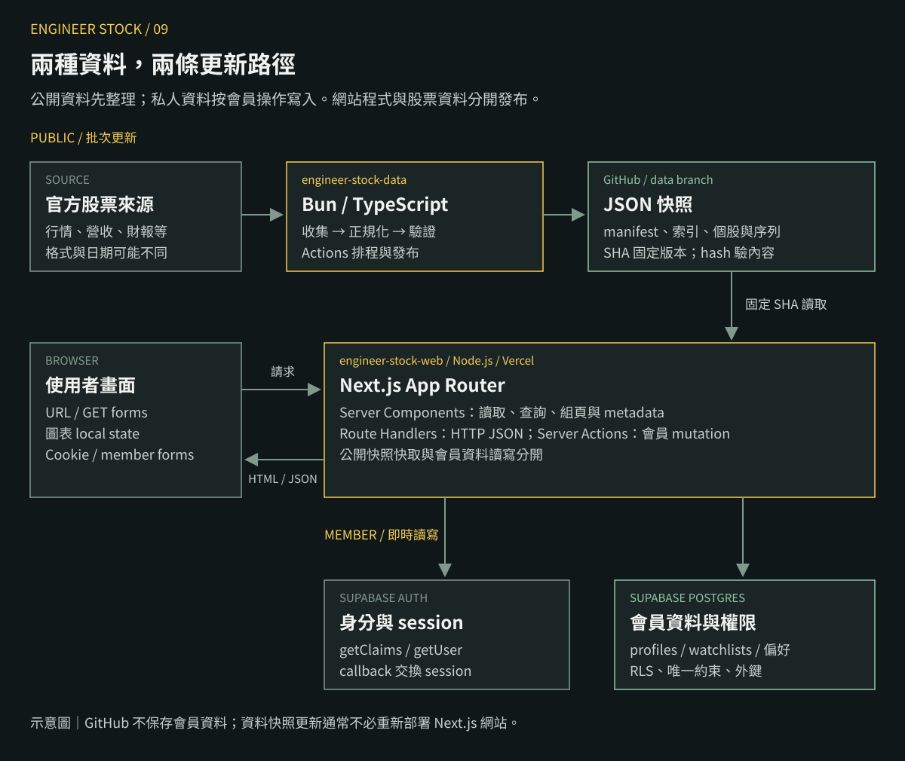
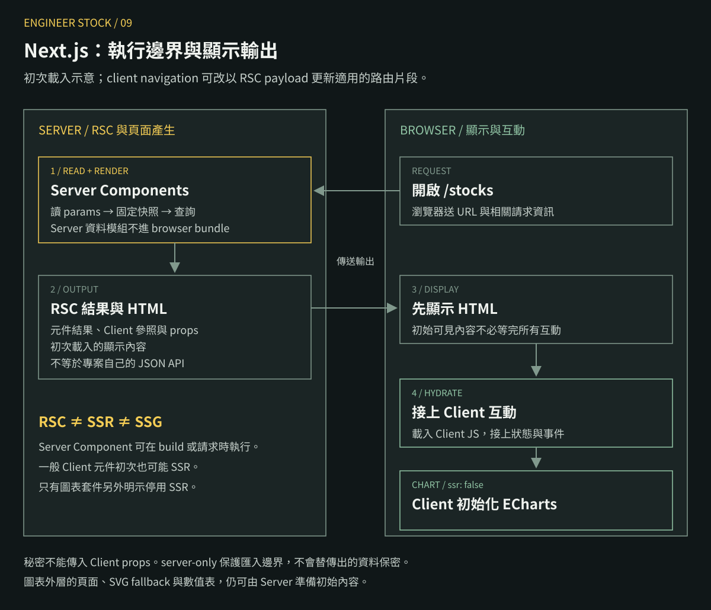
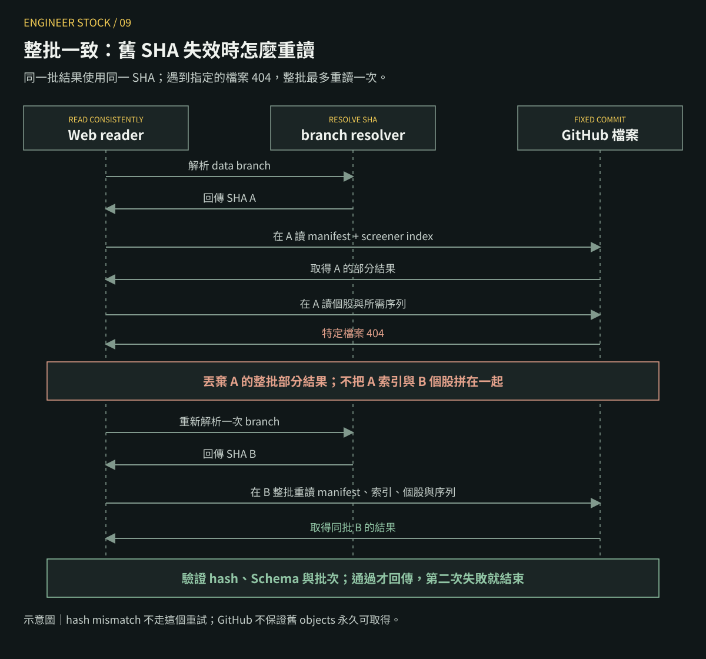
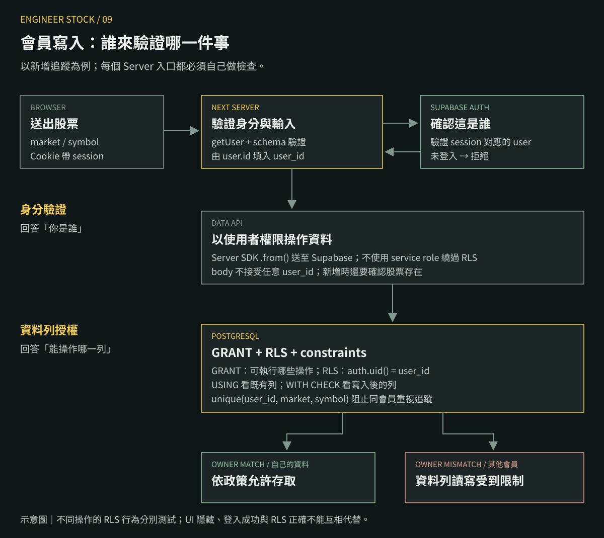
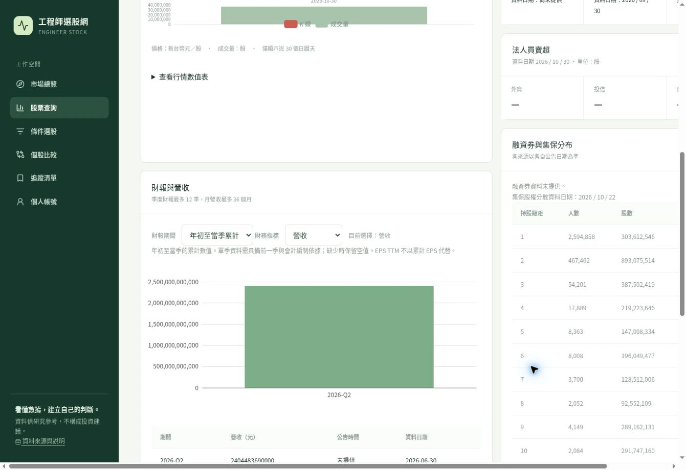

系列：[1 本機啟動](./engineer-stock-01-local.md) · [2 股票 JSON](./engineer-stock-02-json.md) · [3 Actions](./engineer-stock-03-actions.md) · [4 Next.js 資料流](./engineer-stock-04-nextjs-data.md) · [5 篩選與圖表](./engineer-stock-05-screener-charts.md) · [6 註冊登入](./engineer-stock-06-auth.md) · [7 追蹤與 RLS](./engineer-stock-07-rls.md) · [8 Vercel 部署](./engineer-stock-08-vercel.md) · [9 核心架構與選型](./engineer-stock-09-architecture.md)

這個專案最需要講清楚的，是兩種性質不同的資料：**公開、批次更新的股票快照，以及需要登入、依會員隔離的私人資料**。前者放 GitHub，後者放 Supabase；Next.js 接起查詢、畫面與會員操作。

本文對照現有程式，從需求推到選型，再拆解每一層的原理與代價。先理解資料如何流動，面試時才有辦法從「用了哪些工具」往下講到「為何這樣設計」。

## 這篇的重點

- 先能畫出公開資料與會員資料的兩條路徑，再談工具。
- Next.js 的核心在 Server／Client 邊界，以及頁面、HTTP API、Server Actions 的分工。
- RSC、SSR、hydration、資料快取是不同概念，不能混成「都在 Server 跑」。
- SHA 固定資料版本，Schema 驗證結構，RLS 限制資料所有權；三者解決不同問題。
- 文末提供面試講法、追問與讀碼順序。已驗證範圍與尚待完成事項分開列出。

## 1. 先用需求限制選型

先不要從「我要用 Next.js」開始。這個產品需要的是以下行為：

| 需求 | 對架構的影響 |
| --- | --- |
| 股票行情以日資料為主 | 可以在背景先整理，不必每次開頁面都抓官方來源 |
| 股票資料公開、多人讀相同內容 | 可以產生共用快照與快取 |
| 有搜尋、條件篩選、個股與比較 | 需要一致的資料契約、查詢條件與圖表輸入 |
| 會員要跨裝置保存追蹤清單 | 需要持久資料庫、登入與資料所有權 |
| 資料可能延遲、缺值或修正 | 要保留來源、期間、版本與缺值，不能只顯示一個數字 |
| 個人專案要能維護與展示 | 初期優先減少部署單元，同時保留可驗證的責任邊界 |

由這些條件可得到一個判斷：**更新股票資料與處理會員請求，不需要使用同一條寫入路徑**。股票可以先批次產生，會員資料則在使用者操作時寫入。

首次正式快照記錄 1,986 檔普通股，行情日期為 2026-10-30。這是當時資料範圍，不能推論成查詢容量或效能保證。實際工作量還取決於歷史長度、每次讀多少檔案、快取是否命中與同時請求數。

## 2. 整體架構：兩個 Repo、兩種資料路徑

<figure>
  <a href="../images/09-system-architecture.svg"></a>
  <figcaption>架構示意。公開股票與私人會員資料分開保存；瀏覽器送來的參數都需要在 Server 驗證。</figcaption>
</figure>

### 公開資料路徑

官方來源經過 `engineer-stock-data` 的收集、正規化與驗證，產生 JSON。Actions 把整批檔案發布到 `data` branch。`engineer-stock-web` 讀取固定 SHA 的快照，將資料用於頁面或公開 API。

官方 API 不在每個使用者請求的必經路徑上。這可以把來源不穩、格式差異與重試，集中在 Pipeline；代價是網站看到的是批次快照，必須顯示日期與狀態。

### 會員資料路徑

使用者登入後，瀏覽器以 Cookie 帶上 session。Next.js 的 Server Action 或 Route Handler 確認身分、驗證輸入，再操作 Supabase。資料庫透過 RLS 判斷該會員可以存取哪些列。

會員寫入不需要改 Git branch；股票更新也不需要改會員資料表。因此兩邊的更新頻率、權限與失敗處理可以各自設計。

### 為何拆兩個 Repo

兩個 Repo 分開管理「資料發布」與「網站程式部署」。調整 UI 應走網站部署；新行情進來，通常只需更新資料快照。

這個拆分的成本是跨 Repo 協調：網站與 Pipeline 的 Schema 要相容，測試與版本也要對齊。目前兩邊各有 `contracts.ts`，沒有共用一個 TypeScript contracts package。不能宣稱兩個 Repo 已自動享有完整的型別一致性。

這是一個 Next.js 全端應用，旁邊有獨立的批次資料 Pipeline。沒有必要把它描述成已具備服務治理、分散式交易與獨立擴縮的微服務平台。

## 3. Tech stack：每個工具負責哪一件事

| 選擇 | 在此專案的工作 | 主要成本 |
| --- | --- | --- |
| Next.js App Router | 路由、Server render、HTTP API、Server Actions、metadata、快取入口 | 需要理解框架的執行與快取規則 |
| React | 組合 UI；圖表、比較選擇器等互動元件 | Client 邊界過大會增加傳到瀏覽器的程式 |
| TypeScript＋Zod | 型別檢查與外部資料的 runtime 驗證 | 驗證有執行成本，跨 Repo 契約仍需協調 |
| GitHub JSON | 發布公開且可固定版本的讀取快照 | 查詢能力、歷史保存、來源額度與檔案數受限制 |
| GitHub Actions | 排程與資料驗證、發布；網站程式的 CI | 排程可能延遲，CI 與部署的阻擋關係要另確認 |
| Supabase Auth＋PostgreSQL | 身分、session、會員資料、約束與 RLS | 需要處理 Cookie、政策、遷移與外部服務故障 |
| ECharts＋React wrapper | K 線、成交量、營收與財報圖 | bundle、繪圖實例與容器尺寸需要管理 |
| Node.js＋npm | 網站開發、建置與部署執行環境 | 須與 Vercel 及 lockfile 對齊 |
| Bun | 資料 Repo 的 TS 執行、套件安裝與測試 | 與 Node 的相容性不能只靠名稱假設 |
| Vercel | 執行 Next.js Server 功能、Git builds 與環境設定 | 平台行為與資源限制成為維運條件 |
| CSS／Tailwind／Lucide | 視覺規則、utility 基礎與圖示 | 要避免手寫 CSS 與 utilities 分別表達同一規則 |
| Biome、unit tests、PGlite | 格式、靜態規則、資料與 SQL 行為驗證 | 通過這些檢查仍不等於正式整合與效能通過 |

下面把這張表拆成可以自己解釋的原理。

## 4. 為何用 Next.js，而不是再加一個獨立 API 專案

React 負責元件與互動，但完整產品還需要處理 URL、Server 資料讀取、Cookie、請求驗證與部署。Next.js 在同一個專案中提供這些入口，讓畫面和 Server use case 可以就近對照。

對這個站而言，Server 有三個工作：讀公開快照、組出畫面與 JSON、處理會員操作。把這些放在同一個應用內，可以減少初期的 API service 部署、跨服務設定與契約維護。

這層可以理解為 BFF（Backend for Frontend）的角色：替網站準備所需資料、處理身分與回應格式。BFF 是責任描述，不代表用了 Next.js 就自動有清楚的分層。

### 其他方案也能完成，但責任會移動

| 方案 | 要另外承擔什麼 | 適合條件 |
| --- | --- | --- |
| React／Vite＋獨立 API | API 部署、Cookie／CORS、前後端契約與整合 | 已有獨立後端，或 API 要服務多個產品 |
| Astro＋外部會員 API | 動態會員與查詢功能放到外部服務 | 內容頁為主、互動與會員範圍較小 |
| Next.js 全端 | 框架內 Server／Client、快取與 mutation 邊界 | 網站畫面、查詢與會員工作需要一起演進 |

以目前範圍，Next.js 是把網站與 Server 工作集中管理的選擇。若之後有手機 App、其他客戶端或獨立後端團隊，再評估把共用 API 與業務邏輯拆出來。

SSR 也不是唯一選型理由。會員 session、Server mutation、路由資料與同一套部署流程，才是這個專案實際使用的組合。

## 5. App Router 怎麼對上 URL 與責任

App Router 以資料夾表達路由。`page.tsx` 代表頁面，`route.ts` 代表 HTTP handler；`[market]`、`[symbol]` 是動態路徑參數。

| 檔案 | URL／責任 |
| --- | --- |
| `src/app/layout.tsx` | 全站 HTML、sidebar、topbar 與共用版型 |
| `src/app/page.tsx` | `/`：市場總覽 |
| `src/app/stocks/page.tsx` | `/stocks`：查詢、排序與分頁 |
| `src/app/stocks/[market]/[symbol]/page.tsx` | `/stocks/TWSE/2330`：個股 |
| `src/app/screener/page.tsx` | `/screener`：多條件查詢 |
| `src/app/api/v1/stocks/route.ts` | `/api/v1/stocks`：公開 JSON API |
| `src/app/watchlist/actions.ts` | 表單使用的追蹤 mutation，不自行定義一條 REST URL |
| `src/app/auth/callback/route.ts` | 處理 Auth callback 的 HTTP GET |
| `src/app/loading.tsx` | 路由載入中的 fallback |
| `src/app/error.tsx` | 未處理錯誤的 UI 與重試入口 |

本專案鎖定的 Next.js 16.3.4 使用 Promise 形式的 `params`、`searchParams`。例如個股頁先 `await params`，再取得 market 與 symbol。URL 的字串不是可信的 domain 物件；合法市場、代號與資料是否存在，仍要檢查。

`api/v1` 是網站 API 的契約版本；JSON 裡的 `schemaVersion` 是股票資料格式版本；Next.js 的版本則是框架版本。三者不要混在一起。

### layout 共用不等於整站都要 Client

`layout.tsx` 本身是 Server Component，內部可以放 Client Component。此站的 `Sidebar` 因為使用 `usePathname()` 判斷當前路徑，標記了 `'use client'`。這不要求把整個 layout 也改成 Client。

個股頁的 `generateMetadata` 與頁面都會呼叫 `getStockPageData`。共用函式讓標題、canonical URL 與主畫面從同一組讀取邏輯取得資料，減少各自重寫查詢的機會。

## 6. RSC、SSR、SSG、hydration 到底差在哪裡

這幾個名詞回答不同問題。把它們分開，就能解釋為什麼一張頁面同時有 Server Component、預先產生的 HTML 與瀏覽器 JavaScript。

| 名詞 | 回答的問題 | 在這個站怎麼看 |
| --- | --- | --- |
| RSC（React Server Components） | 哪些元件的程式在 Server 環境執行？ | `StocksPage` 直接 await 快照，不把這段讀取程式送到瀏覽器 |
| SSR（Server-side rendering） | 是否在 Server 產生這次請求需要的 HTML？ | 動態資料頁先在 Server 準備可顯示內容 |
| SSG（Static generation） | 是否在 build 時先產生固定輸出？ | 個股與會員頁不能僅因使用 Next.js 就宣稱已做 SSG |
| hydration | 瀏覽器如何讓預先產生的內容接上 React 互動？ | Client 元件取得其程式後處理選單、按鈕與圖表互動 |

[React 的 Server Components 可以在 build 時或請求時執行](https://react.dev/reference/rsc/server-components)。因此「Server Component」描述的是執行邊界，不等於「每次請求都 SSR」。

<figure>
  <a href="../images/09-render-boundaries.svg"></a>
  <figcaption>初次載入示意。RSC 是元件邊界，HTML 是顯示輸出；框架接續的 client navigation 也可能使用 RSC payload 更新畫面。</figcaption>
</figure>

### 初次開頁面時發生什麼

以 `/stocks` 為例：Server 讀查詢參數、取得快照、篩選資料，再產生 Server Component 的結果。Next.js 使用這些結果與 Client 元件資訊組出 HTML，讓瀏覽器可以先顯示內容。

RSC payload 是描述元件結果、Client 元件位置／程式參照與 props 的序列化資料，不是專案自己設計的 `/api/v1/stocks` 回應格式。瀏覽器再載入需要的 Client JavaScript，對互動部分完成 hydration。

這裡的 hydration 可以理解成將 React 的互動接回既有 HTML；不是收到 HTML 後再盲目建立另一份整站 DOM。初次結果不一致仍可能造成 hydration 問題，原理可對照 [React hydrateRoot](https://react.dev/reference/react-dom/client/hydrateRoot)。

使用 Next 的 Link 切換路由時，框架還能以 RSC payload 更新畫面，保留適用的共用 layout。不能把每一次 client navigation 都當成完整下載一份新 HTML 文件。

### `'use client'` 是 module 邊界

需要 `useState`、event handler、瀏覽器 API 的互動元件，放在 Client 邊界內。Client 元件的一般初次輸出也可能先在 Server 產生 HTML；標記 `'use client'` 本身不代表「完全不做 Server render」。

同時，Client module 直接匯入的相依程式可能進入 browser bundle。若把整個頁面過早標成 Client，再匯入資料讀取與大型套件，邊界和 bundle 都會變難管理。

Server Component 可以作為 `children` 等內容傳給 Client Component；不要只看 JSX 的視覺上下層，就推論所有巢狀內容一定在哪裡執行。

### 此站實際有哪些 Client 元件

| 元件 | Client 的理由 |
| --- | --- |
| `Sidebar` | `usePathname` 與目前路由狀態 |
| `ComparePicker` | 使用者輸入、暫存選取項目、最多選五檔 |
| `FinancialChart` | 切換財報期間與指標的 local state |
| `PriceChart` | 載入與操作瀏覽器繪圖套件 |
| `error.tsx` | 以重試按鈕呼叫 `reset()` |

搜尋與篩選表單則可以使用一般 GET form，把條件交回 Server；不是每個 input 都必須有 React state。

### 圖表的 `ssr: false` 是另一個明確選擇

`price-chart.tsx` 把 wrapper 動態載入：

```tsx title="src/components/price-chart.tsx（節錄）"
'use client';
const ReactECharts = dynamic(() => import('echarts-for-react'), { ssr: false });
```

這才是讓該圖表套件在 Client 初始化的設定。外層頁面仍能 Server render；`PriceChart` 還有 SVG fallback 與行情數值表，不能因此說整個個股頁都改成 CSR。

`server-only` 則用在 `src/lib/stock-data/client.ts`，協助阻止這個 Server 資料模組被誤匯入 Client bundle。即使程式留在 Server，主動傳給 Client 的 props／資料仍會到瀏覽器，秘密不能靠這個名稱自動保護。

## 7. 頁面讀取、Route Handler、Server Action 為何要分三種

這三個入口的使用者不同，但應共用相同的 domain 規則。先看此專案的實際路徑：

| 入口 | 誰需要它 | 目前呼叫路徑 |
| --- | --- | --- |
| Server Component | 需要 HTML／元件結果的頁面 | `StocksPage → getSnapshot → screen → StockTable` |
| Route Handler | 需要 HTTP JSON 契約的呼叫端 | `GET /api/v1/stocks → validQuery → getSnapshot → screen → response` |
| Server Action | 網站表單要執行的 mutation | `form action → addWatchlist → getUser → upsert → revalidatePath` |

### Server Component 直接讀資料

首頁與股票頁不需要在 Server 再用 HTTP 呼叫自己的公開 API。直接呼叫資料函式，可共用驗證與快取邏輯，也少一個內部 HTTP 邊界。

```tsx title="src/app/stocks/page.tsx（節錄）"
const snapshot = await getSnapshot();
const rows = await getRows(snapshot);
const result = screen(rows || [], parseFilters(params));
```

這段的重點是依賴方向：頁面依賴查詢與資料讀取模組，不讓資料模組依賴頁面。之後要換資料來源，可以先調整 reader，而不是讓每個元件各自改 URL。

### Route Handler 定義 HTTP 契約

`route.ts` 匯出的 GET／POST／DELETE 對應 HTTP method。回應不只要有資料，也要有可判讀的狀態：此站會區分參數錯誤 400、未登入 401、找不到資料 404、來源暫不可用 503 等情況。

`{ data, meta, error }` 是此專案的回應契約。meta 放 `snapshotId`、資料日期、fixture／stale 等資訊，讓呼叫端能分辨「成功讀到資料」與「資料是否新鮮」。

### Server Action 處理網站自己的 mutation

個股頁用 `<form action={addWatchlist}>` 提交市場與代號。`'use server'` 宣告讓框架建立 Server Function 的呼叫邊界；瀏覽器實際送出的仍是網路請求，Server 不能信任傳入的 FormData。

`addWatchlist` 每次都驗證代號、確認使用者，再寫資料庫。成功後 `revalidatePath('/watchlist')` 讓畫面更新，與股票快照的 tag revalidation 是兩件事。

Action 適合綁定本網站表單的工作；需要穩定 HTTP method、狀態碼與外部呼叫契約時，Route Handler 更直接。Action ID 與按鈕隱藏狀態都不能取代授權，也可對照 [Next.js Server Functions 的呼叫與安全邊界](https://nextjs.org/docs/app/getting-started/mutating-data)。

### 目前有共用，也有重複

股票查詢的 `getSnapshot`、`screen` 有共用；追蹤寫入則在 Actions 與 `/api/v1/watchlist` 各有一份驗證與寫入流程。

後續可以把「確認會員 → 驗證股票 → 新增／移除追蹤」抽成共用 use-case 函式，再由兩種入口呼叫。這是可改善的規則重複，不能把現況說成所有業務邏輯都已集中在 service layer。

## 8. 為什麼查詢放 URL，互動放 local state，追蹤放資料庫

狀態放在哪裡，取決於它的生命週期與誰需要看見。此站沒有把所有東西放進同一個全域 store。

| 狀態 | 保存位置 | 原因 |
| --- | --- | --- |
| 搜尋、市場、排序、頁碼 | URL query | 可複製、重整、返回上一頁並重現查詢 |
| 比較器尚未送出的選項、搜尋字 | `ComparePicker` 的 React state | 是目前操作中的暫存狀態 |
| 財報指標與期間切換 | `FinancialChart` 的 React state | 只影響這個元件如何顯示已取得的資料 |
| 已送出的比較股票 | 重複的 `stock` query parameters | Server 以 URL 準備比較結果 |
| 會員追蹤與偏好 | Supabase 資料表 | 登出、換裝置之後仍需要存在 |
| 公開快照 | Server 端資料快取 | 多個使用者讀取相同內容 |

URL 與 state 不必重複保存同一份真實來源。例如送出排序後，應以 URL 的 sort／direction 決定結果，避免畫面選單說升冪、資料卻仍按另一個 store 的設定排序。

現階段用 URL 與元件 local state 可以表達這些需求。若未來多個互動區塊需要同步管理複雜的編輯中狀態，再評估 Context／Zustand 等方式，而不是為了展示工具先加入全域 store。

## 9. 快取要分層：重畫頁面不等於重抓所有 JSON

這個站同時存在資料讀取、Server render 與瀏覽器導覽。面試時只說「有 cache」，無法回答資料存多久、誰會共用、什麼時候失效。

| 層次 | 放什麼 | 此專案的使用方式 |
| --- | --- | --- |
| React `cache(fn)` | 同一次 Server Component render 內可共用的函式結果／Promise | 包裝 `getSnapshot`、`getStockPageData` |
| Next Data Cache | 可跨請求使用的資料結果 | `unstable_cache` 保存驗證後的快照與個別檔案 |
| Full Route Cache | 可被框架保存的路由輸出 | 主要股票頁明示 `force-dynamic`，不把整個頁面當固定靜態輸出 |
| 瀏覽器的 Router Cache／導覽狀態 | 框架使用的路由片段等資訊 | 屬於 Next client navigation 的另一層，不能當成資料庫或 Server 快取 |

### React cache 解決一次 render 裡的重複工作

`getStockPageData(market, symbol)` 可能被 metadata 與頁面使用。把可共用的讀取放在 module 層的 `cache(...)` 函式，意圖是讓同一 Server Component render 的相同呼叫共用結果。

[React cache 的範圍是 Server Components，會跨 Server request 失效](https://react.dev/reference/react/cache)。不能說「用 React cache 保存了十五分鐘」，也不要把 Route Handler 外的普通函式執行，直接套用 RSC 的 memoization 假設。

### Data Cache 才是這裡跨請求保存快照的位置

看 `src/lib/stock-data/client.ts` 的這段：

```ts title="src/lib/stock-data/client.ts（節錄）"
const encoded = await unstable_cache(
  async (settings: Config) => encodeCache(await freshSnapshot(settings)),
  ['verified-stock-snapshot-v2'],
  { revalidate: c.ttl, tags: ['stock-data'] },
)(c);
```

函式參數 `c` 包含 owner、repo、branch 與 TTL，會參與快取識別。tag `stock-data` 是後續重新驗證的分組。程式把讀取與驗證放進 callback，因此未通過檢查的結果不會當成一份正常快照保存。

底層 raw fetch 使用 `cache: 'no-store'`，讓該次 HTTP 讀取直接取得來源；外層函式則明確決定哪些「已驗證結果」值得保存。HTTP fetch 的設定與函式結果快取，需要分開看。

此專案的 Next.js 16.3.4 程式使用 `force-dynamic` 與明確的 `unstable_cache`。動態組頁與資料結果的保存是兩個責任，不能只憑「頁面每次執行」推論「每個來源每次都重抓」。改動前仍應在目標部署環境驗證實際命中與失效行為。

目前官方文件已將 [`unstable_cache` 的演進方向指向 Cache Components 與 `use cache`](https://nextjs.org/docs/app/api-reference/functions/unstable_cache)。本文解讀現有版本，沒有宣稱這是所有新 Next.js 專案都應照抄的寫法；升級要重新核對設定與測試。

### 900 秒不是資料新鮮度保證

本專案把 branch SHA 重新解析的 TTL 限制在最多 900 秒；固定 SHA 的個別資料檔另有快取期限。到期需要重新驗證，並不等於官方資料、Actions 與網站會在同一秒全部完成更新。

背景重新驗證失敗時，框架可能繼續提供前一份有效結果；平台也可能逐出快取。若沒有可用舊結果，reader 會回傳不可用狀態。這是一個有條件的降級設計，不是離線資料備份保證。

會員資料則是另一條路徑。`getUser()`、watchlists 與 preferences 沒有放進這組公開快照快取，會員回應使用 `private, no-store`；不能讓不同會員共用同一個沒有區分身分的結果。

## 10. GitHub JSON 的核心設計：固定版本與整批一致

把資料存成 JSON 很容易；讓多個檔案在同一次讀取保持同一版本，才是這個方案需要處理的部分。

### 三個識別值分別回答不同問題

| 識別值 | 回答什麼 | 失敗例子 |
| --- | --- | --- |
| Git commit SHA | 到哪個版本的位置讀檔案？ | branch 已移動，讀到另一版檔案 |
| `snapshotId` | 這些檔案是否聲稱屬於同一批？ | 索引與個股檔的批次不同 |
| 每檔 SHA-256＋bytes | 內容與 manifest 登記的是否一致？ | 檔案改變、缺漏或內容損壞 |

`schemaVersion` 再負責格式相容性。它也不能取代日期、單位與資料語意的檢查。

<figure>
  <a href="../images/09-snapshot-sequence.svg"></a>
  <figcaption>這張圖示範舊 SHA 的檔案不可取得時的補救。hash 錯誤不會套用相同重試策略，也不保證舊 Git objects 永久可取。</figcaption>
</figure>

### 為什麼不一路使用 data branch 的 URL

假設先讀 `/data/index/screener.json`，接著 Pipeline 更新 branch，再讀 `/data/stocks/TWSE/2330.json`。兩次請求的 URL 看起來都正確，卻可能屬於不同批次。

此站先把 branch 解析成 SHA，再把 manifest、索引與個股檔固定在那個 SHA 上。這樣 branch 後續移動，不會讓同一批讀取自行換版本。

`data` branch 用新的 root commit 替換前版，因此仍需處理舊物件不可取得的情況。`readConsistently` 遇到特定的 404 錯誤時，重新解析一次版本，並**丟棄先前讀到的整批部分結果**，而不是只換掉最後一個失敗檔案。

如果第二次仍失敗，就結束；hash mismatch、Schema 錯誤等情況也不以這個理由無限重試。這個策略的目的，是避免版本混用，不是掩蓋所有來源錯誤。

### 發布時為何先 staging，再換 branch

Pipeline 在本機 staging 準備整批檔案，通過 `verifySnapshot` 與 `assertPublicationReady` 後，才建立 tree／root commit，再以 `--force-with-lease` 更新遠端 ref。

lease 的意思是「只有遠端仍是我原先看到的 SHA，才允許換成我的版本」。另一個發布者已經更新時，這次寫入會被拒絕，避免直接覆蓋。

branch ref 的切換可以一次指向完整 tree，但這不等於資料庫交易的所有能力。這裡沒有多使用者任意更新資料列、跨 Git 與 Supabase 的原子交易，也沒有永久保存舊版本的保證。

### 為什麼做 screener index 與個股檔

`index/screener.json` 將常用篩選指標放在一起；清單查詢不用為每家公司打開所有財報檔。個股頁再按需讀 `stocks/` 與對應的歷史資料。

這是把一部分查詢工作移到發布前計算，產生偏向讀取需求的資料形狀。它與「在 DB 每次即時做 join、聚合」的成本分配不同；代價是新增指標或調整衍生規則時，需要重建與驗證快照。

### gzip、base64 與大小限制的來由

`reader.ts` 將驗證後資料 JSON 序列化、gzip，再轉 base64 字串放入快取。gzip 壓縮重複結構，base64 讓二進位內容以字串保存，但也會帶來編碼後體積增加；它不是加密。

程式自行設定約 1,900 KiB 的編碼後快取門檻，來源檔案則限制 20 MiB；解壓也有上限。這些是目前程式的防護值，不是對所有部署平台限制的宣告。

壓縮、解壓、JSON parse 與 Schema 驗證都消耗 CPU 與記憶體。超過預算時，要重新考慮分片或儲存方式，不能只持續調大數字。

### hash 能證明什麼，不能證明什麼

hash 可以驗證收到的內容是否符合 manifest；若有權限的攻擊者連 manifest 與資料一起改成相符內容，這個比對本身不能辨認其意圖。因此 repository 權限、CI 憑證、來源信任與內容驗證仍是不同層的責任。

可選 HMAC webhook 另外驗證通知的簽章與時間，再呼叫 `revalidateTag('stock-data', 'max')`。目前未配置；它也只是要求快取重新驗證，不會替網站部署程式或保證 webhook 回應時新資料已載入。程式檢查五分鐘時間窗，沒有使用 nonce 做完整的重放去重。

## 11. TypeScript、Zod、JSON Schema 為什麼要一起存在

TypeScript 檢查的是程式裡的型別關係。官方 API、GitHub JSON、FormData 與 HTTP body 都來自 runtime，外面的資料不會因為你宣告了一個 type 就自動正確。

### 先把外部輸入視為 unknown

```ts
const raw: unknown = JSON.parse(text);
const stock = stockSchema.parse(raw);
```

`unknown` 表示目前還不能放心使用它的欄位；通過 Zod parse 後，才取得符合 schema 的物件。type assertion 不會檢查或轉換內容，不能代替這一步。

專案以 `z.infer<typeof stockSchema>` 產生 `Stock`，讓同一個 Repo 裡的 runtime schema 與 TypeScript 型別少一份重複宣告。概念可對照 [Zod 基礎用法](https://zod.dev/basics)。

### `T` 沒有魔法，只是保留輸入與輸出的型別關係

以下為縮小後的教學範例，完整 reader 還會驗證 hash 與版本：

```ts
import { z } from 'zod';

const valuationSchema = z.object({
  per: z.number().finite().nullable(),
});

function parseValue<T>(raw: unknown, schema: z.ZodType<T>): T {
  return schema.parse(raw);
}

const valuation = parseValue({ per: 12 }, valuationSchema);
if (valuation.per !== null) {
  console.log(valuation.per.toFixed(2));
}
```

`T` 會由傳入的 schema 推導出來。傳 `valuationSchema`，回傳型別就保留 `per: number | null`，不用在每一個呼叫點手動告訴編譯器「相信我」。

把輸入改為 `{ per: '12' }`，runtime parse 會拒絕字串。資料 Pipeline 的正規化負責把合法來源數字字串轉成 number；網站的契約則要求收到的已經是正規化結果。

可把附件的 `snippets/lesson-contract.ts` 放到 Web Repo 根目錄。在已依 lockfile 安裝依賴、並準備 Bun 1.4.4 的環境中執行：

```sh
./node_modules/.bin/tsc --noEmit --strict --skipLibCheck --target es2022 --module nodenext --moduleResolution nodenext lesson-contract.ts
bun lesson-contract.ts
```

這個片段已通過上述 TypeScript 檢查與本機執行，結果如下。它只練習型別推導與 runtime parse，不呼叫 API、不寫資料庫。

```text
12.00
Rejected string input: per must be a finite number or null
```

### 三種不同的檢查

| 檢查 | 例子 | 責任 |
| --- | --- | --- |
| 結構與型別 | `per` 必須存在，值是有限數字或 null | Zod／JSON Schema |
| 格式與 domain 合法性 | 市場代號、日期、自然鍵是否合理 | parser、refinement、跨檔驗證 |
| 語意與可比較性 | 元或千元？單季或累計？期間／編制是否一致？ | 正規化、provenance 與比較規則 |

`number | null` 和 optional 欄位也不同。前者明確保留「欄位存在但資料缺少」；後者允許欄位不出現。此站許多財務指標使用 nullable，避免將未提供誤當成 0。

### 跨 Repo 仍要管理契約

資料 Repo 匯出 JSON Schema；它是可讓不同語言工具讀取的結構描述，不只給 TypeScript 編譯器使用。網站又有自己的 Zod reader schema。網站目前接受符合 major 1 的版本，並繼續檢查實際資料結構。

這能擋掉一部分不相容資料，但版本號本身不會驗證語意。即使結構都還是 number，把金額單位從元改成千元，也會造成錯誤。變更契約時需要版本規則、代表性 fixture 與兩端整合驗證。

若重複開始造成維護問題，可以抽出不依賴 runtime／UI 的 contracts package；目前程式沒有做到這件事，不能在面試時把未來方向說成現有保證。

### 財務資料為何不能隨便補

累計 EPS 不是單季 EPS，也不能直接當成 TTM。缺少前一季或會計編制資訊時，保留 null，比畫出一條定義錯誤的曲線更能保留資料意義。

同理，行情日期、財報期間、公告時間、資料取得／驗證時間是不同欄位。網站把它們分開顯示，是讓使用者能判斷「這個數字代表哪個時點」，而不是只看到請求成功。

## 12. 為何會員放 Supabase：Auth 與資料庫各自解決什麼

會員資料需要在登出、換裝置或 Server instance 重建後仍然存在，也需要處理多人同時寫入、所有權與約束。把這些寫入交給 PostgreSQL，比讓使用者操作競相修改 Git 檔案更符合資料型態。

Supabase 在這裡提供兩組能力：Auth 處理登入與 session；PostgreSQL／Data API 處理會員資料。使用託管服務可以減少自行維護這些基礎設施的工作，但授權規則、輸入驗證與產品流程仍是應用程式的責任。

<figure>
  <a href="../images/09-member-security.svg"></a>
  <figcaption>身分、業務輸入、資料列授權與資料約束分層處理；沒有單一一個 middleware 可以代替全部責任。</figcaption>
</figure>

### Cookie、JWT、session 分別是什麼

Cookie 是瀏覽器替指定網站保存並隨符合條件的請求帶上的資料。JWT 是一種可帶有簽章 claims 的 token 格式；session 則是持續識別登入狀態的整體機制，可能涉及 access token、refresh token 與服務端狀態。

它們不是同一個詞：把 token 放進 Cookie，不會自動完成驗證；Cookie 還存在，也不代表 access token 一直有效。Server 需要驗證目前身分，SDK 也需要處理到期與刷新。

此站 `createServerClient` 的 Cookie adapter 將 Next.js 的 Cookie 讀寫接到 Supabase SDK。`src/proxy.ts` 在匹配的 Auth／account／watchlist 路徑協助刷新與同步 Cookie；公開股票頁不因這份 matcher 而全面經過會員處理。

### Proxy、getClaims、getUser 的分工

Proxy 不是最後一道授權。每個會員讀寫入口仍會檢查身分，再做自己的輸入與資料權限判斷。

目前 Proxy 使用 `getClaims()`；會員 mutation 使用 `getUser()`。[getClaims 可以驗證 JWT，支援非對稱簽章時可使用快取 JWKS；其他設定可能仍需 Auth request](https://supabase.com/docs/reference/javascript/auth-getclaims)。[getUser 會請求 Auth 服務取得驗證過的 user](https://supabase.com/docs/reference/javascript/auth-getuser)。因此兩者的網路成本與 freshness 假設不同，不能只因函式名稱相近就互換。

SDK 的 Cookie 預設也不等於自己已配置 HttpOnly。此站沒有在 adapter 明確指定 HttpOnly；不能向面試官保證所有 token 都在 HttpOnly Cookie。應依實際 SDK、是否需要 browser client、Cookie 屬性與 XSS 防護一起設計，對照 [Supabase SSR advanced guide](https://supabase.com/docs/guides/auth/server-side/advanced-guide)。

### publishable key 為何能公開，service role 為何不能

publishable key 用來識別專案與公開使用的 API 設定，不代表使用者已登入；使用者身分來自另外驗證的 token。`NEXT_PUBLIC_` 命名允許值被用在 Client bundle，不適合保存秘密。

具備管理／bypass 權限的 key 會改變資料庫權限邊界，不能放進這條使用者路徑。否則原本希望靠 RLS 限制會員的設計可能被繞過。

Supabase 也支援 browser 直接呼叫受 RLS 保護的 Data API。本專案選擇在 Next.js Server 集中會員業務驗證；這會增加 Server 與 Supabase 間的呼叫成本，但也讓表單與網站 API 有可共同維護的處理位置。無論是否使用 BFF，資料庫的權限政策都需要正確。

### 身分驗證與 RLS 為何不能合成一件事

Auth 回答「這是誰」；RLS 回答「這個角色與使用者能操作哪些資料列」。只要求 `authenticated`，不能防止 A 存取 B 的資料。

此站從 `user.id` 填入 `user_id`，而不是接受瀏覽器替自己指定擁有者。資料庫再用這樣的條件限制資料列：

```sql
using ((select auth.uid()) = user_id)
with check ((select auth.uid()) = user_id);
```

`USING` 判斷既有資料列是否可被操作；`WITH CHECK` 檢查新增／變更後的列，阻止將擁有者轉給其他會員。UPDATE 也需要相應 SELECT policy。表的 GRANT 與列的 RLS 是不同層，具體行為可對照 [RLS 文件](https://supabase.com/docs/guides/database/postgres/row-level-security)。

### 為何資料庫約束不能只靠前端代替

會員、追蹤與偏好有明確的擁有者關係，適合用關聯式資料表及約束表達。PostgreSQL 的價值不只在保存 JSON，而在讓必要規則由共用的資料層維護；之後新增入口時也不能任意違反。

`watchlists` 的 `unique(user_id, market, symbol)` 允許不同會員追蹤同一檔股票，同時拒絕同會員的重複資料。兩個請求同時寫入時，資料庫的唯一約束仍會檢查，不依賴某一個 UI 是否先查過。

應用使用 upsert 搭配 ignoreDuplicates，讓重複加入同一個追蹤關係能得到一致的資料結果；這不等於所有 HTTP 操作都具備完整的 idempotency 設計。

foreign key 把會員資料連到 `auth.users`，cascade 處理關聯資料清除。PostgreSQL 提供交易與約束，但目前股票 JSON 與會員 DB 並未包在同一個交易中。刪除資料、撤銷 session 與讓既有 access token 失效，也要分別驗證。

### 為何驗證信還需要 callback

註冊與重設密碼會把 `emailRedirectTo`／`redirectTo` 指向 `/auth/callback`。callback 取得 URL 的 `code`，再用 `exchangeCodeForSession(code)` 交換 session，讓後續請求能從 Cookie 取得登入狀態。這段不能只靠「看到成功頁」判定完成。

`next` 則決定成功後去哪一頁。它是外部輸入，若直接拿來 redirect，可能把使用者帶到攻擊者網站。`safeAuthRedirect` 限制為本站路徑，排除 `//`、反斜線、控制字元與不同 origin；測試也涵蓋這些情況。

Server Component 可以讀取請求中的 Cookie，但一般 render 階段不能直接寫 response Cookie。因此 adapter 的寫入與 Proxy 的 refresh／response Cookie 同步要一起看，不能只在任意元件呼叫 SDK 就假設 session 更新會送回瀏覽器。

## 13. 一個 Next.js 請求，從 URL 走到畫面

把前面的名詞串回一個實際例子：使用者打開 `/stocks/TWSE/2330`。

| 步驟 | 實際工作 | 為何這樣安排 |
| --- | --- | --- |
| 1. 路由匹配 | App Router 找到 `[market]/[symbol]/page.tsx` | URL 定位頁面入口 |
| 2. 檢查參數 | await params，驗證 market／symbol | 路徑字串不能直接當合法股票 |
| 3. 取得版本 | `getStockPageData → readSnapshot` | 先決定整頁依據哪一批資料 |
| 4. 讀個股 | 在該 snapshot 讀 stock | 找不到股票與來源故障要分開處理 |
| 5. 平行讀序列 | `Promise.all` 讀營收、季報、年報、股利、籌碼 | 相互獨立的 I/O 不必排隊逐一 await |
| 6. 組成畫面 | Server 處理表格、資料狀態、metadata | 不必將所有組頁邏輯放到 browser |
| 7. 開啟互動 | 圖表 Client 元件收到可序列化資料 | browser 負責圖表初始化、tooltip 與指標切換 |

第 5 步可以平行，前提是已知道共同 snapshot 與股票身分。不能為了「全部 Promise.all」就讓每支請求各自解析一次 branch，破壞版本一致性。

平行 I/O 減少不必要的串接等待；它不會讓同步 JSON parse 或排序自動跑到別的 CPU core。目前沒有該頁的 p95 latency 實測，不能把這個結構直接換算成快幾倍。

### loading、error、notFound 分別處理什麼

`loading.tsx` 提供路由的載入 fallback；Next 的 Suspense／streaming 機制可以在適用邊界先送出部分 UI，原理可對照 [loading file convention](https://nextjs.org/docs/app/api-reference/file-conventions/loading)。此站顯示「資料讀取中」，沒有把每個區塊都另做細緻的 streaming 邊界，也沒有量測首畫面改善。

`error.tsx` 是未處理例外的 UI，提供 `reset()` 重試。`notFound()` 用於股票不存在等明確情況。reader 回傳資料不可用或 stale 時，頁面另顯示狀態提示；預期中的資料狀態不必全部轉成一個模糊的 crash 畫面。

這樣才能分辨「沒有這支股票」、「來源暫時故障」、「拿到舊資料」與「程式發生例外」。API 也需要相應狀態與 meta，不能只以 HTTP 200／畫面能開判斷系統正常。

### metadata 與 SEO 為何放在 Server

個股名稱、title 與 canonical 取決於路由及資料。`generateMetadata` 讓它們跟頁面使用同一套查詢；`sitemap.ts`、`robots.ts` 則產生相關站點資訊。

這能讓輸出內容更容易被理解，但不保證排名。Server render 的實際價值還包括直接開網址時可取得內容、減少 browser 的初始資料協調，以及能在 Server 使用受控的資料讀取程式。

## 14. 為何資料用 Bun，網站卻用 Node.js／npm

JavaScript／TypeScript 是語言；Node.js、Bun 是執行環境；npm、Bun 的 package manager 負責安裝依賴。這些工作可以由不同工具負責，不必因為都能執行 JS 就全部統一。

| 面向 | 網站 Repo | 資料 Repo |
| --- | --- | --- |
| 執行環境 | Node.js；本次本機驗證 v24.22.1 | Bun 1.4.4 |
| 安裝 | `npm ci`，依 package-lock.json | `bun install --frozen-lockfile`，依 bun.lock |
| 測試 | Vitest，另有 SQL 測試 runner | `bun test tests` |
| 主要工作 | 長期提供頁面、API、會員請求 | 一次性批次收集、轉換、驗證、發布 |

[Node.js 使用 V8](https://nodejs.org/en/about)，[Bun 使用 JavaScriptCore](https://bun.sh/docs/runtime)。兩者提供的 runtime 與 API 相容程度需要對照依賴與測試，不能把「JS 都能跑」當成完全可替換。

目前的 Bun 選擇把 TS 執行、安裝與測試整合在資料工作裡；網站則沿用 Node／npm 與部署設定。這裡沒有 Bun 與 Node 的同工作量 benchmark，選型理由不能寫成已量到幾倍速度。

### async 不等於不會阻塞

等待網路時，非同步 I/O 可以讓執行環境處理其他工作。當程式正在同步做 `JSON.parse`、gzip、Schema 驗證或大陣列排序時，這些工作仍占用該 JavaScript 執行緒。

若未來每次請求要掃描數年、數千檔資料，單純替函式加上 `async` 沒有解決計算成本。可以先減少讀取量、預先聚合；再依量測決定是否移到 worker、批次任務或具備查詢能力的資料庫。

直接跑 `.ts` 也不等於通過 TypeScript 型別檢查。執行、`tsc --noEmit`、測試是不同關卡；這也是資料 CI 同時有 check、typecheck、tests 的原因。

## 15. GitHub Actions 與 Vercel：資料發布和程式部署各管什麼

資料 Pipeline 需要「定時執行的工作」，網站則需要「對請求提供動態回應的執行環境」。Actions 與 Vercel 對應這兩種責任。

### Actions 是排程與品質關卡

`publish-data.yml` 的 validate job 安裝固定版本依賴，執行格式／型別／測試；publish job 透過 `needs: validate` 等它通過，再收集與發布。

只有 publish job 取得 `contents: write`；同一 publish concurrency group 避免正常工作互相重疊。最後仍用 Git lease 檢查遠端版本，因為 concurrency 與遠端資料的競爭條件是不同層的保護。

排程週一至週五執行，但「週一到週五」不是交易日曆。是否發布仍要看官方日期、calendar 與來源驗證；GitHub 的排程也不能當成精準時間 SLA。

### Vercel 執行網站的 Server 功能

這個站有 session、Server Actions、Route Handlers 與請求時的資料讀取，不能只上傳一份純靜態 HTML 就保留全部能力。Vercel 提供 Next.js 的建置、Server 執行、網域與環境設定，降低這個個人專案自行維護部署環境的範圍。

Next.js 可以部署到其他相容環境或[自行架設](https://nextjs.org/docs/app/guides/self-hosting)。更換平台時，要重新確認 runtime、快取保存與失效、環境變數、Server Actions、日誌與資源限制；這些不會因為 build 成功就自動一致。

GitHub CI 與 Vercel Git integration 可以各自因 push 啟動。網站是否必須等 CI 通過，取決於必要檢查與 Deployment Checks，現況不能只看有 workflow 就宣稱已阻擋所有失敗部署。

### Preview、Production 與公開變數

Preview 用來驗證變更，Production 服務正式網域。環境變數要依環境分開；Preview 的會員測試應使用測試專案，避免測試寫入正式會員資料。

`NEXT_PUBLIC_` 代表值可能進入 browser 程式，不能保存 service key。修改變數後要讓新的部署套用設定；改 env 不等於已執行 migration，也不等於資料 branch 已更新。

本篇所在的部落格另外使用 Astro／GitHub Pages。它的文章發布與選股網站的 Next.js／Vercel 部署是兩個專案，不要在架構圖中混成同一條鏈。

## 16. ECharts、CSS 與 UI：把互動成本放在需要的地方

### 為何採用圖表引擎

K 線需要正確的 OHLC 映射，另有成交量座標軸、tooltip 與容器 resize。財報則有多指標、單位與期間。ECharts 以 option 宣告這些需求，減少自行維護整套圖表互動的工作。

Canvas 主要把結果畫在畫布上；SVG 保留向量元素。兩者在元素數量、互動、縮放與記憶體上的成本不同，不能只用一句「Canvas 永遠比較快」選型。ECharts 預設採 Canvas，也支援 SVG，詳見 [Canvas vs. SVG](https://echarts.apache.org/handbook/en/best-practices/canvas-vs-svg/)。

React wrapper 負責將元件生命週期接到圖表實例，包括更新、resize 與卸載時 dispose。這類 imperative 套件需要清理，否則切頁後可能殘留實例或事件；目前透過 wrapper 管理，而不是每次 React render 都手動重建圖表。

目前程式動態載入 `echarts-for-react`，沒有自行組成只含必要圖種的精簡 ECharts build。dynamic import 可以把載入邊界拆開，但不會自動證明套件總體積已經最佳化。若要改善，先看實際 bundle 與使用者載入狀況，再考慮 modular imports。

### 圖表的資料契約比顏色更重要

此站 candlestick 的陣列順序是 `[open, close, low, high]`。這與常見文字「開高低收」順序不同，直接照欄位閱讀順序塞進去會畫錯。缺少任一 OHLC 的資料列不拿來畫完整 K 線。

財報圖明示單季、年初至當季累計與年度；單位、資料日期與數值表也跟著保留。圖表是同一份資料的視覺表示，不應另寫一套含義不同的指標計算。

<figure>
  <a href="../images/05-stock.webp"></a>
  <figcaption>前面系列拍攝的個股頁：財報圖與數值表並列。這張是財務資料區域，不是 K 線截圖，也不是效能測試。</figcaption>
</figure>

### 目前的樣式組成

`globals.css` 匯入 Tailwind，同時保留大量手寫 CSS、variables 與共用 class；Lucide 提供 SVG 圖示。不能只因 package.json 有 Tailwind，就說所有樣式都是 utilities。

當前畫面可以用既有樣式與簡單 React 元件表達，因此沒有必要為了架構完整感再加入全域 state 或另一套大型 UI library。需要長期維護的是 token、class 與元件責任的一致性，避免同一規則散落多個地方。

## 17. 測試如何證明邊界，而不是只證明畫面能開

型別檢查不會呼叫真實官方 API；unit test 不會證明 SMTP 可以寄信；RLS SQL 測試也不會完成 browser 的登入。每一種驗證只能支持自己的範圍。

| 已實際執行的檢查 | 能支持的結論 | 不能因此推論 |
| --- | --- | --- |
| 資料 Repo 42 個 unit tests | 受測正規化、資料與發布規則在樣本下通過 | 所有未來官方格式都相容 |
| 產生 18 個 fixture 檔並 verify | 測試快照可依現有契約產生與驗證 | 正式來源當天一定完整 |
| Web 21 個 unit tests | 受測篩選、reader、財務與 API 規則通過 | 每個頁面的互動 E2E 都完成 |
| 隔離 PGlite 執行 SQL 測試 | migration／RLS 在模擬 role 與 claims 下符合斷言 | 正式 Auth token、Cookie 與部署整合已驗收 |
| Biome、typecheck、Next build | 現有程式通過格式／靜態規則／型別與建置 | 已有壓測、p95、錯誤率與使用者體驗數據 |
| 正式 Supabase 唯讀檢查 | 三張會員表啟用 RLS、共 12 個 policies | 已以兩個真實會員完成正式隔離測試 |

Biome 把格式與部分 lint 規則集中在同一工具，減少格式爭議；它不會理解所有財務語意或授權需求。PGlite 讓 SQL 測試可在隔離環境執行、還原，不需要用正式會員表試錯。

目前仍待完成：正式 SMTP 收信與完整登入驗收、正式 `delete_own_account()` 安裝與端到端驗收。資料庫已存在 RLS，不代表這些功能已完成。

## 18. 這套架構什麼時候會不夠用

選型需要附上適用邊界。此站把公開日資料預先整理，將即時會員寫入交給資料庫；如果需求改成即時逐筆交易、大規模回測或高併發任意查詢，原本的成本分配就會改變。

### JSON 篩選有多大的工作量

目前 `screen` 先 filter，再 sort，再 slice。若有 n 列、篩完剩 k 列，大致工作量為掃描 O(n)、排序 O(k log k)，最後才取分頁。只回傳 20 筆，不代表 Server 只處理 20 筆。

這裡的 `index/screener.json` 是整理後的讀取檔案，不是 SQL 的 B-tree index。增加 pageSize 或 page 並不會讓 GitHub 幫忙執行條件查詢。

未來若要讓 DB 查詢，才會重新討論資料表形狀、索引選擇、query plan 與分頁策略。不能只把 JSON 複製進 DB，就假設所有查詢自然變快。

### 優先觀察哪些數字

| 想知道的事 | 需要量什麼 | 會影響的決策 |
| --- | --- | --- |
| 每次請求是否反覆下載 | cache hit／miss、來源 request 次數 | 調整快取 key、共享讀取、分片 |
| 首次讀取是否太重 | 檔案 bytes、parse／validate／gzip 時間與記憶體 | 減少載入、預先聚合或改儲存 |
| 使用者感覺慢在哪裡 | Server latency、browser bundle、圖表初始化 | 決定優化 Server 或 Client |
| 資料多久沒有更新 | 最新交易日、產生／驗證時間、Pipeline 結果 | 修復來源或排程，不是只 redeploy |
| 會員服務是否可靠 | Auth／DB 錯誤率、延遲與跨帳號隔離驗收 | 補整合測試與維運告警 |

上述是下一步應量的指標，本文沒有這些正式量測值，也沒有據此宣稱現況可承受多少 QPS。

### 現在就能指出的限制

- API 的 rate limit 是每個 process 的 `Map`，目前每個 key 每分鐘超過 120 次才拒絕，Map 過大還會清空。多實例、重啟、IP header 信任與不同入口都會影響效果，不能當全站分散式限流。
- stale 判斷含經過時間的門檻，尚未完整按交易日曆理解週末；週末沒有新行情與 Pipeline 故障需要更精確區分。後續年度的交易日曆也需要更新。
- 舊 Git objects 沒有永久保存保證，不能把當前 data branch 當歷史資料倉儲或災難復原備份。
- Pipeline 與 Web 的 contracts 有重複；會員 Actions 與 API 的業務流程也有重複，改規則時要避免兩邊漂移。
- 缺少的歷史行情與財務期間，不能靠圖表設定補回來。先確認來源與契約，再談擴展資料範圍。

若正式量測顯示 JSON 的載入、記憶體或查詢已超出目標，再評估 object storage／CDN、資料庫、搜尋或分析引擎。更換的理由應是已知需求與瓶頸，不是把所有常見基礎建設先放進架構圖。

## 19. 面試先講兩分鐘，再讓對方挑細節

以下是對照目前實作的說法。可以拿來練習，但只保留自己真的能解釋、且與實際參與範圍相符的部分。

> 這個選股站把資料分成兩類：公開股票快照，以及私人的會員追蹤。股票是批次更新、多人共用，所以用獨立 TypeScript Pipeline 收集與正規化，經過驗證後以 GitHub JSON 發布。會員需要即時寫入與跨裝置保存，因此使用 Supabase Auth 和 PostgreSQL。
>
> 網站用 Next.js App Router，Server Components 直接讀資料模組，準備查詢結果與表格；圖表與比較選擇器才放到 Client。對外 JSON 用 Route Handlers，網站表單 mutation 用 Server Actions。它們都要驗證輸入與權限，不能只靠畫面限制。
>
> 核心資料設計是先解析 branch 的 commit SHA，再讓整次讀取固定在同一版本；用 snapshotId、hash 與 Schema 檢查批次和內容。會員則從驗證過的 user 決定 user_id，再由資料庫 RLS 限制資料所有權。
>
> 這套方式減少初期的部署單元，代價是 JSON 查詢、跨 Repo 契約與快取行為需要管理。目前有資料與網站 unit tests、隔離 SQL 測試和建置驗證；正式寄信登入整合與效能數據仍要補齊。我會用這些邊界說明目前完成到哪裡。

這段先交代需求、責任、核心機制、代價與驗證範圍。之後被問 Next.js，就開第 6～9、13 節；被問資料一致性，就開第 10 節；被問會員權限，就開第 12 節。

## 20. 常見追問：回答要帶原因與限制

| 追問 | 可以怎麼回答 |
| --- | --- |
| 為什麼不用 React SPA 就好？ | SPA 也能做，但還要安排 API、session 與 Server 部署。現在用 Next 讓網站查詢與會員操作共用同一個應用；不是說 React 本身做不到。 |
| 為什麼不把所有東西都放 Supabase？ | 公開股票快照與私人即時寫入有不同更新／查詢需求。現階段分開可減少耦合；若 JSON 的查詢成本超過目標，再評估股票進 DB。 |
| RSC 有什麼好處？ | Server 可直接做資料讀取，這段程式不進 browser bundle；仍需傳送畫面與 Client 所需資料，不能說沒有網路成本或不會洩漏傳出的 props。 |
| Client Component 就是 CSR 嗎？ | 一般初次輸出仍可能 Server render，再 hydration。此站圖表套件另外用 dynamic import 的 ssr:false，才明確停用該部分 SSR。 |
| 為什麼不是整站 SSG？ | 目前主要頁面採動態 render，且有會員狀態、請求參數與 Server mutation；是否能靜態產生，要分路由與資料更新需求討論。 |
| 既然有 API，頁面為何不 fetch 自己的 API？ | 同一 Server 直接共用資料／查詢函式，減少一個內部 HTTP 邊界。HTTP API 留給需要 JSON 契約的呼叫端。 |
| Server Action 安全嗎？ | 它是可被呼叫的 Server 入口。每次檢查身分、輸入、資料所有權；Action ID 和隱藏按鈕都不是授權。 |
| 怎麼避免清單與個股混用新舊資料？ | 先固定 SHA，再驗 manifest、snapshotId 與 hash。特定舊檔 404 時丟棄部分結果，整批重讀一次，不只補最後一個檔案。 |
| 15 分鐘 cache 能保證資料 15 分鐘內更新嗎？ | 不能。來源更新、Actions、TTL、背景 revalidation 與失敗都影響時點；還要看行情日期與驗證狀態。 |
| 已登入為什麼還需要 RLS？ | 登入辨識身分，RLS 限制該身分能操作哪些列；避免 A 透過其他入口操作 B 的資料。 |
| TypeScript 為何還要 Zod？ | TS 型別不會驗證 runtime 外部內容。unknown 經 Zod parse 後才取得可用型別；語意與單位還需要額外規則。 |
| 系統可以承受多少流量？ | 尚無壓測數據。先說現有快照範圍與驗證，再提出要量 cache、記憶體、Server latency 與來源請求；不捏造 QPS。 |
| 下一個最該改什麼？ | 先完成正式 Auth／SMTP 的整合驗收，再建立可觀測數據；程式上處理重複契約與會員 use case。先補可驗證的缺口。 |

練習時，把自己實際參與與驗證的工作補進回答。遇到尚未量測的效能問題，就說明下一步如何量測，讓回答能繼續往工程判斷發展。

## 21. 自己讀碼的順序與驗收方式

不必一口氣背完所有檔案。依下表做四輪，每一輪都能在紙上畫出輸入、處理與輸出。

| 輪次 | 開哪些檔案 | 要能回答的問題 |
| --- | --- | --- |
| 1. 公開請求 | Web 的 `app/stocks/page.tsx`、`stock-data/client.ts`、`screener.ts` | URL 怎麼變成查詢？頁面有沒有呼叫自己的 API？哪些工作在 Server？ |
| 2. 版本與驗證 | Web 的 `reader.ts`、`contracts.ts`；Data 的 `snapshot.ts`、`publish.ts` | SHA、snapshotId、hash 各查什麼？遇到 404 與 hash mismatch 的差別？ |
| 3. 會員寫入 | `watchlist/actions.ts`、`api/v1/watchlist/route.ts`、`supabase/server.ts`、RLS migration | user_id 由誰提供？未登入怎麼擋？A 為何不能改 B？ |
| 4. 畫面與部署 | 個股 `page.tsx`、`price-chart.tsx`、`financial-chart.tsx`、工作流程檔 | Server 傳什麼給 Client？圖表為何 dynamic？資料更新是否需要重新部署網站？ |

用自己的話完成三個練習：

1. 從空白紙畫出第 2 節的兩條資料路徑，標出哪裡需要驗證外部輸入。
2. 模擬「branch 更新、舊個股檔 404、重新讀取又失敗」，說出每一步會保留或丟棄什麼。
3. 說明「兩個會員同時追蹤同一檔股票」與「同會員重複追蹤」為何會得到不同的約束結果。

最後拿掉文章，只看第 19 節的五個詞：**需求、責任、機制、代價、驗證**。每個詞都能對應到一段真實程式與一個限制，就已經有面試時可以往下談的內容。

## 版本與查證範圍

本文於 2026-11-02 對照 Web commit `23b2d914017adb6f6a7029f53314839e6db235be` 與 Data commit `c1633aeffe68d4ad95e88ea403d1bfbc1585f70e`。主要版本為 Next.js 16.3.4、React 19.2.6、TypeScript 5.9.3、Zod 3.25.76、ECharts 6.1.0、Supabase SSR 0.12.7、supabase-js 2.118.0、Bun 1.4.4。

資料 Repo 使用該 Zod package 的 `zod/v4` 匯出；網站使用 `zod`。本文不是最新版本推薦表。涉及 Next 快取與 Auth Cookie 的行為，升級時要重新對照實際依賴、官方文件及部署驗證。

網站 Repo 目前為 Private，原始碼連結需要本人的讀取權限；下載附件提供文章、圖、教學片段與已執行驗證的範圍，沒有包含完整私有專案或正式會員資料。


