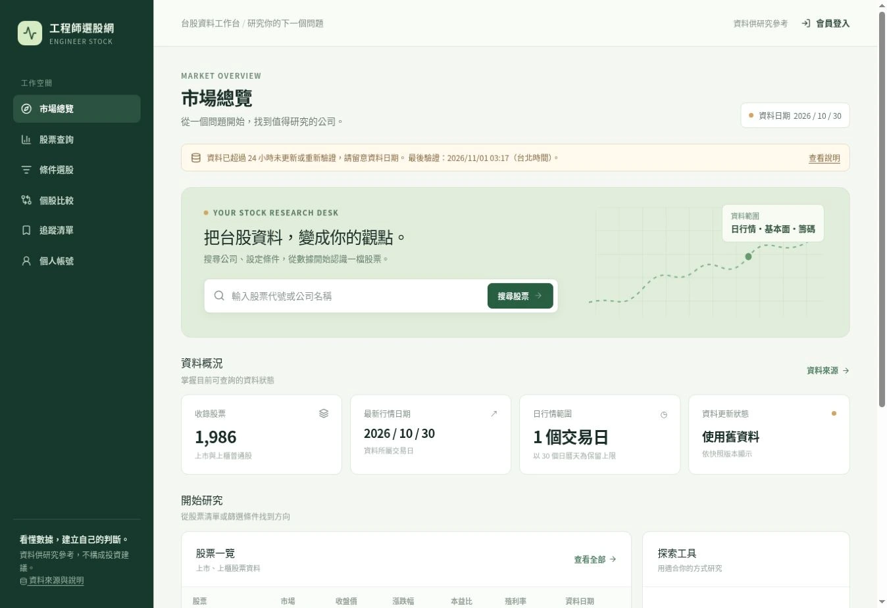

# [Insight] 工程師選股網為什麼把公開行情與個人追蹤分開？

[查看線上最新版](https://ntustray.github.io/mr-blog/posts/engineer-stock-project-intro/) · [離線目錄](../README.md)

在首頁看到一檔股票、用條件篩到同一檔，再點進個股頁時，這三個地方的行情應該是同一天。選股網必須先處理這個一致性問題，才能把查行情、看公司資料與保存追蹤清單放進同一個介面。

正式站的市場總覽。下方課程會用另外一組固定資料練習，方便比對每次輸出。

## 為什麼先打包成快照

公開資料來源有不同的更新週期和格式。網站上每次查詢若直接外連各來源，某一個來源慢一點，使用者就可能在同一頁看到不同日期的數字。專案先由資料 Pipeline 抓取與驗證，再整批發布 JSON 快照。Next.js 載入某個快照的版本後，索引與個股資料都對齊該版本。

這個設計適合固定頻率更新的公開行情。它也把成本移到發布階段，來源失敗時要決定是否沿用上一版，網站則要把真實資料日期顯示出來。若產品要看同一交易日內連續更新的即時報價，就得另外處理資料延遲、增量更新和過期規則。

## 為什麼追蹤清單自己存

同一天的行情可以跨使用者重用。某個人追蹤了哪些股票，則要能新增、移除，而且只能由有權限的人存取。作品把公開行情交給 GitHub Actions 與快照，帳號和追蹤交給 Supabase。分開後，行情更新即使失敗，仍可以另外檢查登入與追蹤功能。

這也留下兩種不同的驗收題。公開資料要看每個頁面是否指向同一批資料。會員資料要拿兩個測試帳號交叉驗證，確認一人無法讀取另一人的清單。

## 從哪篇開始

先看[正式站](https://engineer-stock-web.vercel.app/)的行情日期，打開股票查詢再進入個股頁。下一篇用兩家虛構公司把同一條路徑跑起來。網站練習直接從[公開範例 ZIP](../stock-fixture-lab.zip)開始，用兩筆虛構行情把 Next.js 頁面和查詢 API 跑起來，再接會員登入。資料 Pipeline 則可以從公開 GitHub repo 另外 clone 操作。

接著讀[本機啟動與資料流](./engineer-stock-01-local.md)，或打開[完整系列目錄](../README.md)。

## 參考資料

- [工程師選股網正式站](https://engineer-stock-web.vercel.app/)
- [公開資料 Pipeline](https://github.com/ntustRay/engineer-stock-data)
- [臺灣證券交易所 OpenAPI](https://openapi.twse.com.tw/)

[回離線目錄](../README.md) · [下一章](./engineer-stock-01-local.md)
