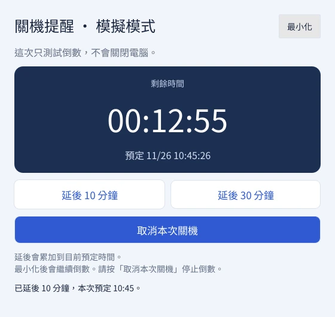
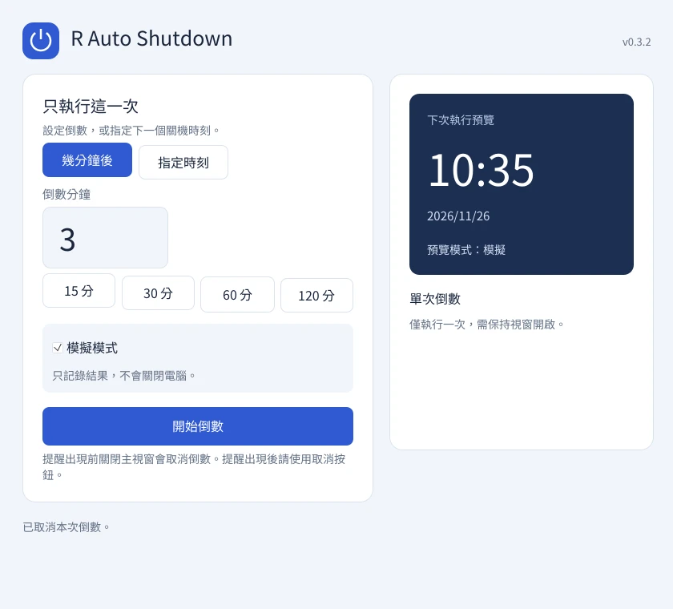

這次做一個桌面視窗。按 Start 之後從三分鐘倒數；剩兩分鐘時按 +10 min，畫面應該變成十二分鐘。先在測試裡把時間往前推，再把相同的動作接到 egui。整個練習只會模擬倒數。

[下載 Rust 測試與 egui 範例（ZIP）](../../downloads/series-labs/auto-shutdown.zip)。完成第一步的 `git checkout` 後，在專案根目錄解壓縮，就能分別執行下方的測試和視窗範例。

## 1. 取得程式與建置環境

準備 Rust 1.88 以上與 Git，可先執行 `rustc --version` 和 `cargo --version` 確認終端機能找到兩者。Windows 需要 Visual Studio Build Tools 的 **Desktop development with C++**。若使用 Ubuntu 24.04，下面的套件對應[此版本的 Linux CI](https://github.com/ntustRay/rust-auto-shutdown/blob/e2641a9cf74413fa88704fd62061070d2fe134c2/.github/workflows/ci.yml)，另加中文字型供完整版顯示提醒。要開視窗，請在有圖形桌面的環境執行。

```sh
sudo apt-get update
sudo apt-get install -y build-essential pkg-config libxcb-render0-dev libxcb-shape0-dev libxcb-xfixes0-dev libxkbcommon-dev libssl-dev fontconfig fonts-noto-cjk
```

各平台準備好工具後，下載相同版本並先跑原有測試：

```sh
git clone https://github.com/ntustRay/rust-auto-shutdown.git
cd rust-auto-shutdown
git checkout e2641a9cf74413fa88704fd62061070d2fe134c2
cargo test --locked --lib
```

看到 `test result: ok` 後，從 `src/lib.rs` 找 `Timer`。它提供 `start`、`extend`、`cancel`、`poll`。視窗只要在對的時機呼叫這四個方法。先寫測試，可以把「延後十分鐘」精確定義成從哪個時間點起算。

## 2. 寫一個不用等待的驗收測試

在專案根目錄建立 `tests/lesson_countdown.rs`（沒有 `tests` 資料夾就新增）：

```rust
use rust_auto_shutdown::{Mode, Timer};
use std::time::{Duration, Instant};

#[test]
fn postpone_then_cancel() {
    let start = Instant::now();
    let mut timer = Timer::default();
    timer.start(start, Duration::from_secs(180), Mode::Simulation).unwrap();

    let clicked = start + Duration::from_secs(60);
    let remaining = timer.extend(clicked, Duration::from_secs(600)).unwrap();
    assert_eq!(remaining, Duration::from_secs(720));
    assert!(timer.cancel());
    assert_eq!(timer.remaining(clicked), None);
    assert!(timer.poll(clicked + remaining, || panic!("unexpected action")).is_none());
}
```

執行 `cargo test --locked --test lesson_countdown`，應看到 `postpone_then_cancel ... ok`。若把 720 秒誤寫成 780 秒，測試會告訴你差了已經過去的一分鐘。這正是按下延後時不能再用最初時長重算的原因。

## 3. 把按鈕接到 Timer

在根目錄建立 `examples/` 資料夾，新增 `reminder_lab.rs`。`eframe` 與 `egui` 已經包含在專案的依賴內，不必另外建 crate。

```rust
use eframe::egui;
use rust_auto_shutdown::{Mode, Timer, format_remaining};
use std::time::{Duration, Instant};

#[derive(Default)]
struct Reminder {
    timer: Timer,
    status: String,
}

impl eframe::App for Reminder {
    fn update(&mut self, ctx: &egui::Context, _: &mut eframe::Frame) {
        let now = Instant::now();
        egui::CentralPanel::default().show(ctx, |ui| {
            if let Some(left) = self.timer.remaining(now) {
                ui.heading(format_remaining(left));
                if ui.button("+10 min").clicked() {
                    if let Err(message) = self.timer.extend(now, Duration::from_secs(600)) {
                        self.status = message;
                    }
                }
                if ui.button("Cancel").clicked() {
                    self.timer.cancel();
                    self.status = "Cancelled".into();
                }
            } else if ui.button("Start 3 min").clicked() {
                self.status = match self.timer.start(now, Duration::from_secs(180), Mode::Simulation) {
                    Ok(()) => "Running".into(),
                    Err(message) => message,
                };
            }
            if self.timer.poll(now, || Ok(())).is_some() {
                self.status = "Finished (simulation)".into();
            }
            ui.label(&self.status);
        });
        ctx.request_repaint_after(Duration::from_millis(200));
    }
}

fn main() -> eframe::Result {
    eframe::run_native("Reminder lab", eframe::NativeOptions::default(),
        Box::new(|_| Ok(Box::new(Reminder::default()))))
}
```

從專案根目錄執行 `cargo run --locked --example reminder_lab`。按 **Start 3 min**，再按 **+10 min**；接著按 **Cancel**，應回到可以重新開始的畫面。若數字只在滑鼠移動時變化，檢查 `request_repaint_after` 是否放在每次 `update` 都會執行的位置。`poll` 放在按鈕之後，讓同一輪收到的取消或延後先更新狀態。

## 4. 核對完整版的提醒視窗

關掉剛才的 Reminder lab 視窗，讓終端機回到提示字元。執行 `cargo run --release --locked --bin r-auto-shutdown` 開啟 0.3.2 完整版。選單次倒數、輸入 3 分鐘，確認畫面上的「模擬模式」已勾選，再開始。三分鐘落在最後五分鐘內，提醒會立即出現。


點「延後 10 分鐘」，直接核對提醒卡上的**預定時刻**。下圖從 10:35:26 改成 10:45:26，剩餘時間則會隨著視窗刷新。



再按「取消本次關機」。主視窗應顯示本次倒數已取消。上面的 Rust 練習只建了一個視窗；完整版把提醒另開一個 viewport，所以關閉提醒視窗和取消計時是兩件需要分開處理的事。



[下一篇：整理每週排程、提醒與真機驗收](../auto-shutdown-03-schedule-boundaries/)
