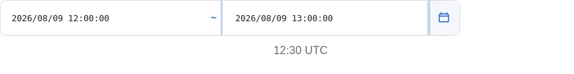

假設圖表一開始列出 UTC 12:30、13:00 和 13:15 三筆 Log。使用者把結束時間從 13:30 往前改到 13:00，什麼時候該更新圖表？本系列選擇在按下 Apply 後才查詢，並用一個容易驗證的結果貫穿四篇：三筆應該變成一筆。

## 先看會寫出哪些東西

| 位置 | 會寫的程式 | 為什麼需要 |
| --- | --- | --- |
| React 頁面 | 一份 `draft`、一份 `committed` | 編輯欄位時保留原本的圖表，按 Apply 才套用。 |
| 查詢函式 | 以 epoch 毫秒比較三筆資料 | 切換到台北時區之後，圖上仍是同一批事件。 |
| 瀏覽器測試 | 重現紐約春季缺口與秋季重複時刻 | 保障使用者輸入的當地時間能對到明確的一個瞬間。 |

試想使用者看到台北 20:00，跟倫敦同事約定用 UTC 12:00 查同一份 Log。API 可以直接收同一個整數。若只傳 `20:00`，少了日期、時區，後端就無法判斷是哪一天的事件。Picker 用時區解讀和顯示輸入，對外用 Unix epoch 毫秒交付起訖點。

這組設計適用於已經發生的事件。若要排「每個工作日紐約時間 09:00」的班表，還要另存當地時刻、時區與重複規則；用第一次發生的 timestamp 無法描述之後的夏令時間。

[第二篇從空的 React 專案開始，接上 Picker 與三筆 Log。](../datetime-02-draft-and-apply/)
