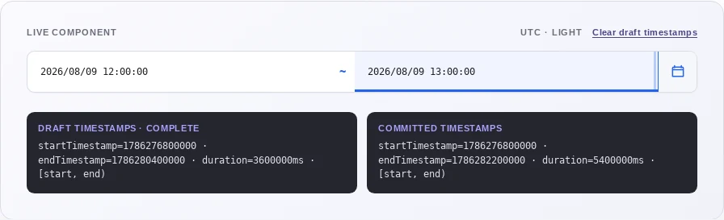

最後要做出的互動如下。結束時間從 13:30 改成 13:00，編輯時保留三筆 Log，按 Apply 才剩一筆。


[下載 Log 篩選器的兩個原始檔（ZIP）](../../downloads/series-labs/datetime.zip)。先用第一步建立 React 專案與安裝套件，再把 ZIP 裡的 `src` 放進專案根目錄。

## 1. 安裝套件，建立資料檔

準備 Node.js 22.18 或更新的 22.x／24.x 版本，在終端機執行。若建立工具詢問是否直接啟動，先跳過，等檔案寫完再跑。

```sh
npm create vite@latest picker-lab -- --template react-ts
cd picker-lab
npm install
npm install @ntustray/react-datetime-range-picker@0.2.2
```

新增 `src/events.ts`。這三筆資料故意放在結束點之前、剛好相等、之後。查詢採半開區間 `[start, end)`，右邊界不含在內。

```ts title="src/events.ts"
import type { DateTimeRangeValue } from '@ntustray/react-datetime-range-picker';

const events = [
  { label: '12:30 UTC', at: Date.UTC(2026, 7, 9, 12, 30) },
  { label: '13:00 UTC', at: Date.UTC(2026, 7, 9, 13) },
  { label: '13:15 UTC', at: Date.UTC(2026, 7, 9, 13, 15) },
];

export function eventsIn({ startTimestamp, endTimestamp }: DateTimeRangeValue) {
  if (startTimestamp === null || endTimestamp === null) return [];
  return events.filter(({ at }) => startTimestamp <= at && at < endTimestamp);
}
```

## 2. 把草稿和查詢接到不同的 callback

用下面內容取代 `src/App.tsx`。兩份 state 同時從 UTC 12:00 到 13:30 開始；JavaScript 的 `Date.UTC` 以 0 表示一月，所以 7 表示八月。

```tsx title="src/App.tsx"
import { useState } from 'react';
import {
  DateTimeRangePicker, type DateTimeRangeValue,
} from '@ntustray/react-datetime-range-picker';
import '@ntustray/react-datetime-range-picker/styles.css';
import { eventsIn } from './events';

const initial = {
  startTimestamp: Date.UTC(2026, 7, 9, 12),
  endTimestamp: Date.UTC(2026, 7, 9, 13, 30),
};

export default function App() {
  const [draft, setDraft] = useState<DateTimeRangeValue>(initial);
  const [query, setQuery] = useState<DateTimeRangeValue>(initial);
  return <main>
    <DateTimeRangePicker value={draft} onChange={setDraft}
      onCommit={setQuery} locale="zh-TW" timezone="UTC" />
    <ul>{eventsIn(query).map(event => <li key={event.at}>{event.label}</li>)}</ul>
  </main>;
}
```

`onChange` 把新值交還給受控元件；`onCommit` 才把這份值交給查詢。若每次編輯都先更新清單，回頭檢查傳進 `eventsIn` 的是哪一份 state。

## 3. 用同一份輸入驗收兩種狀態

1. 執行 `npm run dev`，開終端機印出的網址。應看到三筆 Log。
2. 把結束欄改成 `2026/08/09 13:00:00`，按 Tab。畫面仍應有三筆。要看內部狀態，可在[套件 Playground](https://ntustray.github.io/react-datetime-range-picker/)做相同操作，對照下圖的 Draft 與 Committed。
3. 按「套用」，回到清單。只剩 `12:30 UTC` 才算通過；若還看得到 `13:00 UTC`，檢查右邊界有沒有誤用 `<=`。




日後把陣列換成 API，可在提交時把同一組 epoch 毫秒送出。資料庫使用 timestamp 型別時，先在伺服器轉成對應型別，再套用相同邊界。

[第三篇把容易漏掉的夏令時間輸入寫成 Playwright 測試。](../datetime-03-test-dst-in-playground/)
