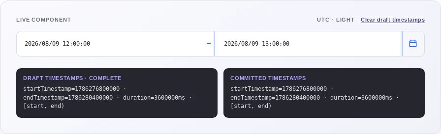
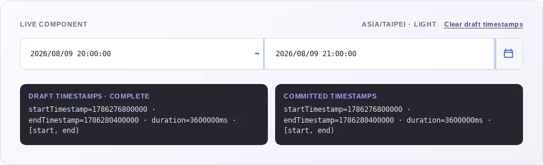
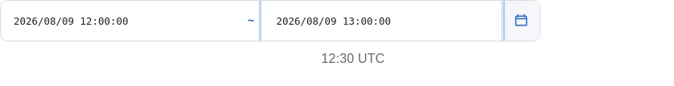

這次把圖表的時間篩選拆成草稿和已提交參數。先在公開 Playground 改一次值、換一次時區，接著把這兩個 state 接進 React。沒有現成圖表也能用三筆事件確認行為。

## 1. 改結束時間，先看 Draft

打開 [Playground](https://ntustray.github.io/react-datetime-range-picker/)，往下滑到 **Edit the time. Keep the timestamps.**。右側標籤預設是 **UTC · LIGHT**。兩欄初始值為 `2026/08/09 12:00:00` 與 `2026/08/09 13:30:00`。把結束欄改成 `2026/08/09 13:00:00`，按 Tab，先別按「套用」。

Draft 的 `endTimestamp` 應是 `1786280400000`，Committed 仍是 `1786282200000`。日曆浮層如果遮住數字，可以在 DevTools 的 Elements 搜尋 `state-readout`，展開下方兩組讀值。


## 2. 套用後切換時區

在日曆按「套用」。Committed 的結束值現在應等於 Draft。再按「開啟日曆」，把時區下拉選成 `Asia/Taipei`，便能看到開始與結束時間移到 `20:00:00` 和 `21:00:00`。下方兩組 timestamps 仍代表同一段時間。





## 3. 接到 React 的事件清單

準備 Node.js 22.18+。已有 React 專案時只要裝第三行的套件，並把範例接到要篩選的頁面。

```sh
npm create vite@latest picker-lab -- --template react-ts
cd picker-lab
npm install @ntustray/react-datetime-range-picker@0.2.2
npm run dev
```

把 Vite 專案的 `src/App.tsx` 改成下面這段，開啟開發伺服器顯示的網址。範例用名為 `committed` 的已提交區間篩事件；接 API 時可在相同位置使用這組參數。

```tsx title="src/App.tsx"
import { useState } from "react";
import {
  DateTimeRangePicker,
  type DateTimeRangeValue,
} from "@ntustray/react-datetime-range-picker";
import "@ntustray/react-datetime-range-picker/styles.css";

const initial = {
  startTimestamp: Date.UTC(2026, 7, 9, 12),
  endTimestamp: Date.UTC(2026, 7, 9, 13, 30),
};

const events = [
  { label: "12:30 UTC", at: Date.UTC(2026, 7, 9, 12, 30) },
  { label: "13:00 UTC", at: Date.UTC(2026, 7, 9, 13) },
  { label: "13:15 UTC", at: Date.UTC(2026, 7, 9, 13, 15) },
];

export default function App() {
  const [draft, setDraft] = useState<DateTimeRangeValue>(initial);
  const [committed, setCommitted] = useState<DateTimeRangeValue>(initial);
  const { startTimestamp, endTimestamp } = committed;
  const visible = startTimestamp === null || endTimestamp === null
    ? []
    : events.filter(({ at }) => startTimestamp <= at && at < endTimestamp);

  return (
    <main>
      <DateTimeRangePicker
        value={draft}
        onChange={setDraft}
        onCommit={setCommitted}
        locale="zh-TW"
        timezone="UTC"
      />
      <ul>
        {visible.map(({ label }) => <li key={label}>{label}</li>)}
      </ul>
    </main>
  );
}
```

先確認三筆事件都在清單。把結束改成 `2026/08/09 13:00:00`，按 Tab 時應仍看見三筆。按「套用」後應只剩 `12:30 UTC`。`13:00 UTC` 正好是結束邊界，依 `[start, end)` 排除。


