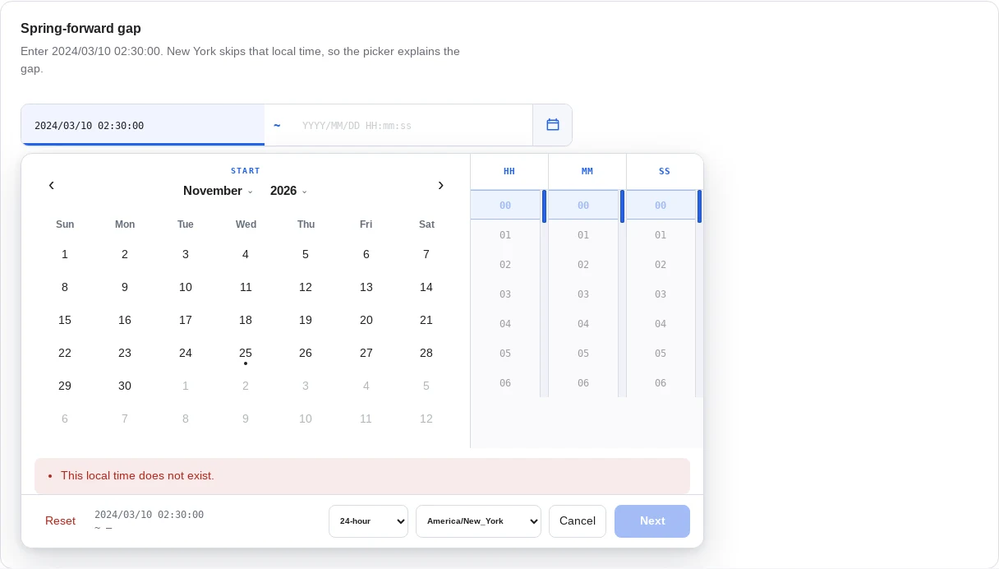
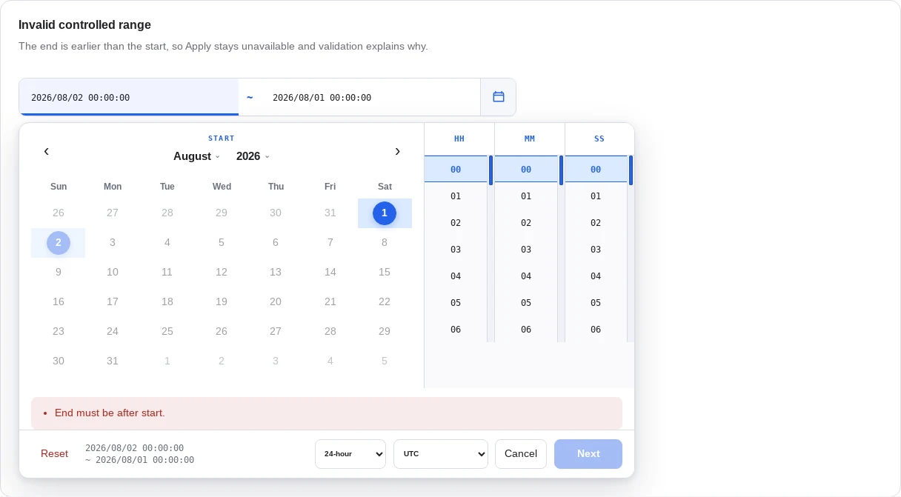

紐約在 2024 年有一天的 02:30 根本沒有發生，另一天的 01:30 則發生兩次。用 [Picker Playground](https://ntustray.github.io/react-datetime-range-picker/) 的兩個案例重現，看看 UI 要在哪裡擋住輸入、在哪裡等使用者選 offset。這些案例已把時區設成 `America/New_York`，電腦可留在自己的時區。

## 1. 先輸入不存在的當地時刻

1. 往下滑到 **Make failure inspectable**，找到 **Spring-forward gap**。
2. 在該區點日曆圖示，把 `2024/03/10 02:30:00` 貼到 **Start**。
3. 按 Tab 離開欄位。日曆區會顯示 **This local time does not exist.**
4. 點 **Cancel** 關閉案例。

那天牆上的鐘從 01:59 跳到 03:00，輸入的 02:30 對不到 UTC instant。把時區選在這裡的目的，是讓使用者知道是哪個本地時刻不成立。

## 2. 再輸入會發生兩次的時刻

1. 找到 **Fall-back overlap**，點該區的日曆圖示。
2. 在 **Start** 貼入 `2024/11/03 01:30:00`，再按 Tab。
3. 確認顯示 **Start UTC offset**。展開選單會看到 **Earlier (-04:00)** 和 **Later (-05:00)**。前者是 `2024-11-03T05:30:00Z`，後者是 `2024-11-03T06:30:00Z`。
4. 選 offset 後，按 **Next**把結束設成同日 `02:30:00`。兩種 offset 選擇對應的完整區間長度相差一小時。

## 3. 確認只有完整區間可以套用

點開同頁 **Invalid controlled range** 的日曆。在這個案例，起點比終點晚，畫面會顯示 **End must be after start.**，**Next** 不可按，無法走到 Apply。

實際接圖表時，把這三組輸入各留成一個測試。成功的重複時刻選擇應產生明確的 timestamp，缺口與顛倒的區間應留在表單驗證，等使用者修正後再送請求。
