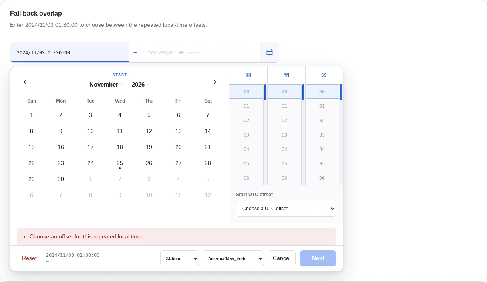

紐約在 2024 年 3 月 10 日從 01:59 跳到 03:00。秋天則有兩個 01:30。這次直接在套件的 Demo 加一個 E2E 測試檔，讓瀏覽器輸入這兩個時刻。畫面下方的錯誤文字和 offset 選單就是測試的觀察點。

[下載兩個 DST 案例的 Playwright 測試檔（ZIP）](../../downloads/series-labs/dst.zip)。完成第一步的 `git checkout` 後，在套件根目錄解壓縮即可得到 `e2e/dst-lesson.spec.ts`。

## 1. 在套件專案開一個測試檔

另開目錄，準備 Node.js 22.18+ 與 Git。使用與截圖同一版的 Demo，可以讓表單名稱和測試定位一致。

```sh
git clone https://github.com/ntustRay/react-datetime-range-picker.git
cd react-datetime-range-picker
git checkout cefadde623e4260ae1235363ae501da7d57c7cec
npm ci
npx playwright install chromium
```

在 `e2e/dst-lesson.spec.ts` 寫下第一個測試。`playwright.config.ts` 會啟動 Demo，`page.goto('/')` 使用設定裡的本機網址。頁面有多個 Picker，所以先找對應案例卡片，再找輸入框。

```ts title="e2e/dst-lesson.spec.ts"
import { expect, test } from '@playwright/test';

test('跳過的 02:30 顯示錯誤', async ({ page }) => {
  await page.goto('/');
  const card = page.locator('.scenario-card').filter({ hasText: 'Spring-forward gap' });
  await card.getByRole('button', { name: 'Open calendar' }).click();
  const start = card.getByTestId('dtrp-start-input');
  await start.fill('2024/03/10 02:30:00');
  await start.blur();
  const dialog = page.getByRole('dialog', { name: 'DST gap example' });
  await expect(dialog).toContainText('This local time does not exist.');
});
```


## 2. 測試重複時刻能不能選 UTC offset

同一個檔案接著寫第二個測試。11 月 3 日的 01:30 可能是 UTC 05:30，也可能是 UTC 06:30；欄位上相同的文字仍需要使用者選擇 offset。

```ts title="e2e/dst-lesson.spec.ts（接續）"
test('重複的 01:30 有兩個 offset 可選', async ({ page }) => {
  await page.goto('/');
  const card = page.locator('.scenario-card').filter({ hasText: 'Fall-back overlap' });
  await card.getByRole('button', { name: 'Open calendar' }).click();
  const start = card.getByTestId('dtrp-start-input');
  await start.fill('2024/11/03 01:30:00');
  await start.blur();
  const dialog = page.getByRole('dialog', { name: 'DST overlap example' });
  const offsets = dialog.getByRole('combobox', { name: 'Start UTC offset' });
  await expect(offsets).toBeVisible();
  await expect(offsets.locator('option').filter({ hasText: '-04:00' })).toHaveCount(1);
  await expect(offsets.locator('option').filter({ hasText: '-05:00' })).toHaveCount(1);
});
```



## 3. 讓測試跑一次，再觀察失敗時停在哪

```sh
npx playwright test e2e/dst-lesson.spec.ts --project=chromium
```

預期看到兩個案例通過。把第一個案例中的輸入暫時改成有效的 `2024/03/10 03:30:00` 再跑一次；第一個 assertion 應失敗，第二個仍通過。把值改回來。如果測試在錯誤文字出現前就停住，用 `--headed` 重跑，確認選到對應的卡片、輸入後也有離開欄位。這兩個案例已固定使用 `America/New_York`，電腦可以保持台北時區。
