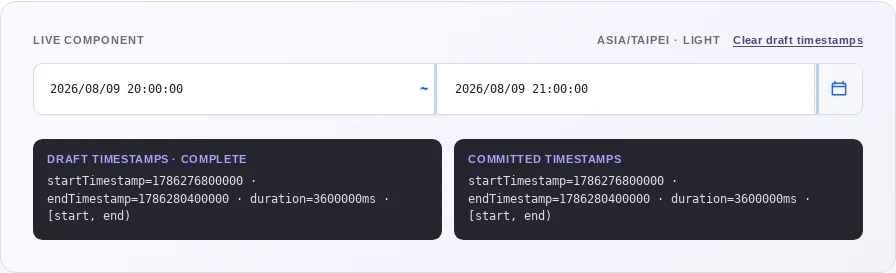

回到第一篇的三筆 Log。改結束時間時仍看見三筆，按 Apply 後只剩 12:30，代表 React 能區分「正在編輯」和「拿去查資料」兩個時機。第三篇再用紐約案例確認：春季輸入能收到缺口提示，秋季輸入則有兩種 offset 可選。



## 如果圖表接上資料庫，還剩哪一段要驗

在資料庫準備三筆事件，時間分別是 UTC 09:59:59.999、10:00:00.000、10:00:00.001。各查一次 09:00–10:00 與 10:00–11:00。第一段應回一筆，第二段兩筆；兩份結果中的事件 ID 不應重複。

若資料欄位存 epoch 毫秒，SQL 和前端要用同樣的比較：

```sql
SELECT event_id, timestamp_ms
FROM events
WHERE timestamp_ms >= $1 AND timestamp_ms < $2
ORDER BY timestamp_ms, event_id;
```

| 現象 | 第一個要檢查的位置 |
| --- | --- |
| 打字就重新載入圖表 | 查詢是否訂閱了 `draft`，或在 `onChange` 裡發送。 |
| 邊界那筆 Log 連著出現兩次 | 前後端有沒有把結束值當成包含端點。 |
| 改顯示時區後整張圖平移 | 比對兩次送出的 epoch 值，檢查呼叫端有沒有重複加上 offset。 |
| 紐約的重複時間選錯一小時 | 看 UI 選的是 −04:00 還是 −05:00，再核對送出的 UTC instant。 |

這套範例把畫面、查詢與時間解析分成可獨立重跑的檢查。正式圖表若會同時發出多次查詢，還應用兩個不同區間驗一次「後送先回」：最後畫面要顯示最後提交的區間，避免較慢的舊回應蓋掉新資料。
