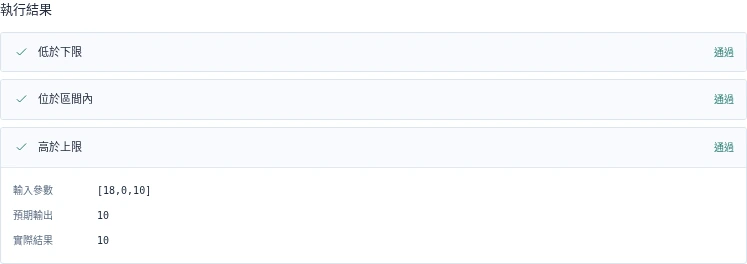

出一道「把 -3 限制在 0 到 10」的題目，需要讓學員看見三樣東西：規格、自己寫的函式，以及測資為什麼沒有過。隔天回來，又應該找到同一題的草稿和筆記。Dev Map Lab 把這些東西放在同一個學習單元，背後各有不同的保存方式。

| 內容 | 放在哪裡 | 如何交給下一層 |
| --- | --- | --- |
| 單元、段落、題目 | repo 裡的 Markdown 與 JSON | build 驗證 ID 和題目格式，由 Next.js 產生靜態頁 |
| 學員寫的 JS／TS | 瀏覽器的編輯器 | Web Worker 轉譯 TS，以 QuickJS WASM 跑測資並回傳結果 |
| 草稿、作答、筆記 | Dexie 管理的 IndexedDB | React 工作台讀回同一個瀏覽器的資料，也能匯出 JSON |
| 跨裝置備份 | 選用的 Neon Auth 與 PostgreSQL | 登入並驗證信箱後，學員主動上傳、合併與取回 |

為什麼教材用固定 ID？把段落標題改得更清楚，不應讓學員上週寫的註記無處可回；筆記指向 `lessonId + blockId`，便能保留這個關聯。為什麼程式題用 Worker？執行測資需要能取消，學員輸入的同步迴圈不能讓整個編輯器卡住。

下一課會從 repo 建立一個自己的 TypeScript 單元，替邊界值補測試，再把成果編譯成靜態檔。第三課為自己的副本串 Neon、部署到 Vercel，驗收本機筆記與雲端備份兩條路。
