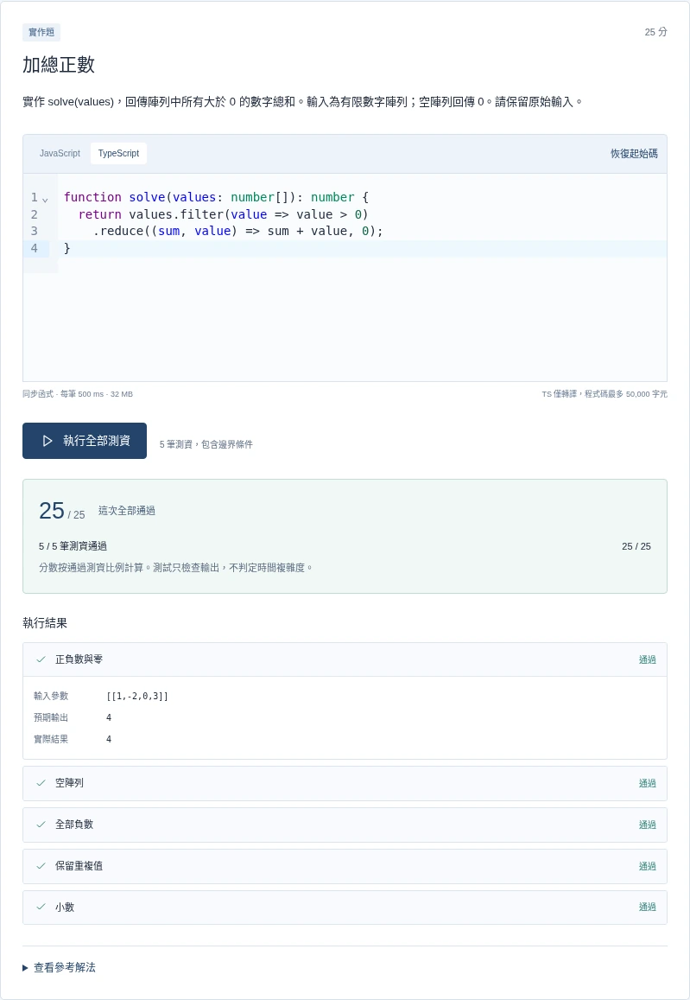

這次跑「加總正數」的五筆測資，然後把其中一個邊界條件存成段落筆記。準備 Node.js 24、Bun 1.4.4 和一個 Chromium 系瀏覽器。練習與筆記可以在訪客模式完成。

## 1. 在本機開啟工作台

```sh
node --version
bun --version
git clone https://github.com/ntustRay/dev-map-lab.git
cd dev-map-lab
bun install --frozen-lockfile
bun run dev
```

打開終端機顯示的網址。從「語言與資料」路線進入「值、參照與不修改輸入」，切到「練習」，再點「實作題」。如果編輯器還在載入，等到出現 `function solve(values)` 再執行。

## 2. 先跑起始碼，找出差在哪一筆

按「執行全部測資」，展開「正負數與零」。這一筆的輸入參數顯示 `[[1,-2,0,3]]`，外層陣列是函式參數列，裡面那一份陣列才是 `values`。起始碼只回傳 0；這筆期望 4，因此會標「輸出不同」。空陣列和全部負數剛好期望 0，會通過。


## 3. 保留輸入，修好 JS 和 TS 兩份草稿

在 JavaScript 編輯器貼上這段，重跑測資。

```js
function solve(values) {
  return values.filter(value => value > 0)
    .reduce((sum, value) => sum + value, 0);
}
```

`filter` 建立一份只含正數的新陣列，`reduce` 由 0 開始加總。空陣列跑到最後仍會回傳 0，原始陣列也會保留。切到「TypeScript」時會看到另一份草稿，在該語言的編輯器貼上以下版本，再跑一次。

```ts
function solve(values: number[]): number {
  return values.filter(value => value > 0)
    .reduce((sum, value) => sum + value, 0);
}
```



五筆都通過後，這題的執行流程就驗證完成。頁面會轉譯 TS 再執行，若要檢查大型範例的靜態型別，另外使用 `tsc`。

## 4. 留下筆記，再把它帶走

1. 切回「教材」，在「用輸入與輸出描述資料處理」的段落旁按「＋」。
2. 寫下「空陣列回傳 0，正負混合時只加大於 0 的值」，按「儲存筆記」。
3. 重新整理，在同一單元切到「段落筆記」，核對原文連結和筆記還在。「匯出本單元 Markdown 筆記」會下載 `javascript-values-notes.md`，用文字編輯器核對剛寫的句子。
4. 若要保存作答和程式草稿，從側欄開「我的筆記」，按「匯出全部資料」，保留下載的 JSON。Markdown 適合閱讀，JSON 用於把整份學習紀錄匯回工具。


畫面是在本機瀏覽器執行公開 commit `8abcf43` 的建置產物時擷取。筆記內容為教學測試資料。
