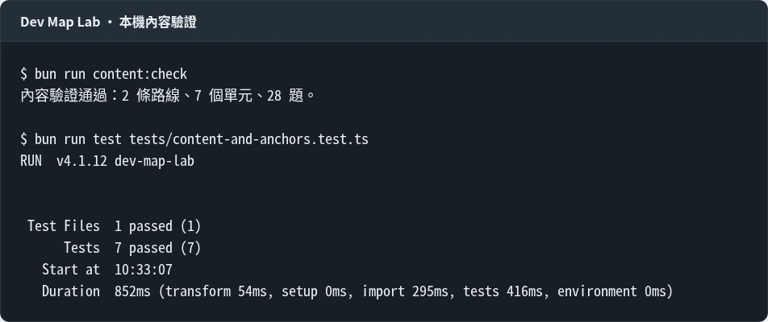

這一課要在自己的開發環境做出下面的單元。下載的教材檔和題庫可以直接改；完成條件是你的新課出現在路線中，失敗的起始程式能經過修改通過三筆測試。


## 1. 建立新單元，給段落一個穩定的 ID

準備 Node.js 24 和 Bun 1.4.4。從公開 repo 開始，若下一堂要部署，可先在 GitHub Fork，將 clone 網址換成自己的 fork。

```sh
git clone https://github.com/ntustRay/dev-map-lab.git
cd dev-map-lab
bun install --frozen-lockfile
bun run content:check
```

在 `content/lessons/` 新建 `typescript-clamp/`。將下列兩個檔案另存到該資料夾，檔名保留為 `lesson.md`、`questions.json`。[下載教材 lesson.md](../../downloads/dev-map-series/typescript-clamp/lesson.md) · [下載完整題庫 questions.json](../../downloads/dev-map-series/typescript-clamp/questions.json)

打開 `lesson.md`。專案用 frontmatter 的 `id: typescript-clamp` 串路線和題庫；正文裡的下列註解是段落筆記的定位點。把段落標題改成自己更好懂的說法，保留註解中的 ID。

```markdown
<!-- block: clamp-cases -->

## 先寫出三種結果
```

## 2. 設計測資，讓錯誤答案只通過一筆

打開 `questions.json`，搜尋 `"id": "typescript-clamp-code"`。同一檔還有選擇、填空、簡答，這個專案的內容測試會確認每個單元包含四種題型。程式題的 `args` 按位置交給 `solve(value, min, max)`。若預期答案只寫在說明文字，測試不會替你檢查。

```json
[
  {
    "id": "below",
    "label": "低於下限",
    "args": [
      -3,
      0,
      10
    ],
    "expected": 0
  },
  {
    "id": "within",
    "label": "位於區間內",
    "args": [
      6,
      0,
      10
    ],
    "expected": 6
  },
  {
    "id": "above",
    "label": "高於上限",
    "args": [
      18,
      0,
      10
    ],
    "expected": 10
  }
]
```

起始解答直接回傳 `value`，三筆只有 `6` 原本就在區間內。先保留這個錯誤版本，等一下可以看清楚執行器是否真的有抓到兩端的錯。

## 3. 加進路線，檢查內容關聯

打開 `content/catalog.json`，找到 `language-foundations`。在它自己的 `lessonIds` 內，把 `"typescript-clamp"` 加在 `"typescript-narrowing"` 後面，保留其他單元。回到根目錄執行：

```sh
bun run content:check
bun run test
bun run dev
```



這是原示例版本的數量。你 clone 的版本可能已有更多單元；看新增前後多一個單元、四道題，並確認沒有 ID 重複或缺少先修。頁面找不到新課時，重啟開發伺服器，檢查 catalog 名稱、目錄名稱、題庫 `lessonId` 和教材 `id` 四處一致。

## 4. 修正解答，驗證學員真的能完成這題

開本機網址，進「語言與資料」裡的新單元，開啟實作題，切 TypeScript，先跑起始程式。低於下限、高於上限應失敗。接著在題目的編輯器寫入：

```ts
function solve(value: number, min: number, max: number): number {
  return Math.min(max, Math.max(min, value));
}
```


替「先寫出三種結果」存一則段落筆記，重新整理確認筆記仍屬於該段落。最後停止 dev server，執行 `bun run build`。根目錄 `out/` 應出現靜態檔；下一篇從這份產物接到自己的網址。
