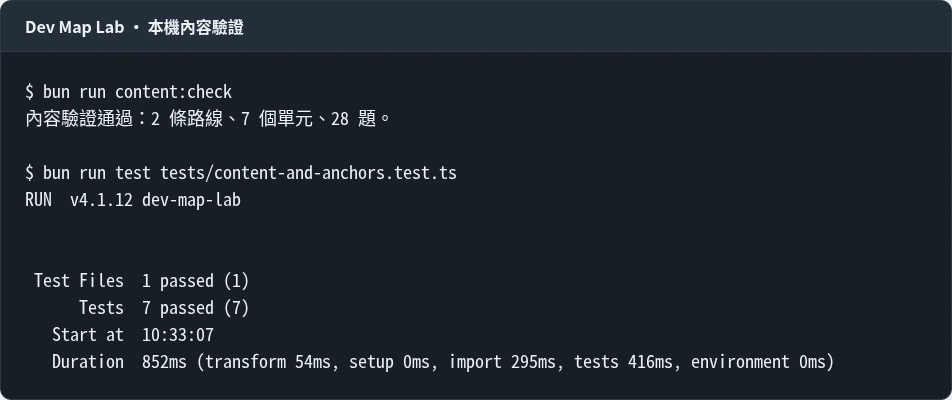
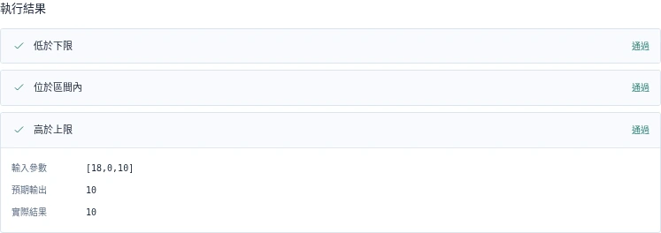

上一課跑的是專案內建題目。這次新增一個「將數字限制在區間內」單元，從路線打開教材，再執行新題目的三筆測資。使用已裝好 Node.js 24、Bun 1.4.4 和依賴的 Dev Map Lab 本機 clone。範例以公開 commit `8abcf43` 的格式為準。

## 1. 新增教材，先決定不變的 ID

在專案根目錄建立 `content/lessons/typescript-clamp/`，新增 `lesson.md`。

~~~~markdown title="content/lessons/typescript-clamp/lesson.md"
---
id: typescript-clamp
version: 1
title: 將數字限制在區間內
summary: 用三筆測資驗證數字低於下限、位於區間內、高於上限時的行為。
minutes: 8
tags: [TypeScript]
prerequisites: [typescript-narrowing]
---

<!-- block: clamp-cases -->

## 先寫出三種結果

在 0 到 10 的區間，-3 應回傳 0，6 應回傳 6，18 應回傳 10。先用這三種輸入測試，再考慮兩個邊界值。
~~~~

`id` 同時用在檔案目錄、單元路由和學習紀錄。`<!-- block: clamp-cases -->` 則是段落筆記用的 ID。修改教材標題時可以保留這兩個值，舊筆記便還有原本的定位點。

## 2. 讓四種題目共用同一個例子

同一份目錄新增 `questions.json`。選擇題先判斷低於下限的輸出，填充題確認上限，簡答題解釋區間內為什麼保留原值，再將三種情況放進實作題。這個版本的 repository 測試要求每個單元包含 `choice`、`fill`、`short` 和 `code` 四種題型。

```json title="content/lessons/typescript-clamp/questions.json"
{
  "schemaVersion": 1,
  "lessonId": "typescript-clamp",
  "questions": [
    {
      "id": "typescript-clamp-choice",
      "version": 1,
      "type": "choice",
      "title": "先判斷結果",
      "prompt": "將 -3 限制在 0 到 10，結果是多少？",
      "points": 5,
      "explanation": "低於下限時回傳下限。",
      "multiple": false,
      "options": [
        { "id": "negative", "text": "-3" },
        { "id": "zero", "text": "0" },
        { "id": "ten", "text": "10" }
      ],
      "correctIds": ["zero"]
    },
    {
      "id": "typescript-clamp-fill",
      "version": 1,
      "type": "fill",
      "title": "核對上限",
      "prompt": "將 18 限制在 0 到 10，結果是多少？",
      "points": 5,
      "explanation": "高於上限時回傳上限。",
      "answers": ["10"],
      "normalization": { "trim": true, "caseSensitive": true, "collapseWhitespace": false }
    },
    {
      "id": "typescript-clamp-short",
      "version": 1,
      "type": "short",
      "title": "解釋區間內的結果",
      "prompt": "為什麼將 6 限制在 0 到 10 時，結果仍是 6？",
      "points": 5,
      "explanation": "6 大於下限且小於上限，兩次比較都保留 6。",
      "referenceAnswer": "6 位於區間內，保留原值。",
      "criteria": [
        {
          "id": "within-range",
          "label": "指出 6 位於區間內",
          "points": 5,
          "acceptedPhrases": ["位於區間內", "在 0 到 10 之間"],
          "keywordGroups": [["大於", "高於"], ["下限"], ["小於", "低於"], ["上限"]],
          "misconceptions": [],
          "semanticThreshold": null
        }
      ]
    },
    {
      "id": "typescript-clamp-code",
      "version": 1,
      "type": "code",
      "title": "限制數字範圍",
      "prompt": "實作 solve(value, min, max)。只接收有限數字，且 min <= max。",
      "points": 10,
      "explanation": "先套用下限，再套用上限。",
      "entrypoint": "solve",
      "starters": {
        "javascript": "function solve(value, min, max) { return value; }",
        "typescript": "function solve(value: number, min: number, max: number): number { return value; }"
      },
      "solutions": {
        "javascript": "function solve(value, min, max) { return Math.min(max, Math.max(min, value)); }",
        "typescript": "function solve(value: number, min: number, max: number): number { return Math.min(max, Math.max(min, value)); }"
      },
      "comparison": { "kind": "deepEqual" },
      "limits": { "timeMs": 500, "memoryMb": 32 },
      "tests": [
        { "id": "below", "label": "低於下限", "args": [-3, 0, 10], "expected": 0 },
        { "id": "within", "label": "位於區間內", "args": [6, 0, 10], "expected": 6 },
        { "id": "above", "label": "高於上限", "args": [18, 0, 10], "expected": 10 }
      ]
    }
  ]
}
```

這三筆程式測資分開驗證下限、原值、上限。起始碼直接回傳輸入，只會通過第二筆。題目已限定 `min <= max` 且輸入都是有限數字。若想支援上下限顛倒，先寫明預期行為，再加一筆測資。

## 3. 加入路線並開啟新頁

打開 `content/catalog.json`，找到 `language-foundations` 路線，在 `lessonIds` 的 `typescript-narrowing` 後面加上 `typescript-clamp`。保留其他路線。

```json
"lessonIds": [
  "javascript-values",
  "javascript-closures",
  "typescript-narrowing",
  "typescript-clamp"
]
```

在專案根目錄執行：

```sh
bun run content:check
bun run test
bun run dev
```

`content:check` 會確認檔案結構及先修關係，這份起始版本預期是 2 條路線、7 個單元、28 題。測試會執行題庫的 JS／TS 參考解法。打開本機網址，從「語言與資料」點進新單元。若之前已開發伺服器但看不到新單元，重啟伺服器再從首頁檢查。



畫面整理自範例教材加入後的實際指令輸出。


## 4. 用畫面驗證測資與教材對得起來

1. 點「練習」再點「實作題」，選 TypeScript，執行起始碼。低於下限與高於上限應顯示「輸出不同」。
2. 把函式改成下面的實作，按「執行全部測資」。

```ts
function solve(value: number, min: number, max: number): number {
  return Math.min(max, Math.max(min, value));
}
```

3. 三筆都通過後，展開「高於上限」，核對輸入 `[18,0,10]` 與實際輸出 `10`。若新題能載入，測資也能跑完，這個單元就能走通現有的教材與執行器。



教材與測資截圖是在本機瀏覽器將本文範例載入公開版工作台後取得。程式由工作台的 QuickJS Worker 執行。
