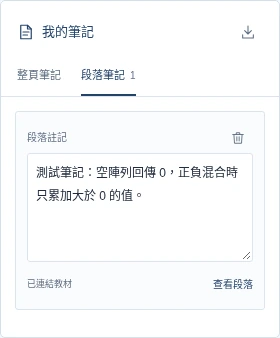

把題目寫完、重新整理看到剛才的筆記、在另一台電腦讀到備份，是三個不同的結果。前兩個可以在沒有帳號的瀏覽器完成，第三個才會動到 Neon。

| 想知道什麼 | 怎麼驗 | 失敗先往哪裡找 |
| --- | --- | --- |
| 教材是否被打包 | 在部署網址直接進自訂單元並重整 | catalog、單元 ID、靜態輸出的路徑 |
| 程式測資是否有意義 | 跑只回傳輸入的初始解答，再跑 clamp 的完整解答 | 題庫的 args、expected 及 Worker 執行結果 |
| 本機筆記是否可還原 | 同一瀏覽器重整，打開同一段落 | IndexedDB 的 origin、使用者範圍與 block ID |
| 雲端是否可備份 | 已驗證帳號上傳後，從第二個瀏覽器取回 | endpoint、Auth session、RLS、備份 revision |

教材跟著 Git 版控，修錯字可以保留單元和段落 ID。若把測資的輸入規格或批改方式改了，應一併考慮題目版本，才知道哪次作答用了舊規則。公開的測資適合自學；若要用成績決定是否錄取，還需要受控的評測環境。

本機筆記則有自己的生命週期。換網域或瀏覽器會看到另一個 IndexedDB，訪客可以先匯出 JSON。會員的雲端備份是一份帶 revision 的快照，兩個裝置同時上傳時需要檢查版本。若下一個需求只是多上一堂課，改教材和測資即可；等到要解決兩台裝置同時編輯同一則筆記，才值得設計同步與衝突處理。
