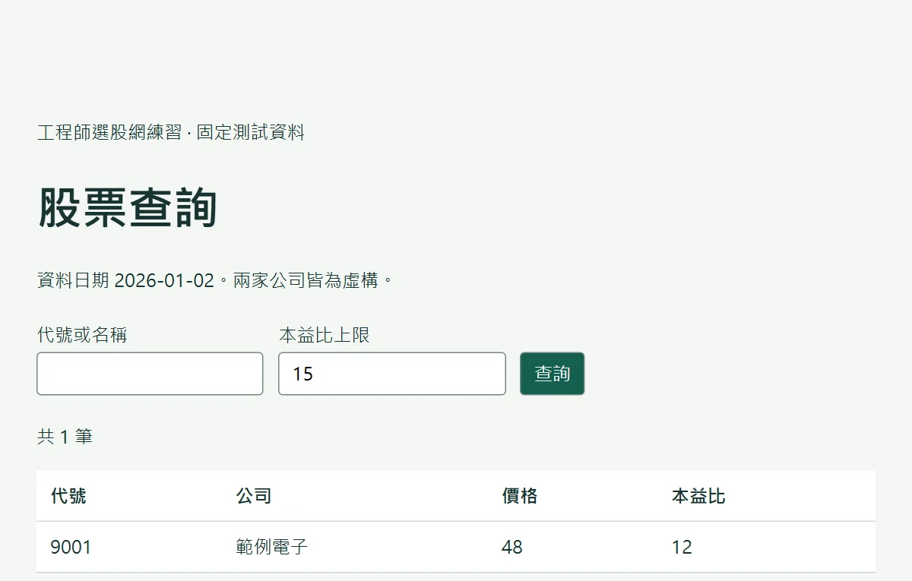

完成這篇：本機顯示兩檔測試公司、搜尋只剩一檔，能找到資料與畫面的檔案。

正式站參考畫面。下方練習使用固定的虛構公司。

<figure>
  <a href="../../images/engineer-stock-series/01-production-home.webp"></a>
  <figcaption>正式網站實拍：市場總覽，資料日期顯示為 2026-10-30。</figcaption>
</figure>

## 1. 先分清楚資料放在哪裡

<figure>
  <a href="../../images/engineer-stock-series/02-data-flow.svg"></a>
  <figcaption>資料流圖：GitHub 股票快照與本機 fixture 交給 Next.js；網站顯示在瀏覽器，會員資料存 Supabase。</figcaption>
</figure>

| 位置 | 責任 |
| --- | --- |
| `engineer-stock-data` | 抓官方資料、驗證 JSON、由 Actions 發布到 `data` branch |
| `engineer-stock-web` | Next.js 頁面、API、搜尋與圖表；正式站部署在 Vercel |
| Supabase | Auth、會員資料、追蹤清單與個人設定 |

這篇先走圖中的 fixture 路徑；會員設定留到第 6 篇。

## 2. 啟動你自己的 Next.js 選股頁

下載[選股網公開練習專案 ZIP](../../downloads/stock-fixture-lab.zip)，解壓到新資料夾。裡面有 Next.js 頁面、查詢 API、兩筆虛構資料和兩個測試。用 VS Code 開啟有 `package.json` 的那一層，從 **Terminal → New Terminal** 執行：

```sh
node --version
npm install
npm test
npm run dev
```

使用 Node.js 24。兩個測試應通過，接著開終端機顯示的 Local 網址。首頁會列出範例電子和範例材料。這版直接讀固定資料，本篇可以把環境變數留空。

## 3. 先改一筆資料，看畫面與 API 怎麼變

先在「本益比上限」填 `15` 並查詢。原始練習只會留下 `9001`。記住這個結果，再加一家公司比較。



打開 `src/lib/stock-fixture.ts`，在 `stocks` 陣列的第二家公司下面加入：

```ts title="src/lib/stock-fixture.ts"
{ code: "9003", name: "範例光電", price: 84, pe: 14 },
```

1. 回到首頁，清空篩選後按「查詢」。你應該看到三筆。
2. 在「本益比上限」填 `15`，再按「查詢」。留下 `9001` 和 `9003`。`9002` 缺本益比，若把缺值當 0 就會誤入結果。
3. 在同一個網址後面開 `/api/v1/screener?per_max=15`。應得到 `data.total: 2`，且 `meta.source` 是 `fixture`。資料筆數相同，因為表格頁和 Route Handler 都呼叫同一個 `screenStocks`。

## 4. 把新增的行為寫進測試

保留第三家後再執行 `npm test`。第二個測試原本預期只剩 `9001`，現在會多出 `9003`。在 `src/lib/stock-fixture.test.ts` 把該行改成：

```ts title="src/lib/stock-fixture.test.ts"
deepEqual(screenStocks("", 15).map(row => row.code), ["9001", "9003"]);
```

再跑一次應全部通過。接著在「代號或名稱」搜尋 `missing`，確認頁面顯示 0 筆；把 Max P/E 的查詢網址改成 `/api/v1/screener?per_max=abc`，應拿到 HTTP 400。若找不到新增的公司，先清掉網址上的 `q` 和 `per_max`。

| 要調整什麼 | 練習專案的檔案 |
| --- | --- |
| 公司資料、查詢條件 | `src/lib/stock-fixture.ts` |
| 表單、欄名、畫面 | `src/app/page.tsx` |
| 對外 JSON 與錯誤狀態 | `src/app/api/v1/screener/route.ts` |
| 查詢範例與預期結果 | `src/lib/stock-fixture.test.ts` |

這個練習先完成固定行情的讀取。正式站還有行情來源、快照驗證和個人追蹤清單。下一篇要處理的問題是：交易所回傳的欄位，怎麼整理成像 `stocks` 這樣可直接查詢的資料？[接著做股票 JSON](../engineer-stock-02-json/)。
