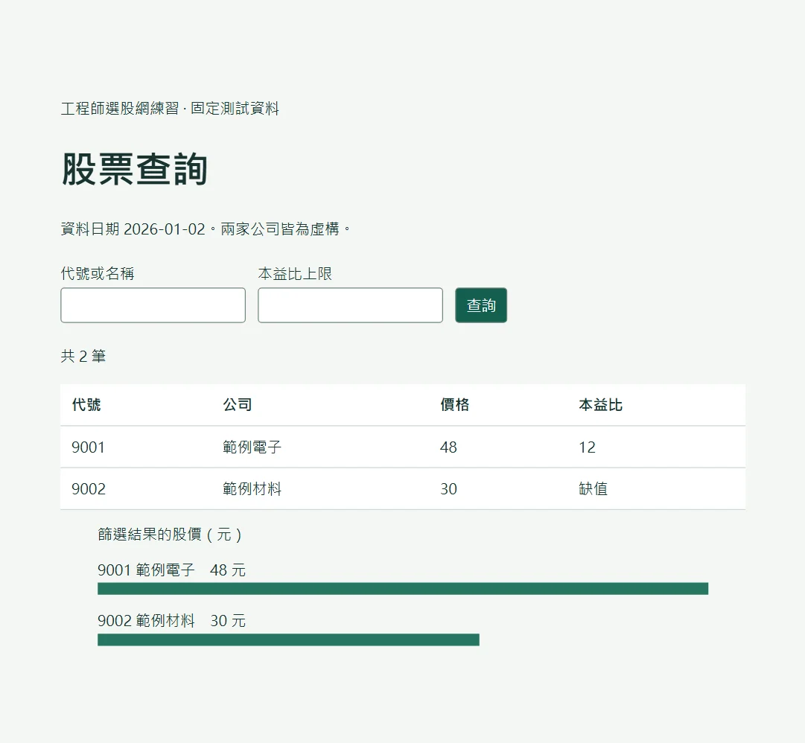

沿用[第一課的公開練習](../../downloads/stock-fixture-lab.zip)。這次把相同的本益比篩選結果同時畫成表格與長條。兩筆固定公司資料，一家本益比是 12，另一家是缺值。這樣能看出條件到底套在哪一層。

## 1. 讓圖表直接吃表格的 rows

新增 `src/app/price-bars.tsx`。所有長條從零開始，共用目前資料的最高價。金額同時顯示成文字，資料筆數為零時回傳提示。這是練習用的收盤價比較圖，不表示股價高低對應報酬或估值高低。

```tsx title="src/app/price-bars.tsx"
import type { Stock } from "@/lib/stock-fixture";

export function PriceBars({ rows }: { rows: Stock[] }) {
  if (!rows.length) return <p>沒有可繪製的公司</p>;
  const max = Math.max(1, ...rows.map(row => row.price));
  return <figure>
    <figcaption>篩選結果的股價（元）</figcaption>
    {rows.map(row => <p key={row.code}>
      <span>{row.code} {row.name}　{row.price} 元</span>
      <span aria-hidden="true" style={{
        display: "block", width: (100 * row.price / max) + "%",
        background: "#267663", height: "0.85rem",
      }} />
    </p>)}
  </figure>;
}
```

## 2. 將它放進真正的查詢頁

在 `src/app/page.tsx` 的 import 區加入 `import { PriceBars } from "./price-bars";`。找到 `</table>`，在下一行、`</main>` 之前加入 `<PriceBars rows={rows} />`。執行 `npm run dev`，開首頁，清空欄位後查詢。9001 的 48 元應比 9002 的 30 元長；兩根的長度比是 48:30。



## 3. 用網址、缺值和空結果驗收

| 操作 | 表格和圖表都應顯示 |
| --- | --- |
| 在原始兩筆資料輸入本益比上限 15 | 只留 9001；9002 的缺值沒有被當成 0 |
| 在「代號或名稱」輸入 `missing` | 表格為 0 筆，圖表位置提示沒有可繪製的公司 |
| 用瀏覽器複製有條件的網址，開新分頁 | 內容和表單條件相同，網址上有 `q`、`per_max` |
| 若已在第一課新增 9003，清空名稱、上限填 15 | 表格和圖各有 9001、9003；分母跟著這組資料的最高價變動 |

最後執行 `npm test`。若 9002 通過本益比篩選，先修 `src/lib/stock-fixture.ts` 的 `stock.pe !== null` 條件。若只有圖多一家公司，檢查是不是把整份 `stocks` 傳給元件。表格和圖都收已經篩過的 `rows`，才不會各寫一套條件。

正式站的歷史走勢使用 ECharts，可以放大日期區間。這課只畫當下篩出的少量公司，Server 直接產生 HTML 就足以驗證查詢和繪圖的接線。[公開成品的圖表](https://engineer-stock-web.vercel.app/)。
