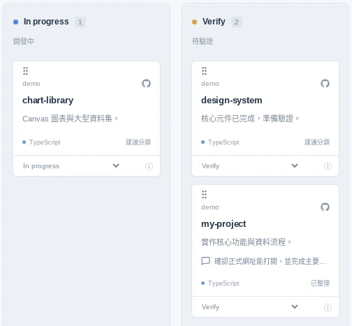

在看板把一張 repo 卡片移到 Verify，重新登入還應該留在 Verify。這個動作要保存的是你對專案的安排。另一位能讀同一個 repo 的人，應該能把自己的卡片留在 Backlog。

| 資料 | 由誰提供 | 哪一端負責 |
| --- | --- | --- |
| repo ID、名稱、是否封存，以及 TODO 文件 | GitHub App 可讀的 repository | Next.js server 呼叫 GitHub API |
| 使用者身分與 session | GitHub 登入與 Better Auth | server 確認請求屬於哪位使用者 |
| 狀態、欄內位置、備註 | 個人的看板 | Neon Postgres 依使用者與 repo ID 保存 |
| 拖曳預覽 | 瀏覽器 | React 和 dnd-kit 先讓卡片跟著操作更新 |

兩個人各自有一張卡，所以表裡的識別條件要包含 `user_id`、`repo_id`。另外，卡片不是 GitHub Issue；調整欄位和排序時程式只需寫自己的資料庫。這讓 GitHub App 的 repository 權限能維持唯讀。

第二篇先在本機寫排序，跑測試覆蓋「兩張卡中間還有被篩選藏起來的卡」。第三篇把同一套程式接上自己的 GitHub App、Neon 與 Vercel。存完重新整理，再從資料庫核對改的是哪一列。
