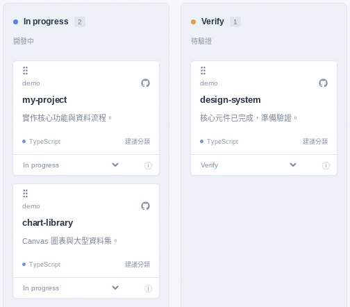

[打開免登入 Demo](https://github-kanban-ntustray.vercel.app/demo)。這次用示範 repo `my-project` 練習把「功能寫完」轉成一個下一次可以接手的驗收動作。畫面上方有「示範模式」提示，重新整理會回到原始卡片。

## 1. 找到還在開發的卡片

在「搜尋 repositories」輸入 `my-project`，看底部數量變成 `1 / 8 repositories`。清空搜尋，`my-project` 和 `chart-library` 都在 **In progress**，右邊的 **Verify** 目前只有 `design-system`。

## 2. 看 TODO，寫一個能驗收的備註

點卡片的 `my-project` 標題。詳細畫面先顯示 `TODO.md`，按上方的 `README.md` 或 `AGENTS.md` 可切換。右側的備註欄填入「確認正式網址能打開，並完成主要流程。」按「儲存修改」，看到「已儲存」再關閉。

## 3. 改欄位，確認移動結果

回到看板，在 `my-project` 卡片底部的狀態選單選 **Verify**。卡片應離開 In progress，出現在 Verify；點開它還能讀到剛存的備註。也可以用卡片上方的「拖曳移動」把手拖過去。

重新整理一次，原始卡片會回到 In progress。Demo 的狀態只在當前頁面。登入後的正式看板會另存狀態、備註和排序，repo 的檔案仍然唯讀。
