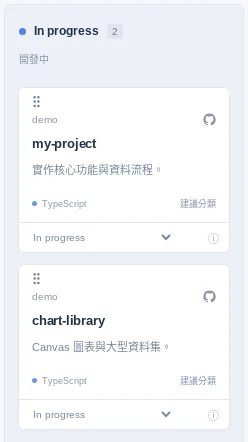
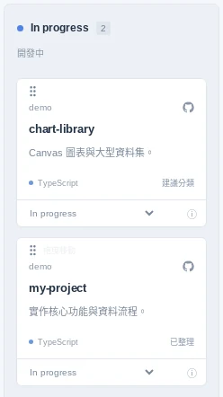

三張可見卡片 A、B、C，B 前面其實還藏著一張被搜尋條件排除的卡。把 C 放到 B 前面，怎麼保住隱藏卡的位置？這次先改排序函式，資料庫和拖曳動畫可以分開驗證。

## 1. 下載專案，先讀一個會算錯的例子

安裝 Node.js 22 以上及 Bun 1.4.4。請在自己的練習目錄執行：

```sh
git clone https://github.com/ntustRay/github-kanban.git
cd github-kanban
bun install --frozen-lockfile
bun test tests/card-order.test.ts
```

打開 `tests/card-order.test.ts`。第一組資料是 `a:0, hidden:10, b:20, c:30`。把 C 拉到 B 前面，C 要插在 10 和 20 之間，所以新位置是 15。若只從畫面拿 A 和 B 計算，中點會變成 10，剛好撞上隱藏卡。



## 2. 在真正的排序入口實作

打開 `src/lib/card-order.ts`。保留檔案原有的 `Card`、`Status` type import 與 `compareCards`，將 `placeCard` 替換成以下寫法。呼叫端已傳入看板的卡片，先排除正在搬的那張，再找目標欄的鄰居。

```ts
export function placeCard(
  cards: Card[],
  activeId: string,
  status: Status,
  overId: string | null,
  after = false,
) {
  const peers = cards.filter(card => card.repoId !== activeId && card.status === status)
    .sort(compareCards);
  const target = peers.findIndex(card => card.repoId === overId);
  const index = target < 0 ? peers.length : target + Number(after);
  const left = peers[index - 1];
  const right = peers[index];

  let position = 0;
  if (left && right) position = left.position + (right.position - left.position) / 2;
  else if (left) position = left.position + 1024;
  else if (right) position = right.position - 1024;
  return { status, position };
}
```

`filter` 先建立新陣列，因此對 `peers` 排序不會重排輸入。空欄第一張放 0，首尾保留 1024 的間距。拖到欄內時使用兩個既有位置的中點，server 收到被移動卡片的新 `status`、`position` 就能寫入。

## 3. 讓測試先指出會壞的位置

暫時讓兩側都有鄰居時回傳 `left.position`，執行 `bun test tests/card-order.test.ts`。上面的案例應從預期 15 變成取得 10。恢復中點公式，再執行以下兩個命令：

```sh
bun test tests/card-order.test.ts
bun run dev
```

開啟 `http://localhost:3000/demo`，用卡片的拖曳把手將同欄的一張卡拉到另一張前方。若游標直接選到 repo 名稱，改抓卡片上緣的把手。這個路徑用示範資料，重整會還原；下一課再接正式寫入。


