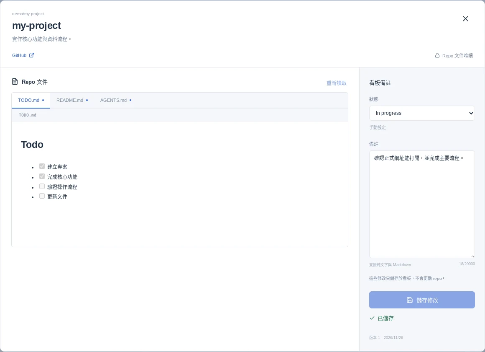

沿用上篇的專案，先推到自己的 GitHub repo，或先 Fork 原專案再把變更推回自己的 fork。這課用一個自有 Neon 測試環境和 GitHub App 完成部署。公開 Demo 不會寫入 Neon，不能拿它驗收資料是否真的有留下來。

## 1. 建 Neon project，取得同一資料庫的兩種連線

在 Neon Console 新建 project，選測試 branch 和資料庫，按 **Connect**。開啟 **Connection pooling** 複製 pooled URL，關閉再複製 direct URL。兩個都包含密碼。下圖用來認控制項；將你自己的值貼到本機設定。


把根目錄的 `.env.example` 複製成 `.env.local`。將 pooled URL 填進 `DATABASE_URL`，把 `BETTER_AUTH_URL` 設為 `http://localhost:3000`。執行以下命令產生 32 bytes 隨機值，複製輸出至 `BETTER_AUTH_SECRET`。環境檔留在自己電腦。

```sh
node -e "console.log(require('node:crypto').randomBytes(32).toString('base64'))"
```

## 2. 建自己的 GitHub App

到 GitHub 個人 **Settings → Developer settings → GitHub Apps → New GitHub App**。填一個尚未被使用的名稱。可先用本機作為開發網址，部署後再建立獨立正式 App 或調整測試 App。

| 欄位 | 本機測試值 |
| --- | --- |
| Homepage URL / Setup URL | `http://localhost:3000` |
| Callback URL | `http://localhost:3000/api/auth/callback/github` |
| Webhook | 取消 Active |
| Repository permissions | Contents 與 Metadata 為 Read-only |
| Account permissions | Email addresses 為 Read-only |

建立後，在 App 設定頁複製 **Client ID**，按 **Generate a new client secret**。將兩者分別存入 `.env.local` 的 `GITHUB_CLIENT_ID`、`GITHUB_CLIENT_SECRET`。把 GitHub App 公開網址 `github.com/apps/` 後方的 slug 填入 `NEXT_PUBLIC_GITHUB_APP_SLUG`。選 **Install App**，先授權自己的一個測試 repo。

## 3. 建表，讓真實帳號的卡片寫入成功

在 `.env.local` 暫時將 `DATABASE_URL` 換成第一步的 **direct** URL。由專案根目錄執行：

```sh
bun run db:migrate
```

看到 `Auth and board schema ready` 後，將 `DATABASE_URL` 改回 **pooled**，執行 `bun run dev`。migration 會先套用 Better Auth 的 schema，再依檔名順序套用 `migrations/*.sql`。這兩種 URL 透過不同連線方式抵達同一個資料庫。

用瀏覽器開 `http://localhost:3000/api/health`，應看到 `database: "ready"`、`github: "configured"`。這個 route 只檢查資料表可查詢以及 Client ID 已設定；接著開首頁、登入、同步，再選測試 repo 寫一條備註。重整後開同一張卡，應能讀回相同文字。



在自己的測試 branch 開 Neon **SQL Editor**，將下方的 `YOUR-OWNER/YOUR-REPO` 改成剛操作的 repository 全名，執行查詢。記下 `version`，再回看板改一次備註並重新查詢。應看到同一列的備註換成新文字，`version` 增加 1。若不同測試帳號都操作過這個 repo，可用剛寫入的備註與時間辨認自己的那列。

```sql
SELECT full_name, status, notes, version, updated_at
FROM board_cards
WHERE full_name = 'YOUR-OWNER/YOUR-REPO'
ORDER BY updated_at DESC;
```

## 4. 將同一專案部署到 Vercel

1. 進 Vercel 的 **Add New → Project**，匯入自己的 repo，Framework Preset 選 **Next.js**，Root Directory 維持 repo 根目錄。`vercel.json` 已指定凍結安裝、型別檢查、測試與 build。


   看左欄 **Import Git Repository**，選自己的看板 repo。原圖右側圈出的是範本。

2. 在 **Environment Variables** 對應填入上方六個必要變數。正式使用時選 Production 的專用 Neon branch，先在該 branch 做同一步 migration。Preview 使用另一個測試 branch 和登入設定。公開變數只有 App slug，密碼與 secret 使用原本的 server 變數名稱。


3. 按 **Deploy**，從專案 Domains 複製分配的穩定網址。將該 origin 填回 Production 的 `BETTER_AUTH_URL`，正式 GitHub App 的 Homepage、Setup URL 和 Callback URL 也改用它，callback 路徑仍為 `/api/auth/callback/github`。若另建 App，同步更新 ID、secret、slug 並安裝到測試 repo。更動 Vercel 變數後執行 **Redeploy**。
4. 在穩定網址分別打開 `/api/health` 和首頁，再完成一次登入、同步、修改、重整。遇到 503 先比對 migration 使用的 branch 和 Vercel 的 branch；登入後沒卡則從 GitHub App 的 installation 核對授權範圍。
