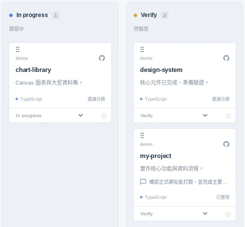

拖曳成功會先在瀏覽器看到新的順序，但正式看板還有兩個條件要滿足：重整能讀回相同狀態，下次 GitHub 同步也不能洗掉你排好的順序。

| 你要驗收哪條路 | 操作 | 可觀察結果 |
| --- | --- | --- |
| React 到 Postgres | 在登入後的看板替測試卡新增備註，重整 | 同張卡還能讀回內容 |
| GitHub 到看板 | 修改狀態後按 repo 同步 | repo metadata 更新，手動狀態與備註仍在 |
| 兩個同時開啟的頁面 | 先開 A、B 兩個分頁，A 儲存後讓尚未重整的 B 改同一張卡 | 若 B 送的是舊 version，Network 回 409；重新讀取可見 A 的修改 |
| 個人看板隔離 | 兩個測試帳號各授權同一個 repo，各寫不同備註 | 各自登入後只看到自己的備註 |

排序只傳一張卡的新位置，減少拖曳時的寫入範圍。代價是不同卡片可能碰巧取到相同中點，現有 comparator 會再以 `fullName` 決定順序。同一張卡的衝突則由 server 鎖住資料列、比對 `version`，通過時在同一筆交易寫入卡片和 activity。把條件寫在 server，關掉某個舊分頁也不會改變資料庫規則。

看完這條路，三種故障各有入口。卡片落點不對，重跑 `tests/card-order.test.ts`。重新整理就消失，檢查看板寫入的回應與 Neon 連線。清單缺特定 repo，先回 GitHub App installation 看授權。這三種問題長得都像「看板有錯」，修的位置卻完全不同。
