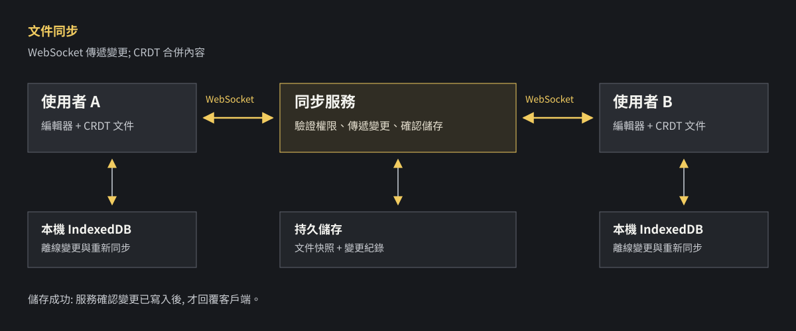

兩個人同時修改一份文件，畫面要即時更新，還要避免其中一人的內容被覆蓋。WebSocket 可以傳資料，但它本身不負責合併衝突；存進資料庫，也不代表斷線期間的修改已經送達。

## 這篇的重點

- WebSocket 傳送變更；CRDT 負責讓收到相同變更的文件副本收斂。
- 離線編輯需要本機保存、重連補送；伺服器寫入成功後，才能回覆「已儲存」。
- 面試時要說明衝突、儲存、權限與驗證方式，不能只列技術名稱。

## 面試題目

設計一個多人線上文件平台。

**練習假設：**

- 同一份文件最多 50 人同時編輯。
- 顯示其他人的游標與線上狀態。
- 可離線編輯，重新連線後同步。
- 文件有檢視與編輯權限。
- 已顯示「伺服器儲存成功」的修改，伺服器重啟後仍可讀取。

這是一道練習題，不宣稱來自特定公司。正式面試時，先確認是否真的需要離線編輯、版本歷史及同時編輯人數；需求不同，設計也會改變。

## 評分標準

以下分數是練習用，不代表所有公司的評分方式。

| 項目 | 分數 | 檢查什麼 |
| --- | ---: | --- |
| 釐清需求 | 15 | 人數、離線、權限、儲存成功的定義 |
| 同步與衝突 | 30 | 如何傳變更、兩人同時修改如何處理 |
| 儲存與復原 | 25 | 斷線、重連、伺服器重啟後如何恢復 |
| 效能與擴充 | 15 | 訊息量、延遲與服務擴充 |
| 權限與測試 | 15 | 禁止未授權編輯，驗證衝突與故障 |

## 很好：85–100 分的回答

> 我會先確認同一份文件的人數、是否要離線編輯，以及「儲存成功」代表什麼。編輯器用 CRDT 保存與合併變更，透過 WebSocket 與同步服務交換。離線變更先留在本機，重連後再補送。伺服器保存變更與快照，寫入成功後才回覆已儲存；游標狀態另外處理。最後會驗證同時修改、重連、服務重啟及權限撤銷。

以下把這段回答拆開。

## 步驟 1：先看資料怎麼走

1. 使用者開啟文件；服務驗證身分和文件權限。
2. 客戶端載入文件，建立 WebSocket 連線。
3. 使用者輸入文字，編輯器產生文件變更。
4. 變更送到同步服務，服務將它傳給同一份文件的其他使用者，並寫入儲存層。
5. 寫入成功後，服務回覆確認；客戶端才能顯示「伺服器已儲存」。

廣播和寫入可以依產品需求設計先後；若先廣播，其他人可能已看見內容，但寫入仍可能失敗。畫面要區分「已同步給其他人」和「已持久保存」。

## 步驟 2：分清 WebSocket 和 CRDT

| 名詞 | 做什麼 | 單靠它還缺什麼 |
| --- | --- | --- |
| WebSocket | 維持瀏覽器與服務之間的雙向連線 | 不決定同時編輯如何合併 |
| CRDT | 規範文件變更如何合併，讓副本在收到所有變更後收斂 | 不負責身分驗證，也不保證資料已存進伺服器 |
| IndexedDB | 在瀏覽器保存資料 | 使用者清除瀏覽器資料或裝置損壞時，尚未同步的內容可能遺失 |
| Snapshot | 某個時間點的文件狀態 | 需要搭配後續變更，才能恢復到較新的狀態 |

[WebSocket](https://developer.mozilla.org/en-US/docs/Web/API/WebSockets_API) 建立後，客戶端和伺服器都可以在同一連線上送訊息。它解決「怎麼送」，不會替文件決定「同時修改時誰保留」。

這裡的 room 是服務端用文件 ID 劃分的邏輯群組，讓同一份文件的使用者收到變更；它不是 WebSocket 協定自帶的權限機制。若需求只要偶爾更新，HTTP 輪詢也能實作，但要取捨更新間隔與重複請求。

### 為什麼不能直接傳整份文件？

假設原文是「你好」：

1. A 在自己的畫面加上 A，得到「你好 A」。
2. B 還沒收到 A 的變更，也加上 B，得到「你好 B」。
3. 兩人先後把整份文件存回伺服器。
4. 如果採用最後寫入的整份文件，較早送達的修改可能被覆蓋。

CRDT 全名是 Conflict-free Replicated Data Type，可理解為一種讓多個副本合併變更的資料結構。系統保存可合併的變更，而不是只比較兩份完整字串。以 [Yjs](https://docs.yjs.dev/api/document-updates) 為例，只要各端最後都收到所有變更，即使收到的順序不同，文件狀態也會收斂。

**收斂不等於完全理解人的意圖。** 一人刪除段落、另一人同時修改該段落，合併後的結果仍需要符合產品規則；像是「這段內容是否應該保留」，不是資料結構自己就能替人判斷。

### 一個可讀的 Yjs 範例

先讓 A 和 B 持有同一份文件，再讓兩人離線修改相同位置。範例只示範合併，不包含 WebSocket、權限或持久儲存。

~~~ts
import * as Y from "yjs";

const a = new Y.Doc();
a.getText("body").insert(0, "你好");

const b = new Y.Doc();
Y.applyUpdate(b, Y.encodeStateAsUpdate(a));

// A、B 在相同位置各自插入文字
a.getText("body").insert(1, "A");
b.getText("body").insert(1, "B");

// 網路恢復後交換變更
const updateA = Y.encodeStateAsUpdate(a);
const updateB = Y.encodeStateAsUpdate(b);
Y.applyUpdate(a, updateB);
Y.applyUpdate(b, updateA);

const textA = a.getText("body").toString();
const textB = b.getText("body").toString();

console.log(textA);
console.log(textB);
console.log(textA === textB); // true
~~~

兩個結果都會保留 A 和 B，並在同步後一致；相同位置的先後排列不應靠這段範例假定。實際服務可以使用 state vector 交換差異，避免每次傳整份狀態。State vector 是用來描述副本已知變更進度的摘要；另一端可用它計算對方還缺哪些變更。

### 一定要用 CRDT 嗎？

不一定。另一種做法是 OT（Operational Transformation）：服務依操作順序轉換衝突操作，再同步給其他客戶端。兩者都需要處理斷線和同步。這題有離線編輯需求，因此示範使用 Yjs；代價是要理解其資料結構、同步方式與儲存成本。

## 步驟 3：斷線後怎麼恢復？

1. 使用者離線後，編輯器仍更新本機文件。
2. 將尚未同步的變更寫入 IndexedDB，畫面顯示「離線／尚未同步」。
3. 重新連線後，重新驗證文件權限。
4. 客戶端與服務比較狀態，補送缺少的變更。
5. 伺服器寫入成功、回覆確認後，畫面更新為「已儲存」。

Yjs 的 [y-indexeddb](https://docs.yjs.dev/getting-started/allowing-offline-editing) 可將共享文件同步到瀏覽器 IndexedDB。本機保存只能保護本機資料仍存在的情況；在尚未同步前清除瀏覽器資料，不能保證內容找回。

如果使用者離線期間被撤銷編輯權限，重連後應拒絕未授權的變更，並告知使用者處理本機內容；不能因為變更存在本機就直接套用。

## 步驟 4：伺服器重啟後怎麼還原？

- **變更紀錄**：每次收到的文件變更，寫入可持久保存的儲存層。
- **快照**：定期保存某個時間點的文件狀態。
- **恢復**：讀取最新有效快照，再套用該快照之後已保存的變更。

切換快照與清理舊紀錄時，要確保期間新增的變更不會被漏掉。儲存確認應在寫入成功後回傳；資料庫本身也需要備份與故障復原。只把變更放在伺服器記憶體，重啟後就無法保證已確認的資料仍在。

游標、線上狀態與文件內容分開處理。游標可以過期或重新取得；文件修改則需要保存。[Yjs Awareness](https://docs.yjs.dev/getting-started/adding-awareness) 也將這類狀態與文件內容分開。

## 步驟 5：人變多時先量什麼？

假設 50 人同時在線，每人平均每秒產生 1 個需要廣播的變更，且每個變更都分別送給另外 49 人：

**50 × 1 × 49 = 每秒 2,450 次送給客戶端的訊息。**

這只是估算：尚未計入游標、封包大小、合併訊息或實際輸入頻率。先量連線數、每秒變更數、送達延遲與儲存延遲，再決定是否需要批次傳送或增加同步服務。

如果同一文件的使用者連到不同服務，可以使用訊息系統轉送變更。但 [Redis Pub/Sub](https://redis.io/docs/latest/develop/pubsub/) 在訂閱端離線時不會重送錯過的訊息，因此不能把它當成唯一的文件保存位置；服務恢復時仍需要從持久儲存補齊。

## 其他等級的回答

### 好：70–84 分

> 我會用 WebSocket 同步變更，用 Yjs 合併，並把文件存在資料庫。

已經分開傳輸與合併，但還要說明離線變更、儲存確認與伺服器重啟。

### 普通：50–69 分

> 我會用 WebSocket 把修改後的文件傳給其他人。

知道需要即時同步，但沒有回答兩人同時編輯、斷線或持久保存。

### 差：0–49 分

> 每次編輯後儲存整份文件，最後寫入的版本為準。

兩人從舊版本同時編輯時，後寫入的整份文件可能覆蓋前一人的修改。

## 驗證與追問

| 情境 | 預期結果 |
| --- | --- |
| 兩人同時修改同一位置 | 收到所有變更後，兩端內容一致 |
| A 離線編輯，B 持續編輯 | A 重連且仍有權限後，雙方完成同步 |
| 伺服器重啟 | 已確認保存的內容可恢復 |
| 離線期間權限被撤銷 | 未授權變更被拒絕，使用者收到提示 |
| 多人快速輸入 | 量測同步延遲、訊息量與儲存延遲 |

**追問：看到其他人的文字，是否表示已儲存？** 不一定。內容可能先被廣播，稍後寫入資料庫才失敗；同步狀態和儲存狀態要分開。

**追問：CRDT 能否避免所有衝突？** 它能依資料結構的規則合併並讓副本收斂，但產品層的編輯意圖、權限與資料保存仍需另行設計。

下一題：[萬人搶票：排隊、庫存與付款怎麼設計？](../interview-ticket-booking-system-design/)
