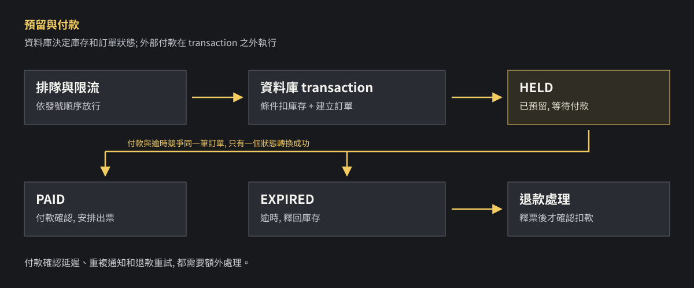

同時有 1 萬人搶 1,000 張票時，問題不只在流量。兩個人可能同時看到最後一張票；付款成功通知也可能在系統釋票後才到。這兩個情境，都需要明確決定誰拿到票、誰需要退款。

## 這篇的重點

- 排隊控制進場流量；庫存是否足夠，仍由資料庫交易決定。
- 條件扣庫存、建立預留訂單與帳號限制要一起成功或失敗。
- 付款通知可能延遲、重複或亂序；逾時釋票與付款確認需要競爭同一筆訂單狀態。

## 面試題目

設計一個線上搶票系統。

**練習假設：**

- 開賣時約有 1 萬人同時進入；共有 1,000 張票。
- 不指定座位，每個帳號最多持有一張有效預留票或已購票。
- 取得預留票後，有 5 分鐘完成付款。
- 不能超賣；重試不能造成重複預留或重複扣款。
- 付款通知可能延遲或重複。

「1 萬人同時進入」不等於「每秒 1 萬次訂票請求」。正式面試要問清楚流量分布、可接受的等待時間、售票公平性及付款方式；以下數字只用來練習。

## 評分標準

以下分數是練習用，不代表所有公司的評分方式。

| 項目 | 分數 | 檢查什麼 |
| --- | ---: | --- |
| 流量處理 | 20 | 排隊、放行速度、系統容量 |
| 庫存正確性 | 30 | 並發扣庫存、訂單與帳號限制 |
| 訂單與付款 | 30 | 重試、逾時、付款通知、退款 |
| 故障與驗證 | 10 | 故障恢復、並發與重複請求測試 |
| 公平與安全 | 10 | 排隊順序、身分驗證、濫用限制 |

## 很好：85–100 分的回答

> 我會先確認票數、同時流量和排隊規則。入口使用 waiting room 控制放行速度；真正能不能買到票，由資料庫 transaction 內的條件扣庫存與訂單建立決定。付款呼叫放在 transaction 外，用 idempotency key 和付款紀錄處理重試。付款確認與逾時釋票競爭同一筆訂單狀態；若釋票後才確認扣款，要建立可重試的退款與對帳流程。

## 步驟 1：先分清排隊和拿到票

1. 使用者登入並進入 waiting room。
2. 排隊服務發號，依產品定義的規則放行。
3. 訂單服務嘗試預留票券；成功才建立待付款訂單。
4. 使用者付款，系統確認付款後安排出票。
5. 超過期限仍未確認付款，釋出票券。

**拿到排隊號碼不代表拿到票。** 放行後仍要檢查庫存；前端看到的剩餘票數也可能已經過期。

排隊服務可以依發號順序放行，但這裡的「先後」指服務成功發號的順序；網路延遲不同，無法直接等同於每個人按下按鈕的真實時間。是否在開賣前先收集使用者、再隨機排序，是另一項產品規則。

同一帳號重新整理時，可以用可驗證的排隊憑證找回原位置；排隊狀態也需要可恢復的儲存機制，避免服務重啟後所有人重新排隊。憑證期限、帳號限制與濫用防護要一起設計。

### 排隊速度怎麼估？

假設負載測試後，系統能穩定處理每秒 200 次預留嘗試；若要依序處理 10,000 次：

**10,000 ÷ 200 = 約 50 秒。**

這是簡化試算，假設處理速度穩定，沒有計入重試、失敗和其他等待。若票提早售完，後續請求可提前收到售完結果；反過來說，若資料庫撐不住每秒 200 次，也不能承諾 50 秒。付款流程不應一直占用資料庫 transaction。

## 步驟 2：為什麼先查票數再扣票會超賣？

假設只剩 1 張票，兩個請求同時進來：

| 時間 | 使用者 A | 使用者 B |
| --- | --- | --- |
| 1 | 查到剩 1 張 | 查到剩 1 張 |
| 2 | 建立訂單 | 建立訂單 |
| 3 | 把庫存改成 0 | 也把庫存改成 0 |

資料庫最後顯示 0，但如果兩筆訂單都成功，就已經賣出 2 張。這稱為 **race condition**：結果受到多個操作交錯順序影響。

### 條件扣庫存

以 PostgreSQL 為例，可以把「有票嗎」和「扣一張」放在同一個更新操作：

~~~sql
UPDATE ticket_inventory
SET available = available - 1
WHERE event_id = $1
  AND available > 0
RETURNING available;
~~~

- 有回傳一筆：本次扣庫存成功。
- 沒有回傳：可能已售完，也可能活動不存在，需要依資料模型區分。
- 所有扣庫存路徑都必須遵守相同規則；不能另有流程繞過檢查。

在 PostgreSQL 預設的 Read Committed 隔離等級下，若其他 transaction 正在更新同一列，後續更新會等待；前一個交易提交後，資料庫會重新檢查條件。因此，最後一張票扣掉後，另一個更新不會再符合「庫存大於 0」。不同隔離等級仍要處理可能的交易重試。[PostgreSQL 文件](https://www.postgresql.org/docs/current/transaction-iso.html)有說明這個行為。

### Transaction 是什麼？

Transaction 將多個資料庫操作視為一組：全部成功才提交；中途失敗就回滾。這題的預留流程至少需要：

1. 驗證同一帳號是否已有有效預留或已購票，並由資料庫限制並發重複建立。
2. 執行條件扣庫存。
3. 建立狀態為 HELD 的預留訂單，記錄到期時間。
4. 全部成功才 commit；任一步失敗就 rollback。

「建立訂單」和「扣庫存」必須在同一個 transaction；否則扣完票後建立訂單失敗，就會留下沒有訂單的庫存減少。**Transaction 本身不會自動替你設計正確的庫存條件或唯一限制。**

「同一帳號一張票」也不能只靠先查一次。兩個請求可能同時查到沒有訂單。PostgreSQL 可考慮使用 [partial unique index](https://www.postgresql.org/docs/current/indexes-partial.html)，對同一活動、同一帳號的 HELD／PAID 訂單建立唯一限制；已轉成 EXPIRED 的舊訂單仍可保留。實際索引與失敗重試要配合資料模型。

## 步驟 3：同一個請求重送，怎麼避免重複處理？

使用者按下購買後，可能發生：

1. 伺服器其實已經建立訂單。
2. 回應在網路途中遺失。
3. 使用者以為失敗，再按一次。

**Idempotency key** 是替「同一次操作」附上的識別值。系統看到相同使用者和相同 key 的重試時，應辨認原操作並回傳原結果，而不是再扣一次庫存。同一個 key 帶不同請求內容時，應拒絕或依介面規則處理。

付款請求也要保存本系統訂單與金流交易的對應，依金流規格使用 idempotency key 重試。以 [Stripe API](https://docs.stripe.com/api/idempotent_requests) 為例，相同 key 的重試有既定規則，但 key 有保存期限與參數限制；不能只靠一個 key 假定所有跨系統故障都自動解決。付款狀態不明時，還需要查詢金流與對帳。

## 步驟 4：付款與逾時同時發生怎麼辦？

訂單先有三個狀態：

| 狀態 | 意思 |
| --- | --- |
| HELD | 已扣庫存並預留，等待付款 |
| PAID | 已確認付款，安排出票 |
| EXPIRED | 預留逾時，已釋回庫存 |

付款確認和逾時釋票，可能同時處理同一筆 HELD 訂單。兩個流程都必須在資料庫 transaction 中鎖定或以條件更新同一筆訂單：

- 付款流程：確認仍為 HELD 且符合期限，才轉為 PAID。
- 逾時流程：確認仍為 HELD 且已到期，才轉為 EXPIRED，並在同一 transaction 釋回庫存。
- 只有成功轉換狀態的流程能繼續；重複執行不能再釋票一次。

例如，逾時流程先成功改成 EXPIRED 並釋票，晚到的付款確認就不能再把它當作正常成交；需要確認是否真的扣款，若已扣款則建立退款工作並對帳。

### 付款明明及時，通知卻太晚呢？

這是需要產品決定的規則。此練習採用：**付款確認必須在期限內完成訂單狀態更新**。如果金流實際已扣款，但確認太晚，可能退款，即使使用者覺得自己按得夠早。

另一種做法是設計確認寬限期、與金流查詢狀態後再釋票；這會讓庫存占用更久，也要處理金流查詢失敗。選哪一種，要先和產品及金流服務確認，不能只說「付款成功就好」。

## 步驟 5：付款通知可能重複，也可能亂序

Webhook 是金流服務主動呼叫我們提供的網址，通知付款狀態。以 [Stripe 文件](https://docs.stripe.com/webhooks)為例，事件可能重複送達，也不保證依產生順序到達。

處理時需要：

1. 驗證 webhook 簽章，確認來源與內容未被竄改。
2. 持久保存事件與處理狀態，依事件 ID 及付款物件狀態避免重複處理。
3. 在資料庫 transaction 內更新訂單；付款是否成功以金流的可信狀態為準。
4. 釋票後才確認扣款時，建立退款紀錄與可重試工作；退款 API 也要避免重複呼叫造成重複退款。
5. 對付款中、退款中或狀態不明的訂單持續對帳，失敗時告警並安排人工處理。

不要只相信使用者瀏覽器跳轉到「付款成功」頁面：使用者可能關閉頁面，前端資料也可能被修改。也不要把外部金流呼叫放進長時間開啟的資料庫 transaction，避免長時間占用鎖。

更新訂單後，系統也可能在送出出票或退款工作之前當機。一種做法是 transactional outbox：在更新訂單的同一個 transaction 寫入待處理工作，再由背景程序讀取、執行及重試。背景工作仍可能被重複執行，所以出票與退款也需要自己的防重複規則。

## 步驟 6：排隊和資料庫怎麼擴充？

先量排隊長度、預留成功／失敗率、資料庫鎖等待、付款確認延遲及逾時率。持續流量高於處理速度時，排隊會越來越長，需要減少放行或回覆系統繁忙。

同一活動只用一列庫存時，該列可能成為競爭點。先用符合情境的負載測試找出瓶頸；如果真的需要拆分庫存，要重新設計每個分區的配額、回收與總量一致性，不能只增加伺服器就假設不會超賣。

## 其他等級的回答

### 好：70–84 分

> 用 waiting room 控制流量，再用資料庫 transaction 扣庫存、建立訂單；逾時釋票。

掌握流量和庫存，但還要說明重複請求、付款通知延遲，以及付款和釋票互相競爭時怎麼處理。

### 普通：50–69 分

> 先查剩餘票數，有票就建立訂單並扣庫存。

知道要檢查庫存，但兩個請求可能同時查到最後一張票。

### 差：0–49 分

> 增加伺服器，讓所有人同時送出訂單。

增加服務數量可能提升入口容量，卻沒有處理同一張票被多人同時購買。

## 驗證與追問

| 測試 | 預期結果 |
| --- | --- |
| 1 萬人同時搶 1,000 張 | 已付款與仍占庫存的預留總數不超過 1,000 |
| 同帳號同時送出多個請求 | 最多建立一筆有效預留或已購票 |
| 重送相同訂票請求 | 不重複扣庫存 |
| 重送付款通知 | 不重複更新訂單或出票 |
| 付款確認與逾時同時執行 | 只有一個訂單狀態轉換成功 |
| 已釋票後才確認扣款 | 不再發票；建立退款與對帳工作 |

以上是設計驗收條件，並非本文已完成的壓力測試或金流驗證。

**追問：Redis 能不能處理庫存？** 可以設計以 Redis 原子操作管理庫存的方案，但還要解決 Redis 與訂單資料庫之間的故障恢復、一致性與對帳。這題先讓資料庫作為庫存依據，較容易說清楚正確性；是否需要改變架構，應由測量結果決定。

上一篇：[多人共編文件：同步、衝突與離線復原](../interview-collaborative-document-system/)。
