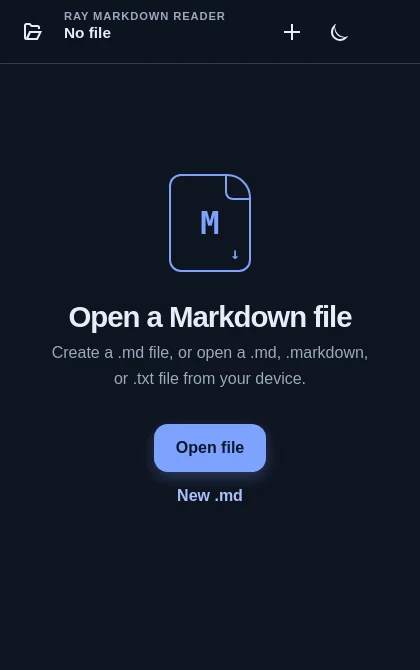

把一份 `trip.md` 打開，加上一行行程再切換預覽，新增的字已經看得見。此時檔案提供者可能還沒收到任何寫入要求。要讓「離開前要不要存檔」有可靠的答案，程式得同時知道上次成功保存的內容與這次正在編輯的內容。

## 先決定什麼算改過

設原檔只有 `# Trip`。使用者先補上 ` notes`，再按退格鍵全部刪掉，最後又只剩 `# Trip`。若每次 keypress 都設 `dirty = true`，這時仍會要求存檔。專案把已存的 `savedContent` 與草稿 `draftContent` 放在同一個 `DocumentFile` 裡，只有兩者不同時才出現未儲存提示。檔案識別、原始換行格式與 UTF-8 BOM 也跟著這份文件保存。

| 程式位置 | 責任 |
| --- | --- |
| `src/domain/Document.ts` | 把位元組還原成可編輯文字，寫回前恢復換行格式與 BOM |
| `src/services/FileService.ts` | 保留目前文件，根據 URI 選擇讀寫方法，接收成功或失敗的結果 |
| `src/app.ts` | 處理 Save、離開前確認、錯誤訊息與切換預覽 |
| `src/services/MarkdownService.ts` | 把目前草稿渲染成預覽 HTML |

桌面通常交給 Tauri 的 dialog 與 fs plugin。Android 的系統選檔器可能回傳 `content://` URI，底下由文件提供者讀寫。這個 URI 要原樣帶回原生端，不應自行拼成磁碟路徑。這個範例的資料留在使用者選取的檔案內，因此不需要註冊會員或建立資料庫。

第二篇會從公開版程式開始，自己接好 Save 的寫入順序，讓失敗保留草稿，再用自動化測試核對。第三篇會把瀏覽器測試和 Android 真機分開驗收。

[下一篇：實作安全存檔與草稿保留](../markdown-reader-02-edit-save-reopen/)
