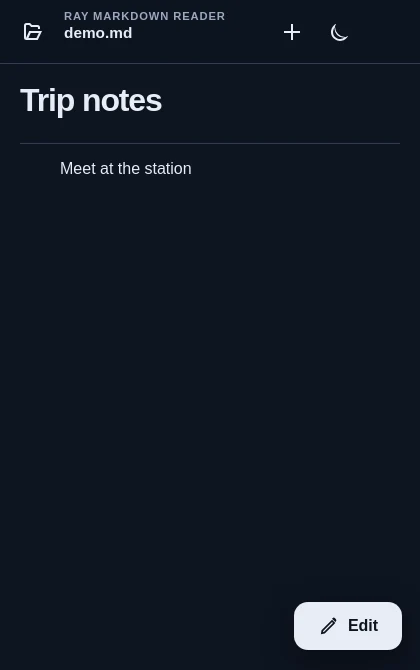
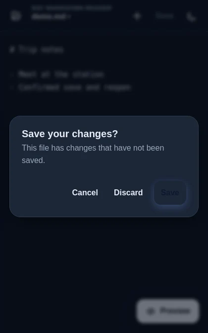
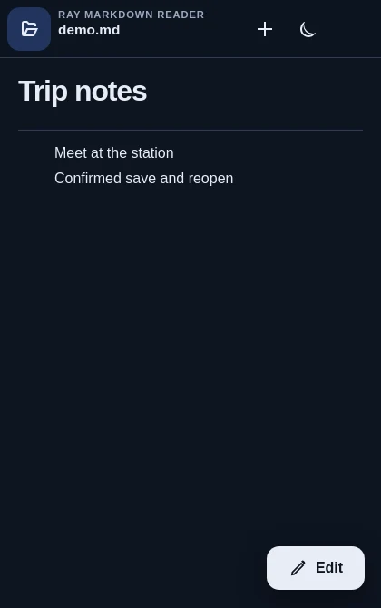

準備一台已安裝 Ray Markdown Reader 測試版的 Android 裝置，以及一份可覆寫的 `demo.md`。需要從原始碼建置時，先完成[專案的 Android 工具鏈與測試版步驟](https://github.com/ntustRay/markdown-file-reader/blob/master/docs/GOOGLE_PLAY_RELEASE_HANDOFF.md)。以下按鈕使用英文介面，截圖是 v1.1.0 前端在 Chromium 手機尺寸下執行的畫面，原生選檔與寫入用測試資料模擬。

## 1. 選 demo.md 並核對預覽

在 Android 的 Downloads 放入一份 UTF-8 檔案 `demo.md`。先貼入這段範例。

```markdown
# Trip notes

- Meet at the station
```

打開 App，按 **Open file**，在系統選檔器選到 Downloads 裡的 `demo.md`。預覽應顯示 **Trip notes** 標題與第一個列表項目。



## 2. 在 Edit 加一行

按 **Edit**，在原來的列表底下加入一行 `- Confirmed save and reopen`。檔名旁出現圓點，表示目前有尚未保存的編輯。切回預覽可先確認列表的格式。


## 3. 測一次取消切換

先保留草稿，按左上角的資料夾圖示 **Open file**。看到未保存變更的對話框後，按 **Cancel**。App 會留在 `demo.md`，剛加的那一行仍應保留。



## 4. 保存，然後重新從檔案來源開啟

按 **Save**，等檔名旁的圓點消失。再用 **Open file**，回到同一個 Downloads 路徑，選同一份 `demo.md`。在預覽確認列表仍有 **Confirmed save and reopen**。如需再核對一次，可以從 Android 檔案工具用另一個能讀 Markdown 的工具開同一份檔。



若顯示保存失敗，先留在編輯畫面保住草稿。可換到確定可寫的測試檔，從步驟 1 重試。要練習新建文件，按 **New .md**，用系統選檔器指定新的名稱和位置。
