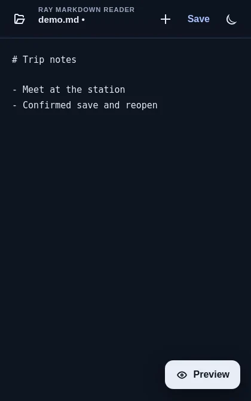
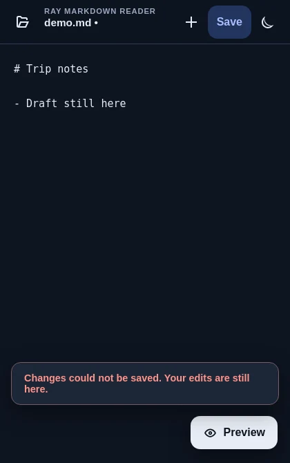

這篇要接的是 Save 按鈕底下的一段程式。先看目標畫面：檔名旁的圓點表示有改動，能不能把它消掉，取決於底下的檔案服務是否寫入成功。



[下載寫入失敗與重試的 Vitest 測試（ZIP）](../../downloads/series-labs/markdown-reader.zip)。把 ZIP 裡的 `tests` 放到第一步取得的專案根目錄，就能用第三步的指令跑同一組案例。

## 1. 從可以執行的專案開始

使用 Node.js 24、npm 與 Git。先下載本課程對照的版本，保留原有的 Tauri adapter 與 UI；這樣可以集中在一次寫入如何影響草稿狀態。

```sh
git clone https://github.com/ntustRay/markdown-file-reader.git
cd markdown-file-reader
git checkout 1447c5f9176bd23de64705f76c7d2336d0e7c7eb
npm ci
npx vitest run tests/unit/Document.test.ts
```

打開 `src/domain/Document.ts`。`decodeDocument` 建立 `savedContent` 與 `draftContent`；`serializeDocument` 把草稿轉回檔案要的 UTF-8 位元組。兩者已經能處理換行與 BOM，寫 Save 的時候直接呼叫它們。

## 2. 在 FileService 接上寫入

在 `src/services/FileService.ts` 的 `FileService` 類別中，將既有的 `saveDocument` 方法換成下面這段。檔案上方原有的 imports、Android bridge 與 `updateDraft` 都沿用。

```ts
async saveDocument(): Promise<DocumentFile> {
  if (this.currentDocument === null) {
    throw new Error('No document is open.');
  }

  const snapshot = this.currentDocument;
  const generation = this.documentGeneration;
  const bytes = serializeDocument(snapshot);

  if (isAndroidContentUri(snapshot.uri)) {
    await writeAndroidContentUri(snapshot.uri, bytes);
  } else {
    await writeFile(snapshot.uri, bytes);
  }

  if (generation !== this.documentGeneration) {
    return { ...snapshot, savedContent: snapshot.draftContent };
  }

  this.currentDocument = {
    ...this.currentDocument,
    savedContent: snapshot.draftContent,
  };
  return this.currentDocument;
}
```

例如按 Save 時是 `版本 A`，等待原生端寫入期間又打成 `版本 B`。完成時，磁碟上有 A，畫面上的草稿仍是 B。展開最新的 `this.currentDocument` 再只更新 `savedContent` 才能保留這個差異。`generation` 處理另一個情況：寫入途中如果已經換檔，舊檔的回覆不能修改新檔狀態。

## 3. 用失敗後再重試的測試驗收

新增 `tests/unit/LessonSave.test.ts`。用測試資料替代桌面磁碟，讓第一次寫入失敗，第二次成功。兩次都針對同一份文件。

```ts
import { expect, it, vi } from 'vitest';
import { open } from '@tauri-apps/plugin-dialog';
import { readFile, size, writeFile } from '@tauri-apps/plugin-fs';
import { FileService } from '../../src/services/FileService';

vi.mock('@tauri-apps/plugin-dialog');
vi.mock('@tauri-apps/plugin-fs');

it('keeps the draft after a write error and saves the retry', async () => {
  vi.mocked(open).mockResolvedValue('demo.md');
  vi.mocked(size).mockResolvedValue(0);
  vi.mocked(readFile).mockResolvedValue(new Uint8Array());
  vi.mocked(writeFile)
    .mockRejectedValueOnce(new Error('read only'))
    .mockResolvedValueOnce(undefined);

  const service = new FileService();
  await service.openDocument();
  service.updateDraft('# Trip notes');
  await expect(service.saveDocument()).rejects.toThrow('read only');
  expect(service.getCurrentDocument()).toMatchObject({
    savedContent: '', draftContent: '# Trip notes',
  });

  await expect(service.saveDocument()).resolves.toMatchObject({
    savedContent: '# Trip notes', draftContent: '# Trip notes',
  });
  expect(writeFile).toHaveBeenLastCalledWith(
    'demo.md', new TextEncoder().encode('# Trip notes'),
  );
});
```

執行 `npx vitest run tests/unit/LessonSave.test.ts tests/unit/FileService.test.ts`。如果第一次失敗後 `savedContent` 已經被改掉，先檢查狀態更新是否誤放在 `await` 之前。UI 會繼續顯示離開確認，讓使用者留在同一份草稿重試。

用相同錯誤在前端重現時，先看畫面底部的存檔失敗訊息，再確認剛輸入的字還在。




## 4. 在前端重跑一次 Save

`src/app.ts` 已經在 Save 事件中等待 `fileService.saveDocument()`。執行下列指令，讓 Playwright 在 Chromium 裡操作新版方法。專案這個版本的 Playwright 設定用 Windows 的 `npm.cmd run dev` 啟動前端；macOS 或 Linux 先把 `playwright.config.ts` 的 `webServer.command` 改成 `npm run dev`。

```sh
npx playwright install chromium
npx playwright test tests/e2e/document-workflow.spec.ts --headed
```

觀察建立文件、打入 Unicode、預覽、Save 後重開的案例。想單獨看這條路徑，可以在上一行的 test 指令後加 `-g "creates, edits, previews, saves and reopens"`。測試中的 Android bridge 使用記憶體裡的檔案資料；它驗證前端如何處理原生回覆。直接開啟 Vite 網址時，普通瀏覽器沒有 Tauri bridge，所以請從 Playwright 啟動練習。下圖是同一版前端在 Chromium 手機尺寸下的紀錄。


## 5. 在 Android 上接到真正的檔案

若要用手機驗證剛寫的 Save，先依[這個版本的建置說明](https://github.com/ntustRay/markdown-file-reader/blob/1447c5f9176bd23de64705f76c7d2336d0e7c7eb/docs/GOOGLE_PLAY_RELEASE_HANDOFF.md)裝 Android SDK Platform 36、Platform-Tools、Build-Tools、Command-line Tools 和 NDK，設定 `JAVA_HOME`、`ANDROID_HOME` 與 `NDK_HOME`。在 Android 手機開啟 USB 偵錯，接上電腦，於手機允許這台電腦偵錯。

回教學專案根目錄執行。第一行要看到裝置序號與 `device`；若顯示 `unauthorized`，解鎖手機確認授權再試。

```sh
adb devices
rustup target add aarch64-linux-android armv7-linux-androideabi i686-linux-android x86_64-linux-android
```

若目前沒有 `src-tauri/gen/android/`，先執行一次 `npm run tauri -- android init`。接著執行 `npm run tauri -- android dev`，選剛確認的手機，等 debug 版安裝並打開。停止先前自己開的 Vite，讓 Tauri 啟動專案指定的 1420 埠。[Tauri 行動裝置開發說明](https://v2.tauri.app/develop/#developing-your-mobile-application)

用另一個編輯器在手機的 Downloads 建立可覆寫的 `trip.md`。回 App 用系統選檔器開它，補一行今天的日期並 Save，再用原編輯器重開同一份檔案。看到該行，才驗到這次寫入確實穿過 Android 的文件提供者。

[下一篇：重開同一份文件，驗證原生存檔](../markdown-reader-03-save-verification/)
