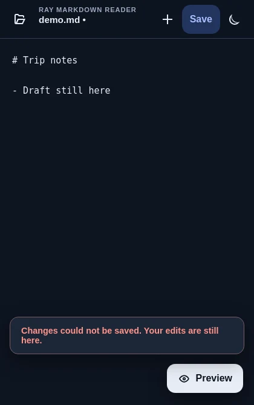

上一回把 `saveDocument` 接到真正的 I/O 邊界。Preview 已經顯示新內容，只能說 Markdown 渲染器收到了草稿；要確認使用者關掉 App 還能找回剛改的字，得重新從原來的文件提供者讀一次。

## 現在有三個地方能驗收

| 想確認什麼 | 如何重現 | 成功的判斷 |
| --- | --- | --- |
| 文字進出後保持格式 | 在 `tests/unit/Document.test.ts` 使用帶 BOM、CRLF 的 UTF-8 文件 | 讀進來可以編輯，序列化後還原原有格式 |
| 點 Save 後仍可繼續打字 | 執行 `document-workflow.spec.ts` 中 typing while saving 案例 | 已寫成功的版本和目前草稿分開，後打的字仍顯示未存 |
| 寫入失敗是否丟掉草稿 | 在第二篇的測試中讓第一次 `writeFile` 拒絕，再重試 | 第一次保留文字與未存標記，第二次成功後才清除 |
| 寫回相同 Android 文件 | 在真機透過系統選檔器開一份可覆寫的測試檔，寫入帶日期的一行、Save、離開，從原提供者再選同一份檔案 | 重開能讀到該行；也可用第二個編輯器獨立讀回 |

## 交付 Android 要多驗哪一步？

依專案的 Android 建置說明準備 Android Studio、SDK、NDK 與 Rust target，取得測試版；連接測試機後確認系統選檔器能選取檔案。相同 URI 的寫入行為取決於文件提供者與取得的權限，因此用 Downloads 的可覆寫測試檔完成一次，再依實際支援範圍重做雲端提供者或唯讀情境。瀏覽器截圖無法證明這幾條原生路徑。

如果重開少了一行，先找 `savedContent` 是否在寫入完成前被更新，再查 `FileService` 傳給原生端的 URI 與 bytes，最後比對原提供者保存的檔案。從這個順序查，就能把預覽渲染、非同步狀態與文件權限分開。

[回到實作：把 Save 接到 Tauri](../markdown-reader-02-edit-save-reopen/)
