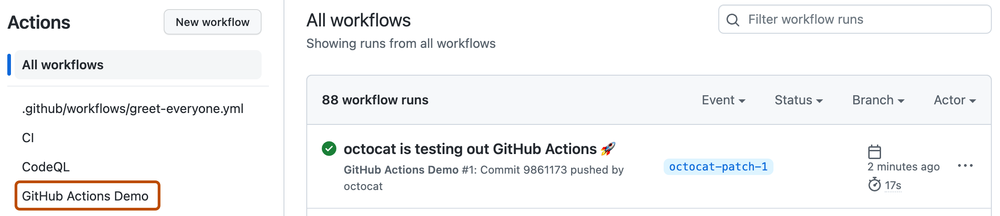

完成後，你會有 `/series-workshop/`、`/series-workshop/posts/local/` 和 `/series-workshop/posts/publish/` 三個網址。下面是獨立練習，沿用 MR Coding 的建置方式，把內容縮成兩篇。

[下載這一課的完整 Astro 專案（ZIP）](../../downloads/series-labs/mr-coding.zip)。想先看成果，可以解壓到空目錄，在 `package.json` 旁執行 `npm install`、`npm run dev`，再開啟終端機顯示的 `/series-workshop/`。

## 1. 建立空站

安裝 Node.js 24 與 Git，在終端機執行以下指令。之後提到的檔案都放在 `series-workshop`，中間的資料夾用編輯器建立。

```sh
mkdir series-workshop
cd series-workshop
npm init -y
npm pkg set type=module scripts.dev="astro dev" scripts.build="astro build" scripts.preview="astro preview"
npm install --save-exact astro@7.4.12
```

建立 `astro.config.mjs`。Pages 的專案網站放在 repository 同名的子目錄，這裡先約定 GitHub 專案也叫 `series-workshop`。

```js
import { defineConfig } from 'astro/config';

export default defineConfig({ base: '/series-workshop', trailingSlash: 'always' });
```

## 2. 用兩篇 Markdown 定義章節

新增 `src/content.config.ts`。loader 讀取指定目錄，schema 讓拼錯、漏填或寫成字串的章節序號在建置時被攔下來。

```ts
import { defineCollection } from 'astro:content';
import { glob } from 'astro/loaders';
import { z } from 'astro/zod';

const lessons = defineCollection({
  loader: glob({ base: './src/lessons', pattern: '*.md' }),
  schema: z.object({ title: z.string(), seriesOrder: z.number().int().positive() }),
});

export const collections = { lessons };
```

建立 `src/lessons/local.md`。

```markdown
---
title: 在本機預覽
seriesOrder: 1
---

執行 `npm run dev`，在瀏覽器開啟系列首頁。
```

再建立 `src/lessons/publish.md`。

```markdown
---
title: 發到 GitHub Pages
seriesOrder: 2
---

先建置 HTML，再把產物交給 GitHub Pages。
```

## 3. 產生目錄與文章 HTML

建立 `src/pages/index.astro`。Astro 在建置期間執行兩條 `---` 中間的程式，頁面收到的是排好序的內容。整理 `BASE_URL` 最後的斜線，可以讓本機與 Pages 用同一段連結。

```astro
---
import { getCollection } from 'astro:content';
const chapters = (await getCollection('lessons'))
  .sort((a, b) => a.data.seriesOrder - b.data.seriesOrder);
const base = import.meta.env.BASE_URL.replace(/\/?$/, '/');
---
<html lang="zh-Hant">
  <head><meta charset="utf-8" /><title>Astro 部落格實作</title></head>
  <body>
    <h1>Astro 部落格實作</h1>
    <ol>{chapters.map(({ id, data }) => (
      <li><a href={`${base}posts/${id}/`}>{data.title}</a></li>
    ))}</ol>
  </body>
</html>
```

建立 `src/pages/posts/[id].astro`，檔名要保留中括號。`getStaticPaths()` 告訴 Astro 要產生哪些網址，`render()` 把對應 Markdown 顯示成 HTML。

```astro
---
import { getCollection, render } from 'astro:content';

export async function getStaticPaths() {
  return (await getCollection('lessons')).map((entry) => ({
    params: { id: entry.id }, props: { entry },
  }));
}
const { entry } = Astro.props;
const { Content } = await render(entry);
---
<html lang="zh-Hant">
  <head><meta charset="utf-8" /><title>{entry.data.title}</title></head>
  <body><a href={import.meta.env.BASE_URL}>回系列目錄</a>
    <h1>{entry.data.title}</h1><Content />
  </body>
</html>
```

執行 `npm run dev`。在瀏覽器開啟 `http://localhost:4321/series-workshop/`，若終端機顯示其他埠號就換成該數字。點第二篇，再點「回系列目錄」。回到編輯器，把兩個序號互換並重新整理。兩個標題會交換位置，兩篇文章的網址仍然相同。驗完把序號改回原值。


點入第二篇後，核對標題和「回系列目錄」連結。若出現 404，回首頁查看連結前面是否有 `/series-workshop/`。


## 4. 在推送前確認建置結果

在另一個終端機進入同一個目錄，執行以下指令。第二行應該印出三個 `true`。若只產生首頁，先檢查文章路由資料夾、loader 路徑和兩個 Markdown 副檔名。

```sh
npm run build
node -e "const fs=require('node:fs'); for (const p of ['index','posts/local/index','posts/publish/index']) console.log(p,fs.existsSync('dist/'+p+'.html'))"
```

## 5. 部署到自己的 GitHub Pages

1. 在 GitHub 建立 public repository `series-workshop`，保留空白，再到 **Settings → Pages → Build and deployment → Source** 選 **GitHub Actions**。
2. 在本機專案根目錄加上 `.gitignore`，每行分別寫入 `node_modules/`、`dist/`、`.astro/`。新增 `.github/workflows/pages.yml`，貼入下方 workflow。

```yaml
name: Publish series
on:
  push:
    branches: [main]
  workflow_dispatch:
permissions:
  contents: read
  pages: write
  id-token: write
jobs:
  build:
    runs-on: ubuntu-latest
    steps:
      - uses: actions/checkout@v7
      - uses: withastro/action@v6
        with:
          node-version: 24
          package-manager: npm@latest
  deploy:
    needs: build
    runs-on: ubuntu-latest
    environment:
      name: github-pages
      url: ${{ steps.site.outputs.page_url }}
    steps:
      - name: Publish
        id: site
        uses: actions/deploy-pages@v5
```

3. 在專案根目錄執行下列指令，把 `YOUR_ACCOUNT` 換成你的 GitHub 帳號。保留 `package-lock.json`，讓 Actions 使用相同依賴。

```sh
git init -b main
git add .
git commit -m "Build two Astro lessons"
git remote add origin https://github.com/YOUR_ACCOUNT/series-workshop.git
git push -u origin main
```

4. 到 **Actions → Publish series** 打開本次執行，確認 `build`、`deploy` 依序成功。打開 `deploy` 顯示的網站，再從目錄點入第二篇。下圖是 GitHub 官方操作介面，run 的名稱以你的 workflow 為準。



如果首頁成功、點第二篇卻 404，對照網址是否含 `/series-workshop/`。若 `deploy` 本身失敗，先回 Settings 確認 Source，並打開失敗的 job 看訊息。這兩個錯誤發生在不同步驟。
