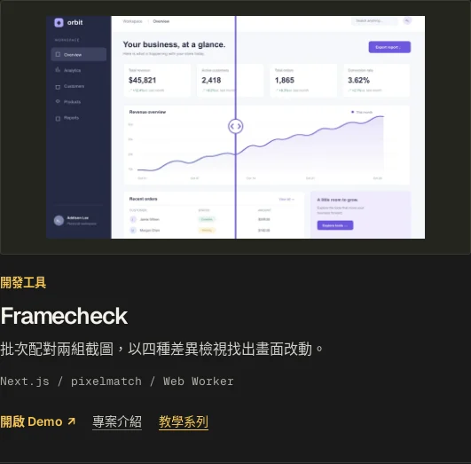
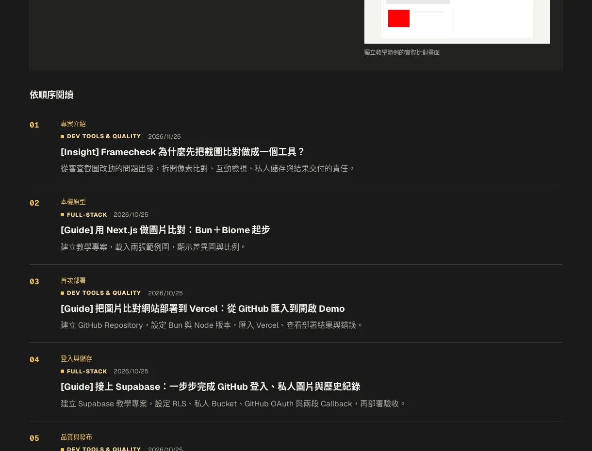

1. 在 [MR Coding](https://ntustray.github.io/mr-blog/)上方點 **Projects**。找到 **Framecheck**。從卡片點「開啟 Demo」可以用公開範例比對兩張圖。回到原頁，再點同張卡片的「教學系列」。

2. 在[系列頁](../../series/visual-regression/)先看介紹。要開始動手時，打開「本機原型」那篇。先看支援的環境和要完成的畫面，再往下做。系列頁可開產品介紹，也提供獨立教學程式下載。

3. 做完第一個例子後，用文章底部的系列導覽開下一篇。如果只想找同一種技術，改用頂端 **Search** 輸入 `Web Worker`。想按分類瀏覽就開 **Topics**，若記得發布時間則去 **Archive**。

先在公開 Demo 看圖怎麼比，再用教學程式重做一次。兩個入口各存一個書籤，回頭找畫面和程式時比較快。
