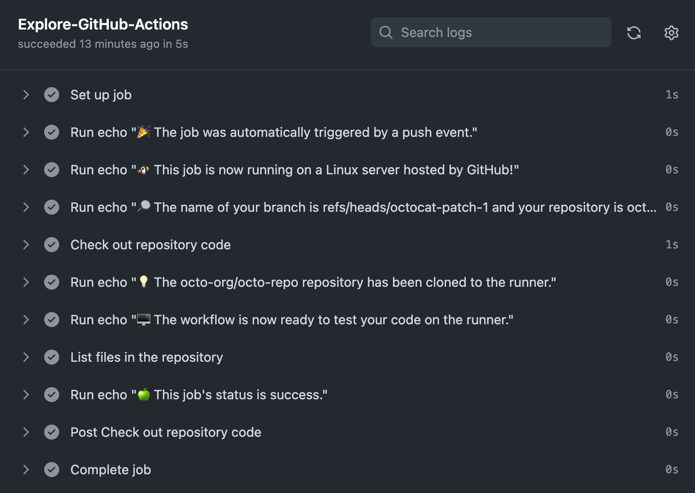

上一章完成的小站，可以用三個 HTML 檔交付。正式的 MR Coding 又多了系列、分類和全文搜尋。如果部署後有人說「找不到這篇」，先跟他確認從哪個入口進站，以及最後打開的網址。這比重新推一次全部檔案更容易定位問題。

| 看到的結果 | 先檢查 | 可以排除什麼 |
| --- | --- | --- |
| 目錄排錯，直開文章正常 | 兩篇的 `seriesOrder`，以及呼叫排序的那一頁 | 文章 HTML 已經存在 |
| 開發時能讀文章，部署後回 404 | 建置結果是否有 `dist/posts/<id>/index.html`，連結是否含 repository 前綴 | 可區分缺 HTML 和指錯網址 |
| GitHub 有新 commit，網站仍是舊文章 | Actions 裡同一個 commit 的 `deploy` 狀態與發佈網址 | commit 成功和發佈成功可以分開檢查 |
| 能直接讀文章，搜尋沒有結果 | 正式站的 `npm run build` 是否產生 `dist/pagefind/` | HTML 與搜尋索引可以分開檢查 |

正式站的 `src/utils/series.ts` 先依系列 ID 篩出章節，再按序號排序。系列目錄和文章上下篇都用同一份順序。如果之後要加第三章「部署自訂網域」，保留前兩篇檔名，讓新文章接上序號，就能保住讀者舊書籤。加到正式站時，還要同步修改系列定義的總篇數，跑 `npm run check:taxonomy` 與 `npm run build`。

文章建置完成後，GitHub Pages 就能直接送出 HTML，讀文章不必查詢資料庫。等到真的出現跨裝置個人筆記、會員進度等需求，再為該功能評估登入、資料表和存取權限。
