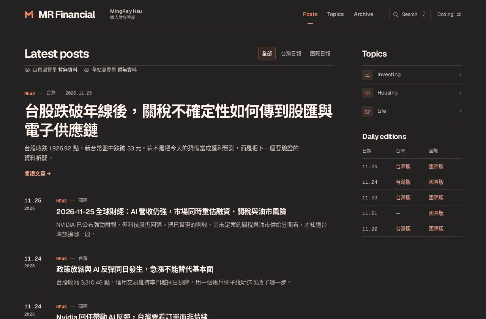

技術文章通常靠主題或教學順序串起來。財經日報多了一個問題：同一天有台灣版和國際版，兩篇還可能在不同時間刊出。如果首頁只倒著排發布時間，兩篇之間一旦插入其他文章，讀者就得自己找另一版。

MR Financial 在每篇日報的檔名放入**期別日期**與**市場**。例如 `finance-2026-11-25-taiwan.md` 與 `finance-2026-11-25-global.md` 共用日期，市場各有自己的欄。這個日期表示哪一期。文章內「資料截至」則記錄內容實際收錄到什麼時候，兩者可以不同。

| 讀者看到什麼 | 程式要保存什麼 |
| --- | --- |
| 11 月 25 日的一列 | 日期作為分組的 key |
| 台灣版、國際版兩個連結 | 各自的文章 ID |
| 同一天只發了台灣版 | 國際版仍可為空 |
| 房貸或旅遊文章 | 保留原本文章，同時從日報索引略過 |

[下一章](../../posts/mr-financial-02-find-daily-editions/)會在正式站的本機副本加一頁 `editions-lab.astro`，從 Markdown 建出這張表。你會自己實作日期分組、測試缺一版的情況，再將結果接回 Astro。文章與索引一起建成靜態 HTML，這個需求用 repository 和 GitHub Pages 就能完成。
