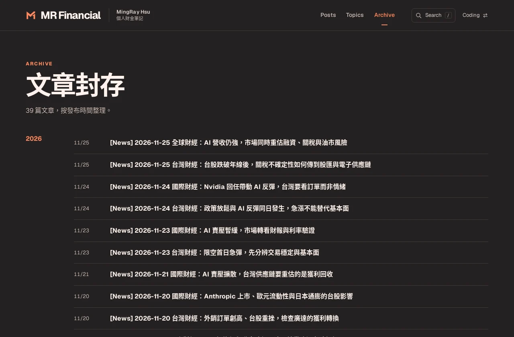

只需要瀏覽器。下面用 2026 年 11 月 25 日兩個版別找資料截點與來源，練習內容是讀文章和保存出處。

## 1. 從 Archive 找同日的兩個版別

開啟 [MR Financial](https://ntustray.github.io/mr-financial-blog/)，按導覽列的 **Archive**。使用瀏覽器的頁面搜尋找 `2026-11-25 台灣財經` 與 `2026-11-25 全球財經`。先開台灣篇，全球篇留在另一個分頁。

## 2. 用資料截點判斷這篇涵蓋到什麼時間

在[台灣篇](https://ntustray.github.io/mr-financial-blog/posts/finance-2026-11-25-taiwan/)找到開頭的「本文資料截至」。這組範例標的是 **2026-11-25 18:00（Asia/Taipei）**。接著在內文看事件或報價發生的時間。把文章截點和事件時間記成兩欄，同一個日報日期可涵蓋不同時區及交易時段。

## 3. 沿著文內連結回到一項來源

按台灣篇開頭的 **全球篇**，或切到剛開好的分頁。選一件要查的事，例如全球篇提到的 NVIDIA 季報，找到 **References** 裡的 SEC EDGAR 行。點開後，核對來源標題、日期，以及文章引用的位置。來源連結若打不開，先留下名稱、日期和連結，等找到原始發布頁再補上驗證結果。

## 4. 用首頁確認另一條路

回首頁找 **Daily editions**。日期仍在表格時，可直接由「台灣版」或「國際版」打開對應文章。同一天已經移出首頁日期表時，回到 **Archive** 查日期。**Topics** 適合知道主題、還不確定日期的情況。

完成後，筆記應留有兩篇文章的連結、一個附時區的資料截點，以及至少一筆可以重開的來源。下一篇會用這幾欄把日報和後來的更新接起來。
