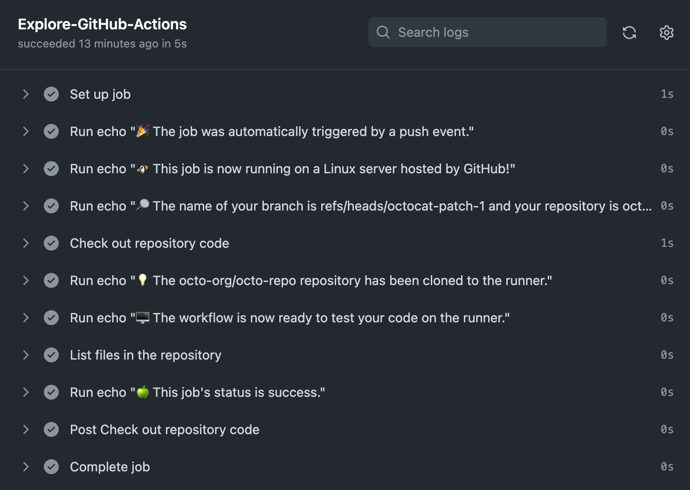

這次要交付一個新頁面 `/mr-financial-blog/editions-lab/`。它讀取你的工作目錄，從最新的五個有日報的日期，各找出台灣版和國際版。先用四個文章 ID 把分組演算法測對，再接進正式站的資料。

[下載索引頁、分組函式與測試（ZIP）](../../downloads/series-labs/mr-financial.zip)。把 `src`、`tests` 合併到第一步取得的 repo，或跟著第二、三步自己建立相同的三個檔案。

## 1. 取得有真實文章的工作目錄

安裝 Git、Node.js 24。在終端機執行下列指令。這份副本可直接練習本機建置；想發到自己的 Pages，先在 GitHub **Fork** 這個 repo，保留名稱 `mr-financial-blog`，再把 clone 網址換成自己的。

```sh
git clone https://github.com/ntustRay/mr-financial-blog.git
cd mr-financial-blog
npm ci
```

打開 `src/content/blog/`，找 `finance-2026-11-25-taiwan.md` 和同一天的 `global.md`。下面是正式站已有的兩篇文章，我們要讓程式從檔名辨認這一對。


## 2. 把文章 ID 分組，先測一個缺版日期

新增 `src/utils/edition-rows.mjs`。Astro 讀進來的 ID 沒有 `.md` 副檔名。正規表示式兩端加上 `^` 和 `$`，避免把帶有相似字串的一般文章誤收成日報。

```js
export function editionRows(ids) {
  const dates = new Map();
  for (const id of ids) {
    const match = /^finance-(\d{4}-\d{2}-\d{2})-(taiwan|global)$/.exec(id);
    if (!match) continue;
    const [, date, region] = match;
    const row = dates.get(date) ?? { date, taiwan: null, global: null };
    row[region] = id;
    dates.set(date, row);
  }
  return [...dates.values()].sort((a, b) => b.date.localeCompare(a.date));
}
```

新增 `tests/edition-rows.test.mjs`。故意把 24 日放進陣列第一個位置，檢查輸出是否按日期排序。固定寬度的 `YYYY-MM-DD` 可以直接做字串比較。

```js
import assert from 'node:assert/strict';
import test from 'node:test';
import { editionRows } from '../src/utils/edition-rows.mjs';

test('同日合併、缺版留空、日期倒序、略過一般文章', () => {
  const tw = 'finance-2026-11-25-taiwan';
  const intl = 'finance-2026-11-25-global';
  const last = 'finance-2026-11-24-global';
  assert.deepEqual(editionRows([last, intl, 'housing-note', tw]), [
    { date: '2026-11-25', taiwan: tw, global: intl },
    { date: '2026-11-24', taiwan: null, global: last },
  ]);
});
```

執行 `node --test tests/edition-rows.test.mjs`，應有一個測試通過。把 `null` 改成空字串再跑一次，看 assertion 顯示哪個欄位不同，然後還原。這一步能在開瀏覽器前驗證「沒發文章」的資料形狀。

## 3. 接到 Astro，產生可點的 HTML 表格

新增 `src/pages/editions-lab.astro`。正式站的 `blog` collection 已經會讀 Markdown，先排除草稿，再把 ID 傳給剛寫完的函式。只有欄位有文章才組 href，缺版時顯示「尚未刊出」。

```astro
---
import { getCollection } from 'astro:content';
import { editionRows } from '../utils/edition-rows.mjs';

const posts = await getCollection('blog', ({ data }) => !data.draft);
const rows = editionRows(posts.map((post) => post.id)).slice(0, 5);
const base = import.meta.env.BASE_URL.replace(/\/?$/, '/');
---
<html lang="zh-Hant">
  <head><meta charset="utf-8" /><title>日報索引練習</title></head>
  <body>
    <h1>日報索引練習</h1>
    <table>
      <thead><tr><th>日期</th><th>台灣</th><th>國際</th></tr></thead>
      <tbody>{rows.map((row) => <tr>
        <th scope="row">{row.date}</th>
        {[row.taiwan, row.global].map(id => <td>
          {id ? <a href={`${base}posts/${id}/`}>閱讀</a> : '尚未刊出'}
        </td>)}
      </tr>)}</tbody>
    </table>
  </body>
</html>
<style>
  body { font: 18px/1.6 system-ui; margin: 24px; }
  table { border-collapse: collapse; }
  th, td { text-align: left; padding: 6px 20px; border-bottom: 1px solid #bbb; }
</style>
```

執行 `npm run dev`，在終端機顯示的站址開啟 `/mr-financial-blog/editions-lab/`。點其中的「閱讀」，確認網址包含該列的日期和市場。截圖用 11 月文章，練習副本刻意少放 24 日台灣版，方便看出空欄。你當下 clone 的日期可能較新。


如果表格只有標題，先確認檔名符合格式，以及 frontmatter 的 `draft` 沒設成 `true`。連結點了 404，就比對瀏覽器網址是否有 `/mr-financial-blog/` 前綴。

## 4. 驗證部署產物

執行 `npm run build`，再執行 `node -e "console.log(require('node:fs').existsSync('dist/editions-lab/index.html'))"`，應該看到 `true`。如果發到自己的 fork，把 `astro.config.mjs` 的 `site` 換成自己的 `https://帳號.github.io`，保留和 repository 名稱相符的 `base`。

在 fork 的 **Settings → Pages → Source** 選 **GitHub Actions**，到 **Actions** 啟用 fork 的 workflows，提交這三個新檔與設定到自己的 `main`。打開 **Deploy to GitHub Pages** 這次的執行，待 `deploy` 綠燈後，從 Pages 網址接上 `editions-lab/`。打開兩個實際存在的連結，才能同時驗證索引頁和文章路徑。


