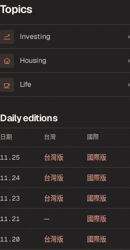

一篇報導寫「公司下季會更新展望」。之後新聞標題換了一輪，回頭看時，最需要知道的是當時寫到哪裡，哪一項說法有文件支持，以及要等什麼才能確認。光保存標題，很難區分當時已經發生的事和當時還在等的消息。

可以直接在自己的讀書筆記留一列。下面是寫法示意，內容不指涉特定公司。

| 欄位 | 要留下的資料 |
| --- | --- |
| 文章日期 | 日報日期與永久連結，方便回到當時的寫法 |
| 事件時間 | 公司公告標的時間、時區和報告涵蓋期間 |
| 可查來源 | 原始公告或交易所資料，附文件日期與段落 |
| 下次要確認的條件 | 公司是否調整展望，有調整時再分清營收區間、毛利或交貨時間 |

## 同一日期用兩個入口，後續更新靠來源接起來

想回到同一天，從 **Daily editions** 或 **Archive** 開台灣與國際版。要回顧同一個議題，從 **Topics** 找文章，再依原始公告的時間排列。台灣和海外可能用不同時區刊登，先核對原始文件日期及統計區間，才知道兩篇是不是在講同一件事。

對維護這個站的人，日期穩定只解決找得到舊文章。真正的接續點是留一個下次能驗證的問題。新資料只有發布日期變動時，先更新時間，保留原本的待查問題。若公告真的修正了數值或期間，就把原句、更新來源與改變的部分放在一起，讀者回頭才知道判斷是何時改變的。
