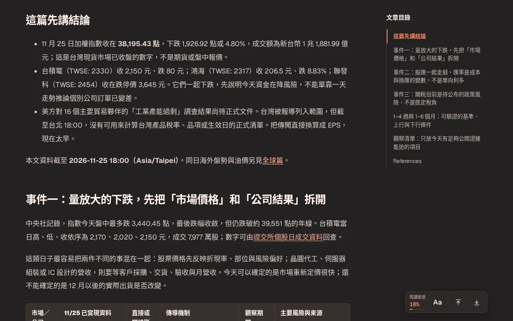
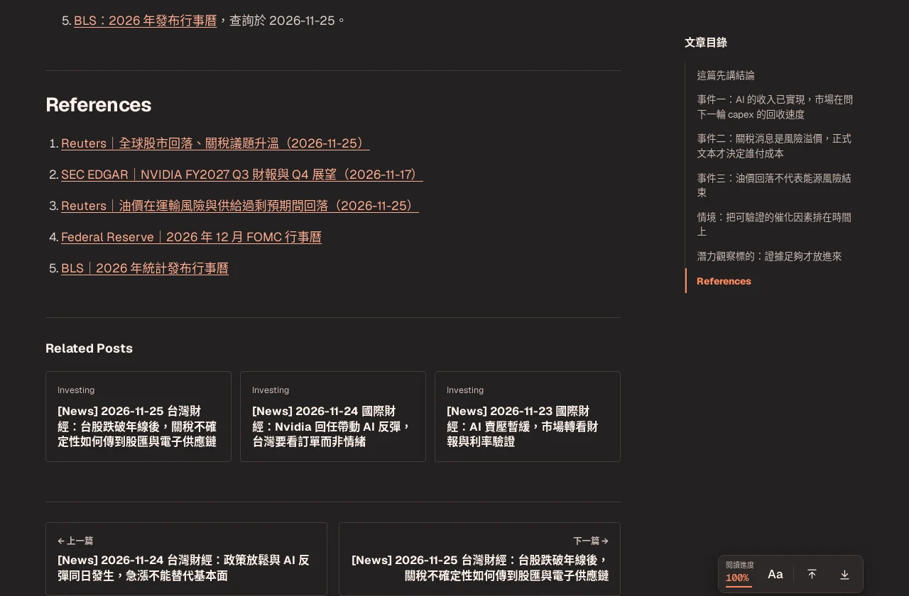

日報索引完成後，最值得回頭檢查的是那個空格。國際版還沒刊出時，表格只要保留日期，台灣版照常能讀。等到另一個 Markdown 加進 repository，下次建置自然會補上連結。若一開始把一列的兩篇都設成必填，早發的那一版反而得等。

| 問題 | 查哪一份資料 |
| --- | --- |
| 首頁為什麼把兩篇排在同一列？ | 兩個檔名的期別日期一致 |
| 文章出現在目錄，資料到底收錄到幾點？ | 正文標明的截至時間和時區 |
| 文中引用的數字後來有沒有修正？ | 文章引用的一手公告、公告的版本或日期 |
| 今天剛補一篇，公開首頁何時才看得到？ | 包含該檔案的 commit 是否已成功部署 |

上一章把第一個問題做成純函式，能直接用 Node 測。第二、三個問題需要文章保存來源與時間，不能靠分組程式推算。日後若加入週報，把它做成另一個明確的期別格式，並補一個「週報不進日報表格」的測試。這樣做比從標題猜日期可靠，也讓既有文章網址能繼續使用。
