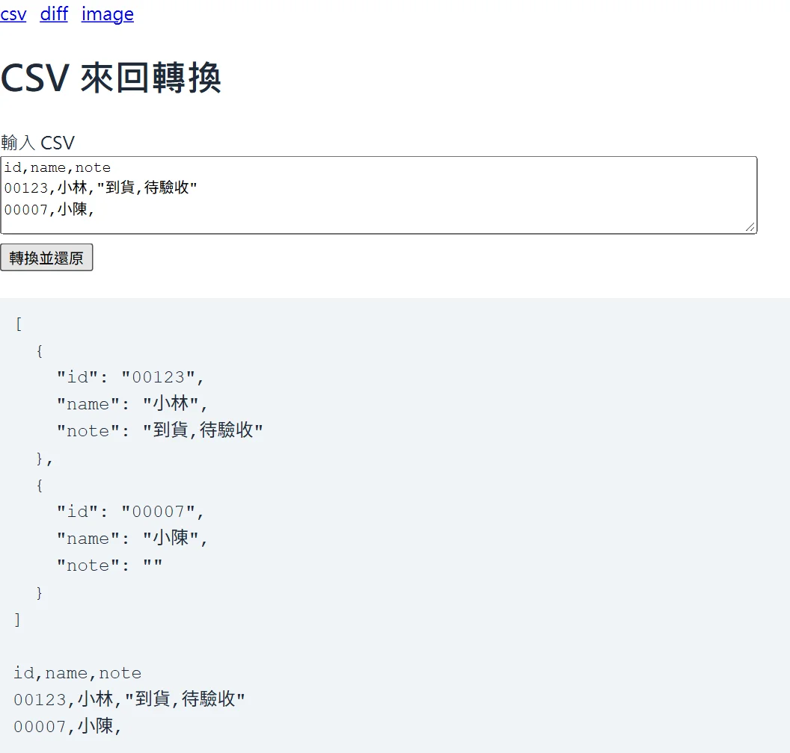

把 `00123` 貼進表格變成 `123`，圖片存成 JPG 後透明底消失。小工具最容易出錯的地方，往往是產出了檔案，卻在轉換時漏掉使用者在意的資訊。這個系列從這兩個條件出發，再加一個常見的小工具：看出兩版需求改了哪一行。

MR 工具百科公開展示了 React、TypeScript 與 Canvas。下面做一個**獨立教學版本**，原始碼可下載，練習資料可公開。三個工具都在瀏覽器裡運算。Vercel 提供網頁與 JavaScript，輸入內容不需要送到伺服器。

| 章節 | 你會寫的程式 | 用什麼驗收 |
| --- | --- | --- |
| CSV ↔ JSON | 讀取欄名、引號與換行，輸出時重新跳脫 | 來回轉換後保留 `00123` 和一欄裡的逗號 |
| 文字 diff | 用逐行 diff 對齊兩版文字，再標記增減 | 改第一行，第二行仍相同 |
| 圖片轉檔與部署 | 解碼檔案、畫入 Canvas、輸出 Blob，上傳 Vite 產物到 Vercel | WebP 保有透明像素，JPG 有底色，公開網址能重新整理 |

這裡保留兩層：React 元件接輸入、顯示結果，轉換函式負責處理資料。這樣檢查 CSV 欄位時，光用 Node 就能重跑；驗證 Canvas 的解碼與輸出時，再打開真的瀏覽器。

下載[練習起始檔](../../downloads/toolbox-workshop-starter.zip)，準備 Node.js 24。[第二章](../../posts/mr-toolbox-02-csv-json-round-trip/)會從空的工具清單加入第一頁。
