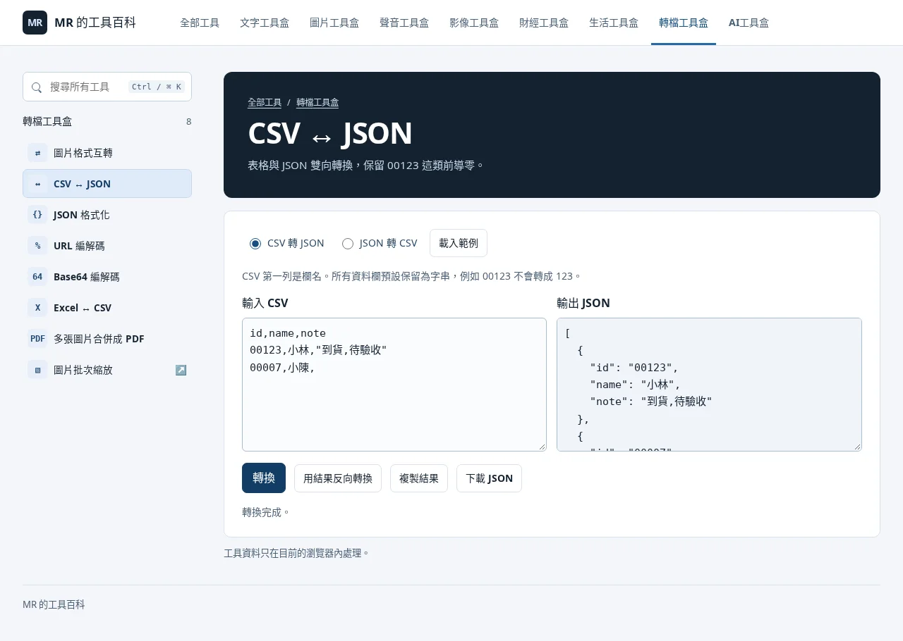
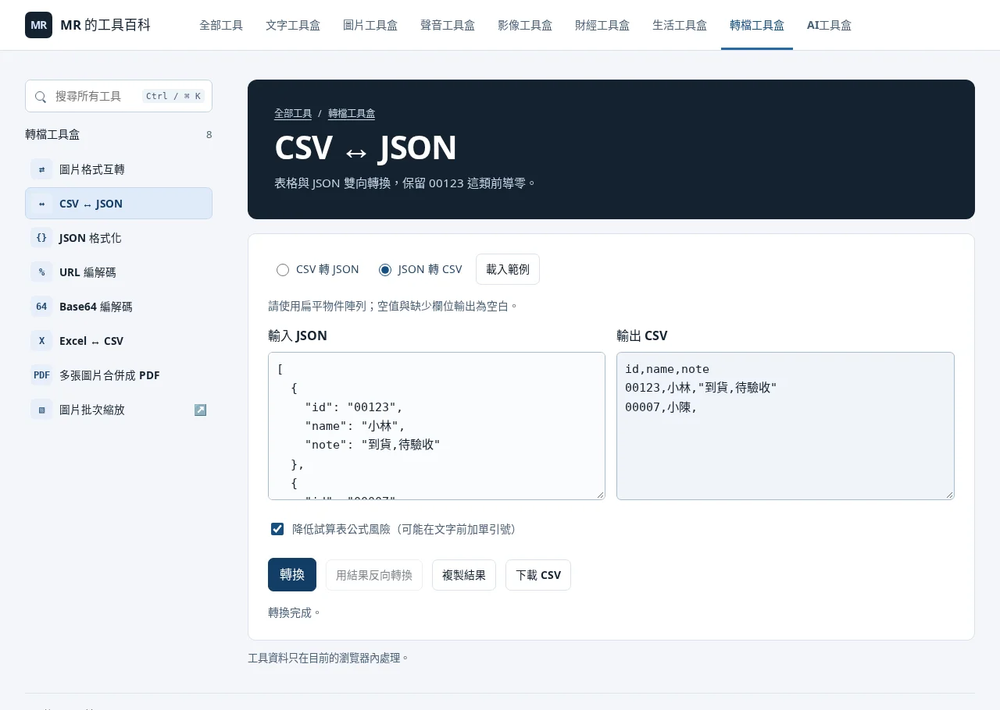

用下面兩筆資料做一次來回轉換。第一筆刻意把有逗號的備註放在引號內，第二筆留空備註。

1. 打開 [CSV ↔ JSON](https://mr-toolbox-two.vercel.app/tools/csv-json/)，選「CSV 轉 JSON」，在「輸入 CSV」貼上這份內容。

```csv
id,name,note
00123,小林,"到貨,待驗收"
00007,小陳,
```

2. 按「轉換」。右側應有兩筆 JSON，`id` 是字串 `"00123"` 和 `"00007"`。第一筆的 `note` 仍是一個完整欄位，第二筆的 `note` 是空字串。



3. 點「用結果反向轉換」。工具會改成「JSON 轉 CSV」，把剛才的 JSON 填入輸入框。**再按一次「轉換」**，右側才會出現 CSV。



4. 點「下載 CSV」，用編輯器開檔，逐列比較欄名、前導零和備註。若直接用試算表開啟，匯入時把 `id` 欄指定為文字，避免試算表自動轉型。
