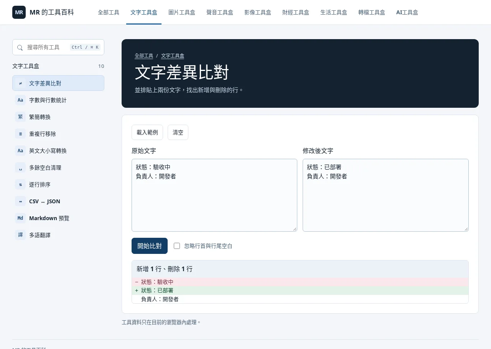

這次要找出兩版需求裡改掉的狀態，同時確認負責人沒有被改動。

1. 打開[文字差異比對](https://mr-toolbox-two.vercel.app/tools/text-diff/)，把原始文字貼到左側。

```text
狀態：驗收中
負責人：開發者
```

2. 在「修改後文字」貼上新版，按「開始比對」。

```text
狀態：已部署
負責人：開發者
```

3. 結果會顯示刪除的「驗收中」和新增的「已部署」。確認「負責人：開發者」仍在兩版資料裡，並對回上方的輸入框。



4. 在新版的第二行前方加兩個空格，再比較一次。若只想看內容變化，勾選「忽略行首與行尾空白」再按「開始比對」。比對有縮排語意的程式或 Markdown 時，把選項關掉複查。
