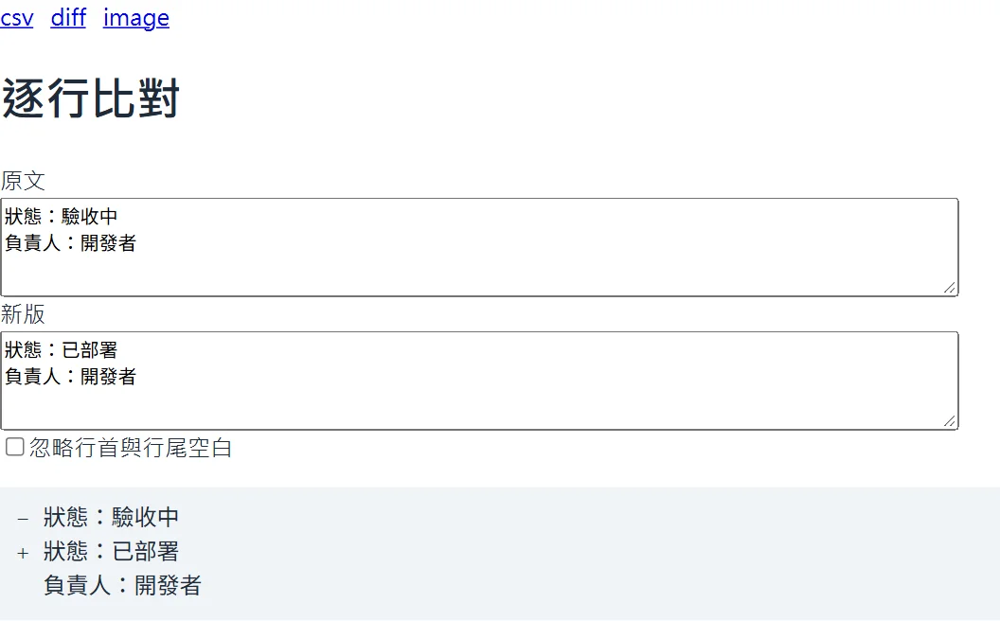

兩份需求只差第一行，後面可能還有幾十行相同。若依陣列索引比較，在開頭插入一行，後面每一行都會被標成改動。這次使用 jsdiff 的 `diffLines` 找出維持相同的部分，React 只負責把增刪符號呈現出來。

## 1. 安裝比對套件

沿用上篇已經能啟動的 Vite 專案，在根目錄執行 `npm install --save-exact diff@9.0.0`。若要從這章開始，可先解壓[起始檔](../../downloads/toolbox-workshop-starter.zip)，執行 `npm install` 並建立 `src/tools`。

## 2. 新增一個 React 元件

建立 `src/tools/diff.tsx`。先把 Windows 與 Unix 換行轉成同一種字元，保留大小寫和段落。`diffLines` 回傳一段段相同、新增、移除的文字；每段可能包含好幾行，所以畫面要在每一行前面補符號。

```tsx
import React, { useState } from 'react';
import { diffLines } from 'diff';

export default function Diff() {
  const [before, setBefore] = useState('狀態：驗收中\n負責人：開發者');
  const [after, setAfter] = useState('狀態：已部署\n負責人：開發者');
  const [trim, setTrim] = useState(false);
  function normalize(input: string) {
    const text = input.replace(/\r\n?/g, '\n');
    return trim ? text.split('\n').map(line => line.trim()).join('\n') : text;
  }
  const parts = diffLines(normalize(before), normalize(after));
  return <><h1>逐行比對</h1>
    <label>原文<textarea value={before} onChange={e => setBefore(e.target.value)} /></label>
    <label>新版<textarea value={after} onChange={e => setAfter(e.target.value)} /></label>
    <label><input type="checkbox" checked={trim}
      onChange={e => setTrim(e.target.checked)} />忽略行首與行尾空白</label>
    <pre>{parts.map(part => {
      const mark = part.added ? '+ ' : part.removed ? '− ' : '  ';
      return part.value.replace(/\n$/, '').split('\n').map(line => mark + line).join('\n');
    }).join('\n')}</pre></>;
}
```

## 3. 用三個改動驗收

執行 `npm run dev`，從終端機顯示的網址開啟 `/?tool=diff`。下面是預設兩份文字真正跑出的結果。同一個狀態改字，會留下刪除的舊行與新增的新行。



1. 在新版最前面新增一行 `版本：2`。該行出現加號，最後的負責人仍沒有增刪符號。這是拿來抓「只比索引」錯誤的測資。
2. 在新版「負責人」前加兩個空格。預設會出現一刪一加。勾選「忽略行首與行尾空白」，這兩筆差異應消失。比較 Python 縮排時，要保留預設值。
3. 兩個輸入框貼入完全相同的內容。所有行都應留下，且沒有加減符號。若畫面把尖括號當 HTML，確認 JSX 放入的是字串，並未使用 `innerHTML`。

這版每次輸入都重新比對，適合短小文字。若要處理整份大型 log，可以先改為按鈕觸發，量測一次比對需要多久，再決定是否移到 Web Worker。
