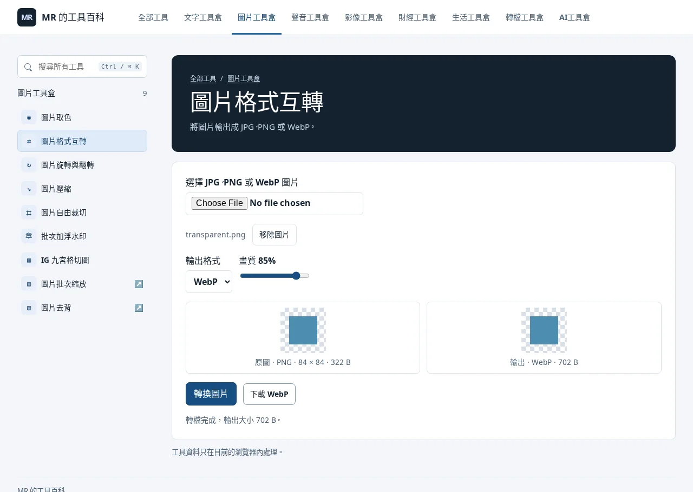
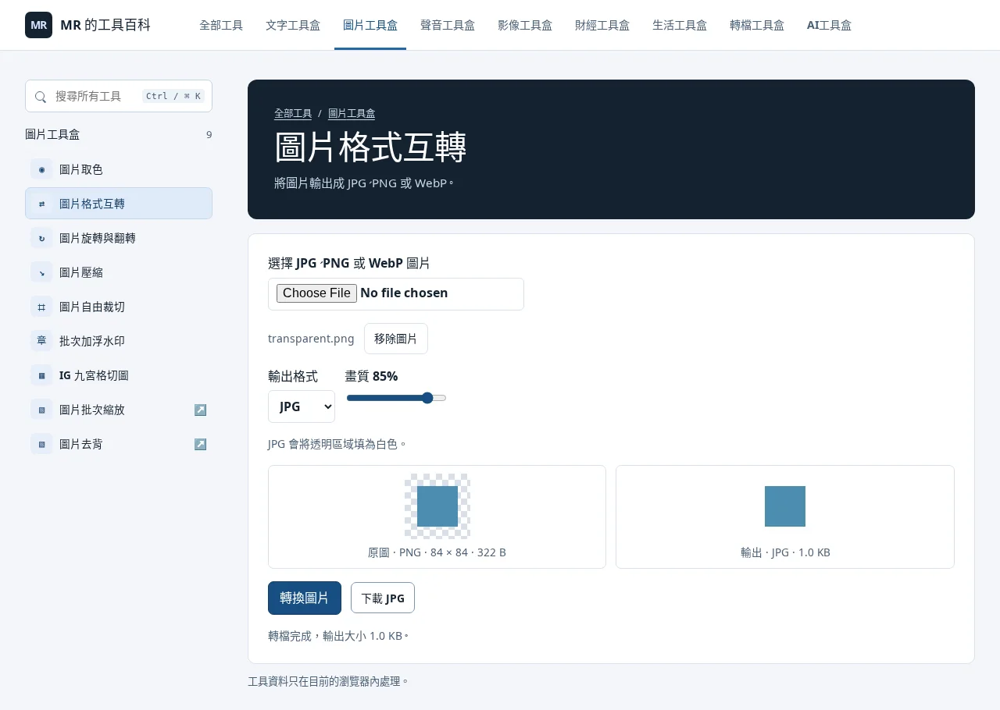

拿一張角落有透明區域的 PNG。可以用自己的透明貼紙，也可以跟著 [Pixel Workbench 的貼紙練習](../../posts/pixel-02-transparent-sticker/)存一張副本。

1. 開啟[圖片格式互轉](https://mr-toolbox-two.vercel.app/tools/image-converter/)，在「選擇 JPG、PNG 或 WebP 圖片」選原檔。
2. 把「輸出格式」選成 **WebP**，按「轉換圖片」，再下載結果。用會顯示透明棋盤格的圖片編輯器打開，確認四角仍然透明。

3. 保持同一張原圖，把輸出格式改成 **JPG**，再按「轉換圖片」並下載。開啟兩個檔案比較背景。JPG 不支援 alpha channel，原本透明的四角會變成不透明。

4. 核對兩個檔案的像素尺寸和檔案大小。需要透明底時，選 WebP 或 PNG，並以實際輸出確認透明度。照片若要比較壓縮大小，把兩份成品都放到最後的顯示尺寸再看畫質。

這組截圖使用同一張 84 × 84 的合成 PNG。下載後驗查左上像素，WebP 的 alpha 為 0，JPG 解碼成 RGBA 後的 alpha 為 255。
