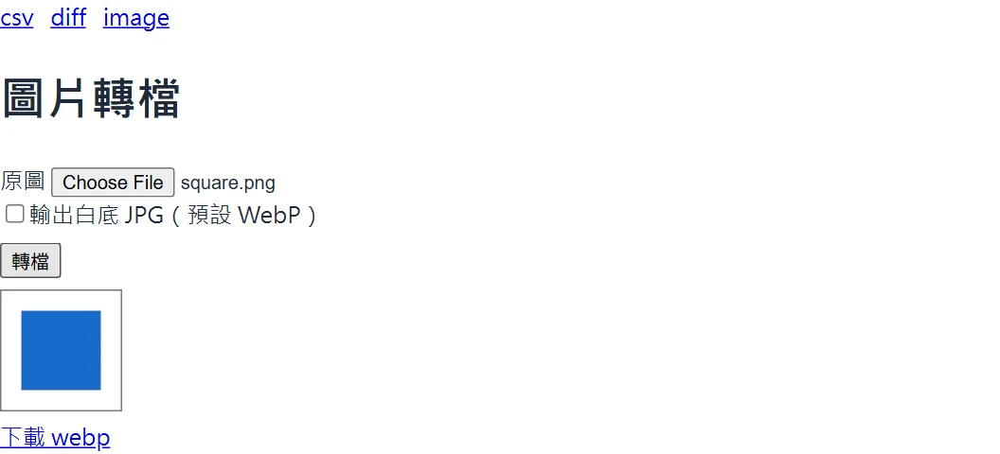
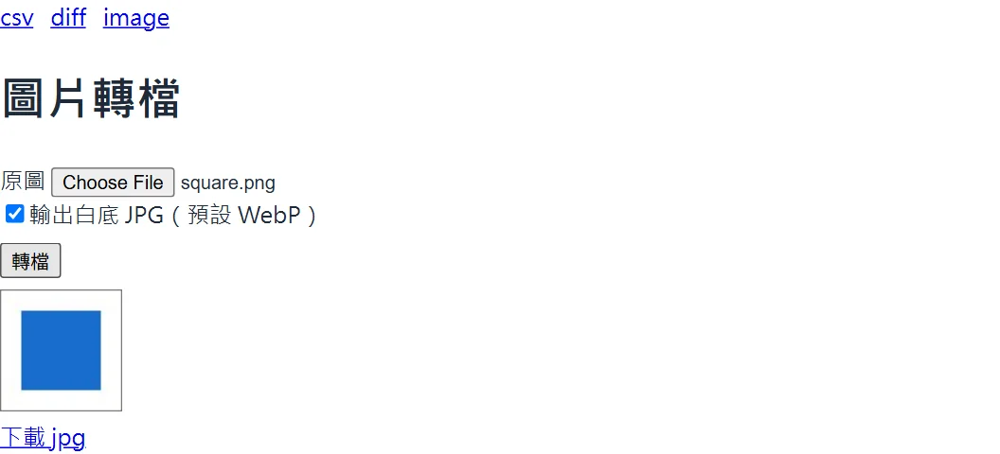
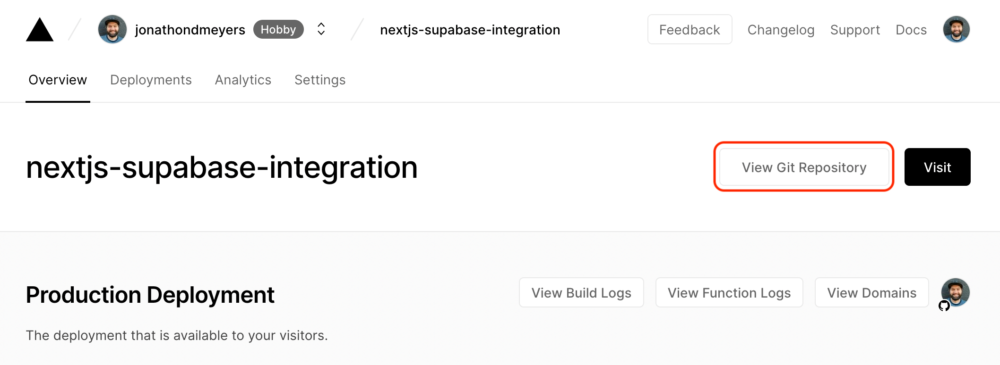

這次沿用前兩章的 Vite 專案，在瀏覽器讀檔、解碼、轉格式。操作完成後，再把三個工具一起部署。起始檔內附 `square.png`，是一張 84 × 84、四周透明的藍色方塊，適合拿來檢查透明度。

## 1. 把原始檔轉成瀏覽器能下載的 Blob

在 `src/encode.ts` 放入這個函式。`createImageBitmap` 將壓縮圖片解碼成像素，Canvas 決定輸出尺寸及底色，`toBlob` 再把畫布編碼回檔案。轉 JPG 時先鋪白底，讓透明區域的顏色由你的程式控制。

```ts
export async function encode(file: File, mime: 'image/webp' | 'image/jpeg') {
  const image = await createImageBitmap(file);
  try {
    const canvas = document.createElement('canvas');
    canvas.width = image.width; canvas.height = image.height;
    const ctx = canvas.getContext('2d');
    if (!ctx) throw new Error('無法建立 Canvas');
    if (mime === 'image/jpeg') {
      ctx.fillStyle = '#fff'; ctx.fillRect(0, 0, canvas.width, canvas.height);
    }
    ctx.drawImage(image, 0, 0);
    const blob = await new Promise<Blob | null>(resolve => canvas.toBlob(resolve, mime, 0.9));
    if (!blob || blob.type !== mime) throw new Error('瀏覽器不支援此輸出格式');
    return blob;
  } finally { image.close(); }
}
```

## 2. 接上選檔、預覽與下載

新增 `src/tools/image.tsx`。完成轉檔後建立的 Object URL 只屬於這個瀏覽器，不能拿去當公開圖片連結。換檔、換格式或元件離開畫面時釋放舊網址，讓瀏覽器可以回收先前的 Blob。

```tsx
import React, { useEffect, useState } from 'react';
import { encode } from '../encode';

export default function ImageTool() {
  const [file, setFile] = useState<File | null>(null);
  const [jpeg, setJpeg] = useState(false);
  const [busy, setBusy] = useState(false);
  const [result, setResult] = useState<{ url: string; ext: string } | null>(null);
  const [error, setError] = useState('');
  useEffect(() => () => { if (result) URL.revokeObjectURL(result.url); }, [result]);
  async function run() {
    if (!file) return;
    setBusy(true); setError(''); setResult(null);
    try {
      const blob = await encode(file, jpeg ? 'image/jpeg' : 'image/webp');
      setResult({ url: URL.createObjectURL(blob), ext: jpeg ? 'jpg' : 'webp' });
    } catch (e) { setError(e instanceof Error ? e.message : '轉檔失敗'); }
    finally { setBusy(false); }
  }
  return <><h1>圖片轉檔</h1>
    <label>原圖 <input disabled={busy} type="file" accept="image/png,image/jpeg,image/webp"
      onChange={e => { setFile(e.target.files?.[0] ?? null); setResult(null); }} /></label>
    <label><input type="checkbox" disabled={busy} checked={jpeg}
      onChange={e => { setJpeg(e.target.checked); setResult(null); }} />輸出白底 JPG（預設 WebP）</label>
    <button disabled={busy || !file} onClick={run}>轉檔</button>
    {result && <output><br/>
      <a href={result.url} download={`result.${result.ext}`}>下載 {result.ext}</a></output>}
    <p role="status">{error}</p></>;
}
```

啟動 `npm run dev`，開啟 `/?tool=image`，選 `square.png` 後按「轉檔」。下載 WebP，再勾選 JPG 重做一次。畫面會顯示當次實際輸出的副檔名。





白色網頁上很難憑肉眼比較透明度。把兩份檔案放到有棋盤格的影像編輯器查看，或在練習頁瀏覽器 DevTools Console 貼這段，讀回**目前預覽**左上角的像素。WebP 的第四個數字應為 0，JPG 應為 255；JPG 顏色會受有損壓縮影響。

```js
const image = document.querySelector('output img');
await image.decode();
const canvas = document.createElement('canvas');
canvas.width = image.naturalWidth;
canvas.height = image.naturalHeight;
const ctx = canvas.getContext('2d');
ctx.drawImage(image, 0, 0);
console.log(canvas.width, canvas.height, [...ctx.getImageData(0, 0, 1, 1).data]);
```

## 3. 用 Vercel 部署整站

1. 終端機執行 `npm run build`，看到 `dist/index.html` 和 `dist/assets/` 後，再執行 `npm run preview`。從終端顯示的網址依次開啟 `/?tool=csv`、`/?tool=diff`、`/?tool=image`，確認重新整理後仍可操作。
2. 在 GitHub 建立空的 repository `toolbox-workshop`。在專案根目錄執行下列指令，將 `YOUR_ACCOUNT` 改成自己的帳號。起始檔的 `.gitignore` 已排除依賴及建置輸出。

```sh
git init -b main
git add .
git commit -m "Build three browser tools"
git remote add origin https://github.com/YOUR_ACCOUNT/toolbox-workshop.git
git push -u origin main
```

3. 登入 Vercel，在 Dashboard 選 **Add New → Project**。在 **Import Git Repository** 找到 `toolbox-workshop`，按 **Import**。若清單裡沒有專案，從此處的 GitHub App 設定授予這個 repository 存取權。下圖是官方範例，實際要選自己的 repo。


4. **Framework Preset** 確認為 **Vite**，**Root Directory** 選包含 `package.json` 的目錄，**Build Command** 填 `npm run build`、**Output Directory** 填 `dist`。這三個工具全在用戶端執行，環境變數欄位留空，按 **Deploy**。
5. 等狀態成為 **Ready**，按 **Visit**。把 `/?tool=image` 接到公開網址，重新載入並轉換同一張 PNG。若首頁可開卻沒出現工具，先檢查 Console 有無 JavaScript 載入失敗，再到部署的 Build Logs 檢查匯入的分支、根目錄與輸出目錄。


