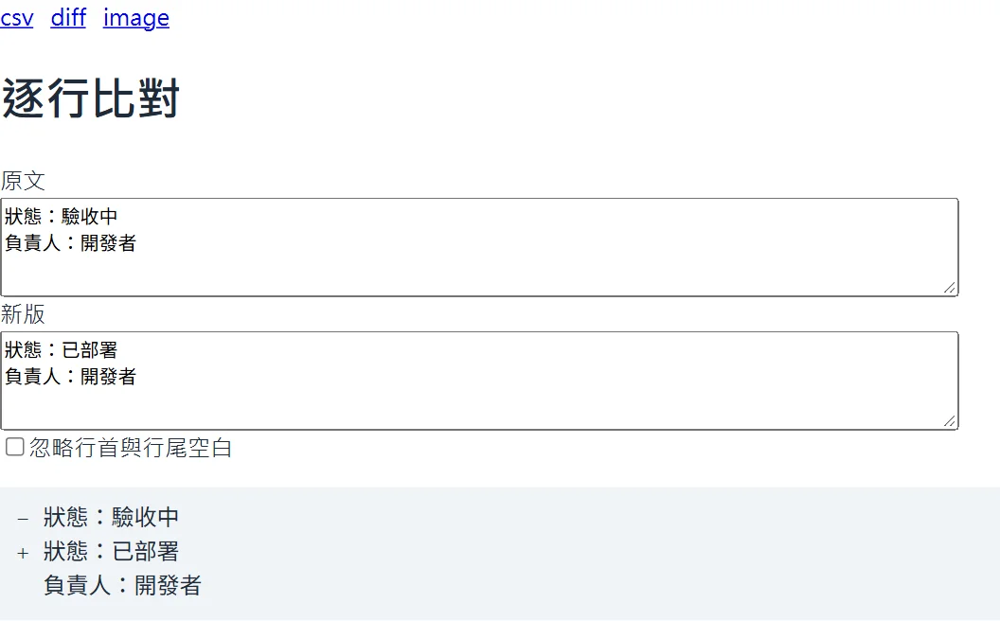

現在一個靜態網站就能交付三件事：逐欄讀 CSV、逐行比對文字、把解碼後的圖片存成另一種格式。「有結果」對這三個工具都不夠。CSV 可能少一個前導零，diff 可能把沒改過的行也畫上加號，圖片看起來相同卻丟了透明度。

| 已經實作的行為 | 可以保留下來的最小測資 | 有辨識力的驗收條件 |
| --- | --- | --- |
| CSV → 物件 → CSV | `00123,"a,b"`、空白備註、引號內換行 | 重新讀取後欄位數和字串值一致；可允許換行樣式改變 |
| 文字 diff | 在開頭插一行，保留最後一行 | 同一尾行不應一刪一加；關掉忽略空白時，縮排改動可見 |
| PNG → WebP / JPG | 同一張四角透明的 84 × 84 PNG | 長寬一致，WebP 角落 alpha 為 0，JPG 為 255 |
| Vercel 靜態部署 | 分享 `/?tool=image` 給另一個瀏覽器 | 直接開到正確工具，使用者可選自己的圖片下載結果 |

前兩個工具的核心運算只吃字串，適合把測資留在 Node 測試。第三個依賴瀏覽器實際提供的圖片 codec，驗收時要把輸出重新解碼，看像素與尺寸。只比 `.webp` 副檔名，抓不到瀏覽器回傳另一種格式的情況。

如果工具要接手每天上千個檔案，先記錄檔案大小、數量和處理時間，才知道該移入 Worker，或另外開 CLI。當需求只是偶爾貼一段文字、轉一張圖，Vite 建出的靜態檔和一個 Vercel 網址就能完成交付。

[完整練習原始碼](../../downloads/toolbox-workshop-complete.zip)包含三個工具、固定的套件版本與透明測試圖。解壓後在 `package.json` 所在目錄執行 `npm install`、`npm run build` 和 `npm run preview`，即可重做這張表的驗收。
