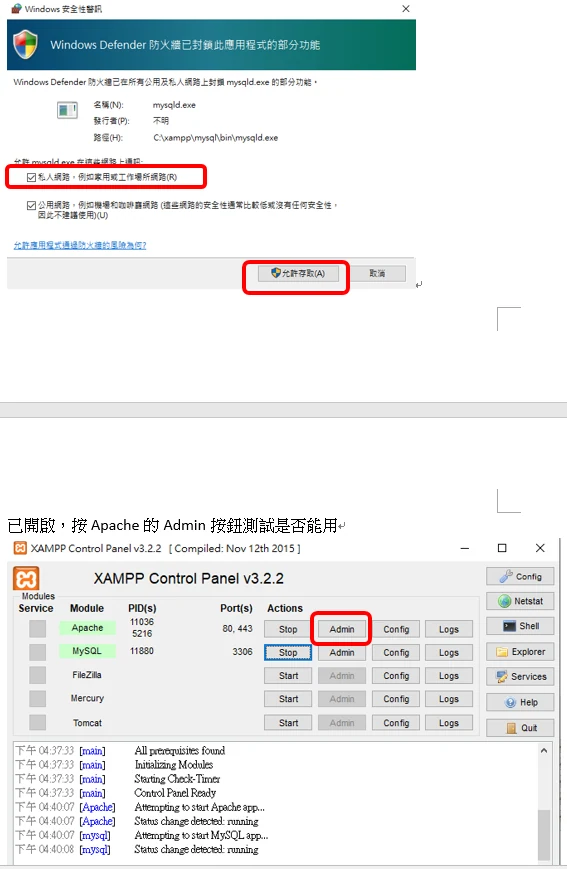

> 此範例要掛在已有 TrailRenderer 元件的 GameObject 上；widthCurve 調整軌跡寬度曲線。

[參考:https://docs.unity3d.com/ScriptReference/TrailRenderer-widthCurve.html](https://docs.unity3d.com/ScriptReference/TrailRenderer-widthCurve.html)



```csharp
using UnityEngine;
using System.Collections;

public class ExampleClass : MonoBehaviour
{
    public float width = 1.0f;
    public bool useCurve = true;
    private TrailRenderer tr;

    void Start()
    {
        tr = GetComponent<TrailRenderer>();
        tr.material = new Material(Shader.Find("Sprites/Default"));
    }

    void Update()
    {
        AnimationCurve curve = new AnimationCurve();
        if (useCurve)
        {
            curve.AddKey(0.0f, 0.0f);
            curve.AddKey(1.0f, 1.0f);
        }
        else
        {
            curve.AddKey(0.0f, 1.0f);
            curve.AddKey(1.0f, 1.0f);
        }

        tr.widthCurve = curve;
        tr.widthMultiplier = width;
        tr.transform.position = new Vector3(Mathf.Sin(Time.time * 1.51f) * 7.0f, Mathf.Cos(Time.time * 1.27f) * 4.0f, 0.0f);
    }

    void OnGUI()
    {
        GUI.Label(new Rect(25, 20, 200, 30), "Width");
        width = GUI.HorizontalSlider(new Rect(125, 25, 200, 30), width, 0.1f, 1.0f);
        useCurve = GUI.Toggle(new Rect(25, 65, 200, 30), useCurve, "Use Curve");
    }
}
```
