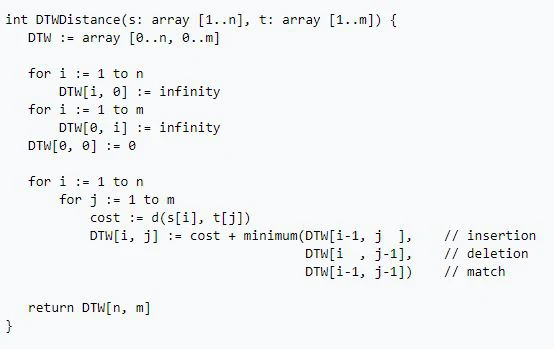

> 000webhost 已停止服務。Hostinger 於 2024 年公告停止接受新用戶，並排定同年 10 月 14 日全面關閉；以下為當年的體驗紀錄。

[HOST連結](https://www.000webhost.com/) 想要免費host的朋友可以去參考一下

優點：

1. 費用：免費
2. 上手度：相當簡單方便
3. 資源：在網路上可以找到非常多相關資源，相當老牌
4. ＷordPress：一鍵安裝，簡單
5. SSL：免費有給https相當的不錯，這點很推
6. Domain：可以用自己免費的Domain，給推

缺點：

1. 穩定度：奇差無比，免費仔只能QQ
2. 持續性：固定會有總和1小時關機時間 慘
3. 內容性：為了簡單上手，很多參數不給你調

勘誤參考：[Hostinger：000webhost 關閉公告](https://www.hostinger.com/blog/000webhost-closes/)。
