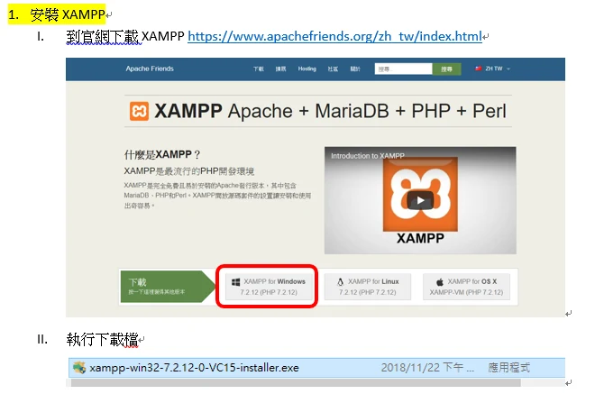
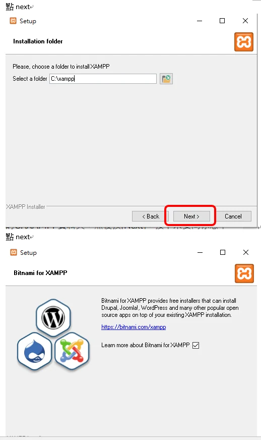
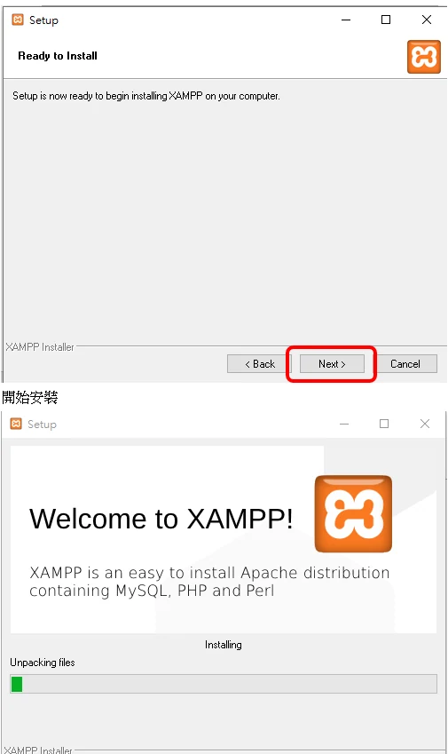
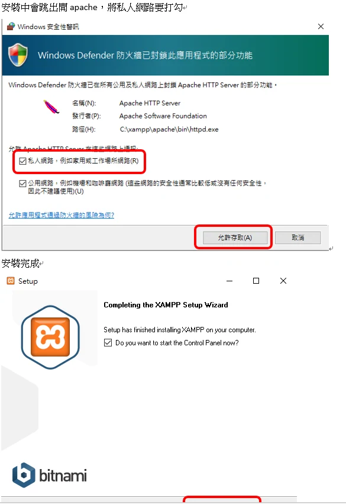
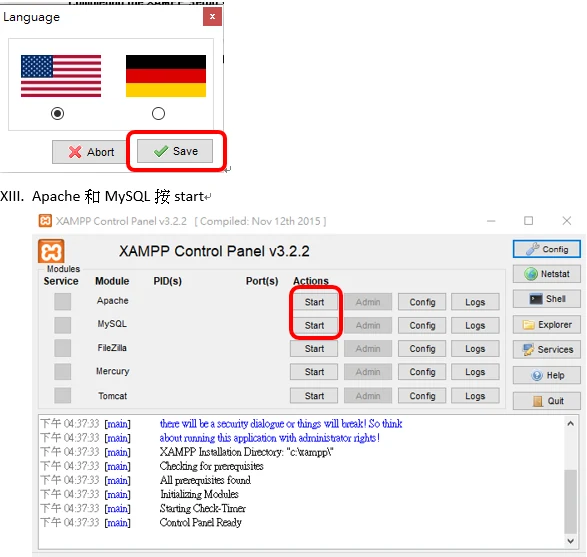
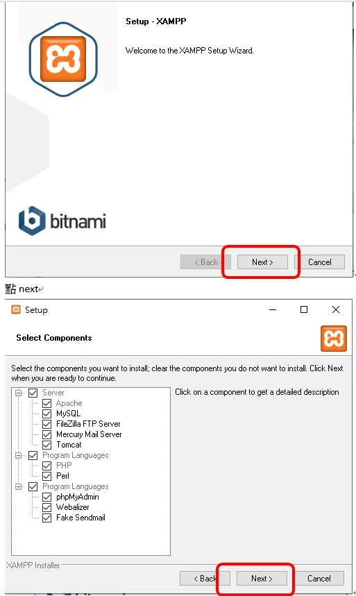

> 本文保留 2019 年的使用心得與操作畫面；方案、限制及介面請以服務商目前公告為準。

- 打上你要的網址

- 檢查有沒有

- 註冊\>網域管理\>FREEDNS

- 修改DNS

- 在你的HOST增加Domain
- 當年的免費註冊一次最長可選 12 個月；這不代表網域能永久免費，也不代表現在仍有相同方案。

Byte Host 只支援以下的網域   
.tk .ml 等免費的都不可用QQ
